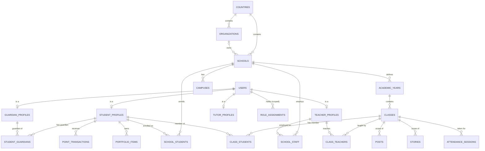
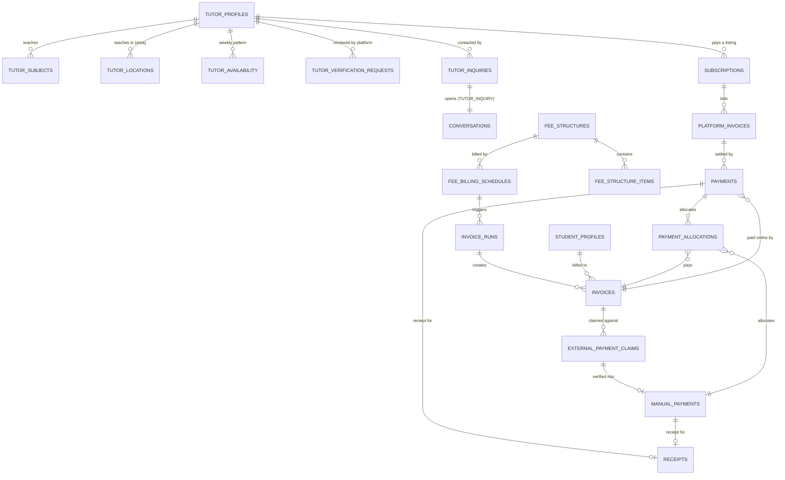

# Database Design

*Version 1, 24 November 2026. Source: `Education_Platform.md` (20 Nov 2026), with the resolutions recorded in [Spec_Review.md](Spec_Review.md). Finding ids (R-xx) refer to that review.*

Target: **PostgreSQL 18**, one shared database, used by a Spring Boot modular monolith (`com.nemaz.school.<module>`). Flyway owns the schema. Every table is tagged with the phase that first needs it (**P1–P5**, using the phase re-sequencing in R-08; the AI phase P6 was removed on 26 November 2026, D34). **Scope revision of 26 November 2026 (D32–D40):** online courses, hosted video, the tutor booking marketplace, the Student AI Tutor and Tutor Copilot, NFC/RFID/GPS attendance, the transfer workflow, the double-entry ledger and the timetable generator are not part of the design; the tutor marketplace is a **directory** (§4.27) and the school AI assistant is **deferred** (§4.37).

---

## 1. Conventions

| Topic | Rule |
|---|---|
| Primary keys | `id uuid primary key default uuidv7()`. UUIDv7 is time-ordered, so it's index-friendly and safe to expose in URLs. Exceptions: reference tables keyed by ISO or standard codes (`countries.code`, `languages.code`, …) and append-only logs (`bigint generated always as identity`). |
| Profile keys | Role profiles use a **shared primary key**: `student_profiles.user_id = users.id`. Columns called `student_id`, `guardian_id`, `teacher_id` or `tutor_id` hold that user id and reference the matching profile table (R-03). Plain actor columns (`created_by`, `author_id`, `awarded_by`) reference `users(id)`. |
| Standard columns | `-- + std` means: `created_at timestamptz not null default now()`, `updated_at timestamptz not null default now()`, `version int not null default 0` (JPA `@Version`, used for optimistic locking and offline sync conflicts). Append-only tables have only `created_at`. |
| Soft delete | `deleted_at timestamptz` only where the spec needs history or restore (posts, messages, portfolio items, users). Other rows end through status and dates (`left_at`, `revoked_at`). |
| Enumerations | Stored as `text` and checked with a `CHECK` constraint. Mapped with JPA `EnumType.STRING`. Comments list the allowed values: `-- ACTIVE\|FORMER`. Anything an admin can extend (languages, roles, permissions, point categories, notification types, grading schemes) is a **table**, not an enum (§70). |
| Time | All instants are `timestamptz` stored in UTC. Calendar-only values are `date`. Wall-clock recurring values are `time` plus an IANA `timezone`. Ethiopian dates are only for display, never stored (§64). |
| Money | `amount_minor bigint` plus `currency_code char(3)`. No floats. Rates are in basis points (`*_bps int`). |
| Localized labels | Small configuration labels (category names, grade names, curriculum text) use `name_i18n jsonb`, e.g. `{"en":"Kindness","am":"ደግነት"}`. User content is stored once in its original language, and translations go in `content_translations` (§71, R-24). |
| Tenant column | Every school-owned row carries `school_id`, even if it can be derived from its parent row (§98). A **composite FK** makes it consistent with the parent, e.g. `foreign key (class_id, school_id) references classes(id, school_id)`, so a row can't point at another tenant's class. Parents expose `unique (id, school_id)` for this. Optional Postgres row-level security can be added later on `school_id`. |
| Scope | Content with a scope uses `scope_type` plus **typed nullable FKs** (`school_id`, `class_id`, …) and a CHECK that exactly the right FK is set. It does not use an untyped `scope_id`, so referential integrity is kept. |
| Extensions | `citext` (emails and usernames), `btree_gist` (exclusion constraints), `pg_trgm` (name and tutor search). |
| Naming | snake_case, plural table names, `*_id` FKs, `*_at` instants, `*_on` dates, `is_*` / `can_*` booleans. |

The code blocks below are design DDL. They're complete enough to turn straight into Flyway migrations. Indexes are listed only where they aren't obvious; every FK also gets an index.

---

## 2. Domain map & phase index

| # | Domain (module) | Tables | Phase |
|---|---|---|---|
| 1 | Reference & localization | currencies, languages, calendar_systems, countries, country_languages, country_calendars, administrative_areas, addresses, holidays, system_settings | P1 |
| 2 | Tenancy & configuration | organizations, schools, school_languages, campuses, setting_definitions, settings, feature_definitions, feature_overrides | P1 |
| 3 | Identity & access | users, password_credentials, federated_identities, otp_challenges, student_login_codes, auth_sessions, roles, permissions, role_permissions, role_assignments | P1 |
| 4 | People & relationships | student_profiles, guardian_profiles, teacher_profiles, tutor_profiles, school_staff, school_students, student_guardians, invitations | P1 (tutor_profiles P4) |
| 5 | Academic structure | academic_years, academic_periods, grade_levels, subjects, classes, class_subjects, class_teachers, class_students, student_groups, student_group_members | P1 |
| 6 | Attendance & offline sync | attendance_sessions, attendance_records, absence_reports, sync_operations, idempotency_keys | P1 |
| 7 | Engagement | point_categories, point_transactions, point_balances, badges, student_badges | P1 |
| 8 | Teacher toolkit | classroom_activity_templates | P1 |
| 9 | Media | media, media_variants | P1 |
| 10 | Social (feed & stories) | posts, post_media, post_student_tags, post_comments, post_reactions, post_views, stories, story_views, content_translations | P1 |
| 11 | Messaging | conversations, conversation_members, messages, message_attachments, message_reads, message_reactions, user_blocks | P1 |
| 12 | School communications | announcements, announcement_audiences, announcement_recipients, announcement_acknowledgements, announcement_revisions | P1 |
| 13 | Notifications | notification_types, notifications, notification_deliveries, notification_preferences, user_notification_settings, push_devices | P1 |
| 14 | Calendar | events, event_participants | P1 |
| 15 | SIS integration | import_mapping_profiles, import_jobs, import_job_rows, external_systems, external_entity_mappings, sync_runs | P1 (sync_runs later) |
| 16 | Portfolios | portfolios, portfolio_collections, portfolio_items, portfolio_attachments, portfolio_comments, portfolio_feedback, portfolio_approvals | P1 basic, P2 full |
| 17 | Moderation & safeguarding | content_reports, moderation_cases, moderation_actions, safeguarding_incidents, safeguarding_incident_notes | P1 |
| 18 | Consent & data governance | policy_documents, policy_versions, consent_records, retention_policies, legal_holds, data_subject_requests | P1 (retention P2) |
| 19 | Audit & platform infrastructure | audit_logs, event_publication (outbox), shedlock, report_jobs | P0–P1 |
| 20 | Subscriptions | subscription_plans, plan_prices, plan_entitlements, subscriptions | P1 (manual), P4 (tutor listing), P5 (school billing) |
| 21 | Curriculum | education_systems, curriculum_versions, academic_levels, curriculum_subjects, curriculum_topics, learning_objectives, school_curriculum_adoptions, curriculum_mappings, learning_evidence, mastery_records | P2 |
| 22 | Assignments, assessment, grading | grading_schemes, grading_scheme_bands, assessment_rubrics, rubric_criteria, rubric_levels, assignments, assignment_attachments, assignment_targets, assignment_submissions, submission_attachments, assessments, assessment_results, assessment_result_rubric_scores, period_grades, quizzes, quiz_questions, quiz_attempts, quiz_attempt_answers | P2 |
| 23 | Digital library | resource_categories, library_resources, resource_access_rules, resource_collections, resource_collection_items | P2 |
| 24 | *(removed, D33)* Courses | none | removed |
| 25 | *(removed, D33)* Video | none | removed |
| 26 | Payments core | payment_providers, country_payment_providers, platform_invoices, payments, payment_transactions, payment_webhook_events | P3 |
| 27 | Tutor directory | tutor_subjects, tutor_languages, tutor_locations, tutor_availability, tutor_qualifications, verification_requirements, tutor_verification_requests, tutor_verification_documents, tutor_inquiries | P4 |
| 28 | School fee base | fee_items, invoices, invoice_lines | P3 |
| 29 | *(removed, D34)* AI (copilot & student tutor) | none | removed |
| 30 | Timetable & academic plans | bell_schedules, bell_periods, rooms, subject_period_requirements, timetable_versions, timetable_entries, timetable_entry_teachers, timetable_overrides, academic_plans, academic_plan_items | P2 |
| 31 | Lesson planning | lesson_plan_templates, lesson_plans, lesson_plan_objectives, lesson_plan_revisions, lesson_plan_reviews | P2 |
| 32 | Assessment plans, results & documents | assessment_plans, assessment_plan_components, subject_marklists, result_amendments, period_results, report_card_templates, report_cards, transcripts | P2 |
| 33 | Question banks & secure exams | question_banks, bank_questions, exam_sittings, exam_accommodations, quiz_attempt_events | P2 |
| 34 | Attendance QR & staff attendance | attendance_credentials, attendance_qr_sessions, attendance_checkins, staff_attendance_records, staff_attendance_corrections | P1 extension (M7d, M7e) |
| 35 | Student numbers & ID cards | student_number_formats, student_number_counters, id_card_templates, id_cards | P2 |
| 36 | School fees: schedules, verification, cash, receipts | fee_structures, fee_structure_items, payment_plans, student_fee_assignments, fee_discounts, fee_billing_schedules, invoice_runs, invoice_installments, verification_providers, school_receiving_accounts, external_payment_claims, manual_payments, payment_allocations, receipt_sequences, receipts, cash_sessions | P3 |
| 37 | *(deferred, D34)* School AI assistant | not created | deferred |

That is 223 tables in total: 213 in the original design, minus 46 removed on 26 November 2026 (courses, video, the tutor booking marketplace, marketplace finance, the AI tutor tables and tutor data sharing; D32–D34), plus 56 added the same day for school operations and the tutor directory (domains 30–36, `tutor_locations`, `tutor_inquiries`, `platform_invoices`). Roughly 110 of them (domains 1–20, minus the rows tagged later) plus the 5 attendance-QR tables of domain 34 are needed for P1. Payroll and HR are out of scope (D14).

---

## 3. Core relationship diagrams

### 3.1 Access model (school world, P1)



### 3.2 Tutor directory, payments & school fees (P3–P4)



---

## 4. Tables

### 4.1 Reference & localization (P1)

```sql
create table currencies (
  code            char(3) primary key,           -- ISO 4217: ETB, KES, USD
  name            text not null,
  symbol          text,
  minor_units     smallint not null default 2
);

create table languages (
  code            text primary key,              -- BCP 47: am, en, om, ti, so, sw
  name            text not null,                 -- English name
  native_name     text not null,                 -- አማርኛ, Afaan Oromoo
  script          text,                          -- Ethi, Latn
  direction       text not null default 'LTR',   -- LTR|RTL
  is_enabled      boolean not null default true
);

create table calendar_systems (
  code            text primary key,              -- GREGORIAN|ETHIOPIAN (extensible)
  name            text not null
);

create table countries (
  code                    char(2) primary key,   -- ISO 3166-1: ET, KE
  name_i18n               jsonb not null,
  default_currency_code   char(3) not null references currencies,
  default_language_code   text not null references languages,
  default_timezone        text not null,         -- Africa/Addis_Ababa
  default_calendar_code   text not null references calendar_systems,
  phone_country_code      text not null,         -- +251
  address_format          jsonb not null,        -- labels per admin level per language, required levels, postal rules
  name_format             jsonb,                 -- labels for given/middle/family name (R-37)
  status                  text not null default 'DRAFT', -- DRAFT|ENABLED|DISABLED
  launched_at             timestamptz
  -- + std
);

create table country_languages (
  country_code    char(2) references countries,
  language_code   text references languages,
  is_default      boolean not null default false,
  is_official     boolean not null default false,
  sort_order      smallint not null default 0,
  primary key (country_code, language_code)
);

create table country_calendars (
  country_code    char(2) references countries,
  calendar_code   text references calendar_systems,
  is_default      boolean not null default false,
  primary key (country_code, calendar_code)
);

-- Region > Zone > Woreda (ET), County > Sub-county (KE): generic levels (§68)
create table administrative_areas (
  id              uuid primary key default uuidv7(),
  country_code    char(2) not null references countries,
  parent_id       uuid references administrative_areas,
  level           smallint not null check (level between 1 and 5),
  code            text,
  name_i18n       jsonb not null,
  unique (country_code, level, code)
);

create table addresses (
  id                      uuid primary key default uuidv7(),
  country_code            char(2) not null references countries,
  admin_area_1_id         uuid references administrative_areas,  -- structured (preferred)
  admin_area_2_id         uuid references administrative_areas,
  admin_area_3_id         uuid references administrative_areas,
  administrative_level_1  text,                  -- free text fallback (§68)
  administrative_level_2  text,
  administrative_level_3  text,
  locality                text,
  postal_code             text,
  address_line_1          text,
  address_line_2          text,
  latitude                numeric(9,6),
  longitude               numeric(9,6)
  -- + std
);

-- Concrete dated occurrences (movable feasts are entered per year)
create table holidays (
  id                  uuid primary key default uuidv7(),
  country_code        char(2) references countries,
  admin_area_1_id     uuid references administrative_areas, -- regional holiday
  school_id           uuid references schools,               -- school break
  name_i18n           jsonb not null,
  holiday_type        text not null,             -- NATIONAL|RELIGIOUS|REGIONAL|SCHOOL_BREAK
  starts_on           date not null,
  ends_on             date not null,
  check (country_code is not null or school_id is not null),
  check (ends_on >= starts_on)
  -- + std
);

create table system_settings (
  key             text primary key,
  value           jsonb not null,
  description     text,
  updated_by      uuid references users,
  updated_at      timestamptz not null default now()
);
```

### 4.2 Tenancy & configuration (P1)

```sql
create table organizations (
  id              uuid primary key default uuidv7(),
  country_code    char(2) not null references countries,
  name            text not null,
  legal_name      text,
  slug            citext not null unique,
  address_id      uuid references addresses,
  logo_media_id   uuid references media,
  status          text not null default 'ACTIVE', -- ACTIVE|SUSPENDED|ARCHIVED
  -- + std
);

create table schools (
  id                      uuid primary key default uuidv7(),
  country_code            char(2) not null references countries,
  organization_id         uuid references organizations,       -- null = independent school (§5)
  name                    text not null,
  short_name              text,
  slug                    citext not null unique,
  school_type             text,                  -- PRE_PRIMARY|PRIMARY|SECONDARY|K12|OTHER
  ownership_type          text,                  -- PUBLIC|PRIVATE|FAITH|NGO|INTERNATIONAL
  education_system_id     uuid references education_systems,   -- P2 column
  default_language_code   text not null references languages,
  timezone                text not null,
  default_calendar_code   text not null references calendar_systems,
  currency_code           char(3) not null references currencies,
  address_id              uuid references addresses,
  phone_e164              text,
  email                   citext,
  website                 text,
  logo_media_id           uuid references media,
  cover_media_id          uuid references media,
  brand_color             text,
  status                  text not null default 'ONBOARDING', -- ONBOARDING|ACTIVE|SUSPENDED|ARCHIVED
  unique (id, country_code)
  -- + std
);

create table school_languages (           -- §110 school-level localization
  school_id       uuid references schools,
  language_code   text references languages,
  is_default      boolean not null default false,
  primary key (school_id, language_code)
);

create table campuses (
  id              uuid primary key default uuidv7(),
  school_id       uuid not null references schools,
  name            text not null,
  code            text,
  address_id      uuid references addresses,
  timezone        text,                          -- null = school timezone
  status          text not null default 'ACTIVE', -- ACTIVE|ARCHIVED (values added in M1a; the design left them open)
  unique (id, school_id),
  unique (school_id, code)
  -- + std
);

-- Behavior settings: typed definition + scoped values (R-33)
create table setting_definitions (
  key             text primary key,              -- e.g. feed.parent_contributions.enabled
  module          text not null,
  value_schema    jsonb not null,                -- JSON Schema for validation
  default_value   jsonb not null,
  allowed_scopes  text[] not null,               -- {PLATFORM,COUNTRY,ORGANIZATION,SCHOOL}
  description     text
);

create table settings (
  id              uuid primary key default uuidv7(),
  key             text not null references setting_definitions,
  scope_type      text not null,                 -- PLATFORM|COUNTRY|ORGANIZATION|SCHOOL
  country_code    char(2) references countries,
  organization_id uuid references organizations,
  school_id       uuid references schools,
  value           jsonb not null,
  updated_by      uuid references users,
  updated_at      timestamptz not null default now(),
  check ( (scope_type='PLATFORM'     and num_nonnulls(country_code,organization_id,school_id)=0)
       or (scope_type='COUNTRY'      and country_code is not null and num_nonnulls(organization_id,school_id)=0)
       or (scope_type='ORGANIZATION' and organization_id is not null and num_nonnulls(country_code,school_id)=0)
       or (scope_type='SCHOOL'       and school_id is not null and num_nonnulls(country_code,organization_id)=0) )
);
create unique index ux_settings_scope on settings
  (key, scope_type, coalesce(country_code,''), coalesce(organization_id, '00000000-0000-0000-0000-000000000000'), coalesce(school_id, '00000000-0000-0000-0000-000000000000'));

create table feature_definitions (
  key             text primary key,              -- attendance, points, feed, messaging, library, tutor_directory, payments, school_fees; plus the capacity keys max_students and storage_bytes, which exist only so plan_entitlements.limit_value has a key to attach to (M1a)
  description     text,
  default_enabled boolean not null default false
);

create table feature_overrides (              -- §80; same scope pattern as settings
  id              uuid primary key default uuidv7(),
  feature_key     text not null references feature_definitions,
  scope_type      text not null,                 -- PLATFORM|COUNTRY|ORGANIZATION|SCHOOL
  country_code    char(2) references countries,
  organization_id uuid references organizations,
  school_id       uuid references schools,
  enabled         boolean not null,
  config          jsonb,
  updated_by      uuid references users,
  updated_at      timestamptz not null default now()
  -- same scope CHECK + unique index as settings
);
```
Resolution order: **school → organization → country → platform → definition default**. A feature is on only if it is enabled **and** the school's plan entitles it (§4.20).

### 4.3 Identity & access (P1)

```sql
create table users (
  id                      uuid primary key default uuidv7(),
  account_type            text not null default 'STANDARD', -- STANDARD|MANAGED (school-managed child, R-31)
  email                   citext unique,
  email_verified_at       timestamptz,
  phone_e164              text unique,
  phone_verified_at       timestamptz,
  username                citext unique,         -- optional, for managed/older students
  given_name              text not null,
  middle_name             text,                  -- e.g. father's name (R-37)
  family_name             text,                  -- e.g. grandfather's name / surname
  display_name            text not null,
  date_of_birth           date,                  -- drives age-aware rules (§131)
  gender                  text,                  -- optional, school-collected
  avatar_media_id         uuid references media,
  home_country_code       char(2) references countries,
  preferred_language_code text references languages,       -- §111
  locale                  text,                  -- am-ET, en-ET
  timezone                text,
  calendar_preference     text references calendar_systems,
  status                  text not null default 'ACTIVE',   -- PENDING|ACTIVE|LOCKED|SUSPENDED|DEACTIVATED
  last_login_at           timestamptz,
  deleted_at              timestamptz,
  check (account_type = 'MANAGED' or email is not null or phone_e164 is not null)
  -- + std
);
create index ix_users_name_trgm on users using gin (display_name gin_trgm_ops);

create table password_credentials (
  user_id         uuid primary key references users,
  password_hash   text not null,                 -- argon2id
  must_change     boolean not null default false,
  changed_at      timestamptz not null default now(),
  failed_attempts smallint not null default 0,
  locked_until    timestamptz
);

create table federated_identities (
  id              uuid primary key default uuidv7(),
  user_id         uuid not null references users,
  provider        text not null,                 -- GOOGLE|APPLE|MICROSOFT
  provider_subject text not null,
  email           citext,
  created_at      timestamptz not null default now(),
  unique (provider, provider_subject)
);

create table otp_challenges (                    -- phone-first sign-in (Ethiopia), email verify, reset
  id              uuid primary key default uuidv7(),
  user_id         uuid references users,
  channel         text not null,                 -- SMS|EMAIL|VOICE
  destination     text not null,
  purpose         text not null,                 -- LOGIN|VERIFY_PHONE|VERIFY_EMAIL|RESET_PASSWORD|ACCEPT_INVITE
  code_hash       text not null,
  attempts        smallint not null default 0,
  expires_at      timestamptz not null,
  consumed_at     timestamptz,
  request_ip      inet,
  created_at      timestamptz not null default now()
);

create table student_login_codes (               -- ClassDojo-style QR / text code (R-31)
  id              uuid primary key default uuidv7(),
  student_id      uuid not null references student_profiles,
  school_id       uuid not null references schools,
  class_id        uuid references classes,       -- class sheet the code was printed for
  code_type       text not null,                 -- QR|TEXT
  code_hash       text not null unique,
  issued_by       uuid not null references users,
  expires_at      timestamptz,
  revoked_at      timestamptz,
  last_used_at    timestamptz,
  created_at      timestamptz not null default now()
);

create table auth_sessions (                     -- renamed from "sessions" (R-19)
  id                  uuid primary key default uuidv7(),
  user_id             uuid not null references users,
  refresh_token_hash  text not null unique,      -- rotated on each refresh
  token_family_id     uuid not null,             -- reuse detection
  auth_method         text not null,             -- PASSWORD|OTP|FEDERATED|LOGIN_CODE
  user_agent          text,
  ip                  inet,
  created_at          timestamptz not null default now(),
  last_seen_at        timestamptz,
  expires_at          timestamptz not null,
  revoked_at          timestamptz,
  revoked_reason      text
);

create table roles (
  code            text primary key,
  -- PLATFORM_ADMIN, COUNTRY_ADMIN, ORGANIZATION_ADMIN, SCHOOL_ADMIN, CAMPUS_ADMIN,
  -- SCHOOL_STAFF, PLATFORM_MODERATOR, SUPPORT_AGENT, SAFEGUARDING_LEAD (R-34), PLATFORM_SAFEGUARDING_LEAD (M13a),
  -- SCHOOL_BURSAR, SCHOOL_FINANCE_MANAGER (P3, §4.36)
  name_i18n       jsonb not null,
  scope_level     text not null,                 -- PLATFORM|COUNTRY|ORGANIZATION|SCHOOL|CAMPUS
  is_system       boolean not null default true,
  description     text
);

create table permissions (
  code            text primary key,              -- school.manage, class.manage, import.run, moderation.decide, audit.read ...
  module          text not null,
  description     text
);

create table role_permissions (
  role_code       text references roles,
  permission_code text references permissions,
  primary key (role_code, permission_code)
);

-- Administrative/operational roles only. Teacher, student, guardian and tutor capabilities come
-- from profiles + memberships + relationships, not from this table (R-02).
create table role_assignments (
  id              uuid primary key default uuidv7(),
  user_id         uuid not null references users,
  role_code       text not null references roles,
  scope_type      text not null,                 -- PLATFORM|COUNTRY|ORGANIZATION|SCHOOL|CAMPUS
  country_code    char(2) references countries,
  organization_id uuid references organizations,
  school_id       uuid references schools,
  campus_id       uuid,
  status          text not null default 'ACTIVE',-- ACTIVE|REVOKED
  granted_by      uuid references users,
  granted_at      timestamptz not null default now(),
  revoked_at      timestamptz,
  foreign key (campus_id, school_id) references campuses (id, school_id)
  -- CHECK: FKs set exactly as required by scope_type (same pattern as settings)
);
create unique index ux_role_assignment_active on role_assignments
  (user_id, role_code, scope_type, coalesce(country_code,''), coalesce(organization_id,'00000000-0000-0000-0000-000000000000'),
   coalesce(school_id,'00000000-0000-0000-0000-000000000000'), coalesce(campus_id,'00000000-0000-0000-0000-000000000000'))
  where status = 'ACTIVE';
```

*As built (M1b, `V1_05`/`V1_06`):* `student_login_codes` is created with students and classes in M3, `users.avatar_media_id` with media in M2. Added CHECKs for the commented enumerations, `auth_sessions.revoked_reason` (ROTATED, LOGOUT, LOGOUT_ALL, REUSE_DETECTED, EXPIRED, USER_INACTIVE, PASSWORD_CHANGED; set together with `revoked_at`), `role_assignments` (`status = 'REVOKED'` exactly when `revoked_at` is set; a CAMPUS assignment stores `campus_id` and its `school_id`). Emails are stored lower-cased, phones in E.164. Seeded permissions include `school.read` besides those listed (see `R__40_roles_permissions.sql`).

### 4.4 People & relationships (P1; tutor_profiles P4)

```sql
create table student_profiles (
  user_id                 uuid primary key references users,
  avatar_config           jsonb,                 -- ClassDojo-style monster/avatar builder
  learning_language_code  text references languages,
  created_at              timestamptz not null default now()
);

create table guardian_profiles (
  user_id                 uuid primary key references users,
  preferred_contact_channel text,                -- PUSH|SMS|EMAIL|VOICE
  created_at              timestamptz not null default now()
);

create table teacher_profiles (                  -- school-world identity; separate from tutor (§40)
  user_id                 uuid primary key references users,
  bio                     text,
  years_experience        smallint,
  created_at              timestamptz not null default now()
);

create table tutor_profiles (                    -- directory identity (P4): a listing, not a marketplace seller
  user_id                 uuid primary key references users,
  country_code            char(2) not null references countries,
  headline                text,
  bio                     text,
  years_experience        smallint,
  teaches_online          boolean not null default false, -- with the tutor's own tools; the platform hosts nothing
  teaches_in_person       boolean not null default true,
  service_radius_km       smallint,
  age_groups              text[],                -- EARLY_YEARS|PRIMARY|LOWER_SECONDARY|UPPER_SECONDARY|ADULT
  rate_from_minor         bigint,                -- informational, shown on the listing
  rate_unit               text,                  -- HOUR|SESSION|MONTH
  currency_code           char(3) references currencies,
  accepting_learners      boolean not null default true, -- false pauses new inquiries
  verification_status     text not null default 'UNVERIFIED', -- UNVERIFIED|PENDING_REVIEW|VERIFIED|SUSPENDED|REJECTED (§88)
  verified_at             timestamptz,
  listing_status          text not null default 'DRAFT',      -- DRAFT|PENDING_REVIEW|LISTED|PAUSED|EXPIRED|SUSPENDED
  listed_at               timestamptz
  -- + std (no address: areas are in tutor_locations; no rating: there are no reviews, D32)
);

-- Employment / staff membership in a school (R-02)
create table school_staff (
  id              uuid primary key default uuidv7(),
  school_id       uuid not null references schools,
  user_id         uuid not null references users,
  campus_id       uuid,
  staff_type      text not null,                 -- TEACHER|ADMINISTRATOR|SUPPORT_STAFF
  job_title       text,
  employee_number text,
  external_ref    text,                          -- SIS id (§125)
  status          text not null default 'ACTIVE',-- INVITED|ACTIVE|SUSPENDED|FORMER
  started_on      date,
  ended_on        date,
  foreign key (campus_id, school_id) references campuses (id, school_id),
  unique (id, school_id)
  -- + std
);
create unique index ux_school_staff_active on school_staff (school_id, user_id) where status in ('INVITED','ACTIVE');
-- staff_type = TEACHER requires a teacher_profiles row (enforced in service layer)

-- Student enrollment in a school (R-01)
create table school_students (
  id              uuid primary key default uuidv7(),
  school_id       uuid not null references schools,
  student_id      uuid not null references student_profiles,
  campus_id       uuid,
  student_number  text,
  external_ref    text,
  admission_on    date,
  status          text not null default 'ACTIVE',-- PENDING|ACTIVE|TRANSFERRED|GRADUATED|WITHDRAWN
  left_on         date,
  left_reason     text,
  foreign key (campus_id, school_id) references campuses (id, school_id)
  -- + std
);
create unique index ux_school_student_active on school_students (school_id, student_id) where status in ('PENDING','ACTIVE');
create unique index ux_school_student_number on school_students (school_id, student_number) where student_number is not null;

-- Guardian relationship: global, verified by a school (R-29)
create table student_guardians (
  id                      uuid primary key default uuidv7(),
  student_id              uuid not null references student_profiles,
  guardian_id             uuid not null references guardian_profiles,
  relationship_type       text not null,         -- MOTHER|FATHER|GRANDPARENT|SIBLING|AUNT_UNCLE|LEGAL_GUARDIAN|OTHER
  is_primary              boolean not null default false,
  status                  text not null default 'PENDING', -- PENDING|ACTIVE|REJECTED|REVOKED
  verification_method     text,                  -- SCHOOL_INVITE|SCHOOL_VERIFIED|DOCUMENT|PLATFORM_ADMIN
  verified_by_school_id   uuid references schools,
  verified_by             uuid references users,
  verified_at             timestamptz,
  can_view_academics      boolean not null default true,
  can_message_staff       boolean not null default true,
  can_receive_notifications boolean not null default true,
  can_award_points        boolean not null default true,
  can_give_consent        boolean not null default true,
  can_book_and_pay        boolean not null default true,
  custody_restricted      boolean not null default false, -- court order etc.; overrides flags above
  restriction_note        text,                  -- visible to school admins only
  revoked_at              timestamptz,
  revoked_by              uuid references users
  -- + std
);
create unique index ux_student_guardian_live on student_guardians (student_id, guardian_id) where status in ('PENDING','ACTIVE');

-- Invitations: guardian link, staff, class join (§125)
create table invitations (
  id                  uuid primary key default uuidv7(),
  invitation_type     text not null,             -- GUARDIAN_LINK|STAFF|STUDENT_ACCOUNT|CLASS_JOIN
  school_id           uuid references schools,
  class_id            uuid references classes,
  student_id          uuid references student_profiles,  -- for GUARDIAN_LINK
  relationship_type   text,
  payload             jsonb,                     -- e.g. staff_type, role
  channel             text not null,             -- SMS|EMAIL|LINK|PRINTED_CODE
  destination         text,                      -- phone/email (unverified; never proves guardianship)
  token_hash          text unique,
  short_code          text,                      -- human-typed class/parent code
  status              text not null default 'PENDING', -- PENDING|SENT|ACCEPTED|EXPIRED|REVOKED
  invited_by          uuid not null references users,
  import_job_id       uuid references import_jobs,
  accepted_by         uuid references users,
  accepted_at         timestamptz,
  expires_at          timestamptz not null,
  created_at          timestamptz not null default now()
);
```
Accepting a GUARDIAN_LINK invitation creates `student_guardians` with status PENDING. It becomes ACTIVE only after school verification, unless the school's setting `guardians.auto_verify_invite` allows the invite itself to count as verification.

*As built (M5a, `V5_01`):* `guardian_profiles`, `student_guardians` and `invitations` exist now. `invitations` has no `course_id` (courses are removed, D33) and `import_job_id` (added by the M4 import module), replaces `destination`/`short_code` with `destination_e164`, `destination_email`, `code_hash` (HMAC with the `parent-code:` namespace) and adds `guardian_name`, `max_uses`, `use_count`, `revoked_at`, `revoked_by`; EXPIRED is derived from `expires_at`. `student_guardians` adds `requested_via` (INVITE_LINK|PARENT_CODE|ADMIN), `invitation_id`, `decided_by`/`decided_at`/`decision_note`, the std columns and one live primary guardian per student (partial unique index).

*As built (M3a, `V3_02`, `V3_03`):* `guardian_profiles`, `student_guardians` and `invitations` are not created yet (M5); `tutor_profiles` waits for P4. `school_students` also has `unique (id, school_id)`. Enumerations carry CHECK constraints. Staff are provisioned directly (no `INVITED` rows yet). Managed students (`users.account_type = MANAGED`) have a `student_profiles` row (`avatar_config` is a jsonb object) and a `school_students` row per enrollment; API paths use the student's user id, and the latest live enrollment of the school is "the" enrollment.

### 4.5 Academic structure (P1)

```sql
create table academic_years (
  id              uuid primary key default uuidv7(),
  school_id       uuid not null references schools,
  name            text not null,                 -- "2018 E.C. / 2025-26"
  starts_on       date not null,
  ends_on         date not null,
  status          text not null default 'PLANNED', -- PLANNED|ACTIVE|CLOSED
  is_current      boolean not null default false,
  unique (id, school_id)
  -- + std
);
create unique index ux_academic_year_current on academic_years (school_id) where is_current;

create table academic_periods (
  id              uuid primary key default uuidv7(),
  academic_year_id uuid not null,
  school_id       uuid not null,
  name            text not null,                 -- Term 1, Semester 2
  period_type     text not null,                 -- TERM|SEMESTER|QUARTER|CUSTOM
  sequence        smallint not null,
  starts_on       date not null,
  ends_on         date not null,
  foreign key (academic_year_id, school_id) references academic_years (id, school_id),
  unique (academic_year_id, sequence)
  -- + std
);

create table grade_levels (
  id              uuid primary key default uuidv7(),
  school_id       uuid not null references schools,
  name            text not null,                 -- "Grade 8", "KG 2"
  code            text,
  sequence        smallint not null,
  academic_level_id uuid references academic_levels, -- curriculum mapping (P2 column)
  is_active       boolean not null default true,
  unique (id, school_id),
  unique (school_id, sequence)
  -- + std
);

create table subjects (
  id              uuid primary key default uuidv7(),
  school_id       uuid not null references schools,
  name            text not null,
  code            text,
  color           text,
  curriculum_subject_id uuid references curriculum_subjects, -- P2 column
  is_active       boolean not null default true,
  unique (id, school_id)
  -- + std
);

create table classes (
  id              uuid primary key default uuidv7(),
  school_id       uuid not null references schools,
  campus_id       uuid,
  academic_year_id uuid not null,
  grade_level_id  uuid,                          -- null for mixed-grade clubs
  name            text not null,                 -- "8A"
  class_type      text not null default 'HOMEROOM', -- HOMEROOM|SUBJECT|CLUB|OTHER
  icon            text,
  color           text,
  status          text not null default 'ACTIVE',-- ACTIVE|ARCHIVED
  archived_at     timestamptz,
  external_ref    text,
  created_by      uuid references users,
  foreign key (campus_id, school_id) references campuses (id, school_id),
  foreign key (academic_year_id, school_id) references academic_years (id, school_id),
  foreign key (grade_level_id, school_id) references grade_levels (id, school_id),
  unique (id, school_id)
  -- + std
);

create table class_subjects (
  class_id        uuid not null,
  subject_id      uuid not null,
  school_id       uuid not null,
  primary key (class_id, subject_id),
  foreign key (class_id, school_id) references classes (id, school_id),
  foreign key (subject_id, school_id) references subjects (id, school_id)
);

create table class_teachers (                    -- §10 + R-07
  id              uuid primary key default uuidv7(),
  class_id        uuid not null,
  school_id       uuid not null,
  teacher_id      uuid not null references teacher_profiles,
  role            text not null,                 -- LEAD|CO_TEACHER|SUBJECT_TEACHER|ASSISTANT
  subject_id      uuid,                          -- required when role = SUBJECT_TEACHER
  status          text not null default 'ACTIVE',-- PENDING|ACTIVE|FORMER|REMOVED (R-11)
  joined_at       timestamptz not null default now(),
  left_at         timestamptz,
  added_by        uuid references users,
  foreign key (class_id, school_id) references classes (id, school_id),
  foreign key (subject_id, school_id) references subjects (id, school_id),
  check (role <> 'SUBJECT_TEACHER' or subject_id is not null)
  -- + std
);
create unique index ux_class_teacher_active on class_teachers
  (class_id, teacher_id, coalesce(subject_id,'00000000-0000-0000-0000-000000000000')) where status in ('PENDING','ACTIVE');

create table class_students (                    -- §10, §12
  id              uuid primary key default uuidv7(),
  class_id        uuid not null,
  school_id       uuid not null,
  student_id      uuid not null references student_profiles,
  status          text not null default 'ACTIVE',-- PENDING|ACTIVE|FORMER|REMOVED
  joined_at       timestamptz not null default now(),
  left_at         timestamptz,
  left_reason     text,                          -- TRANSFERRED_CLASS|LEFT_SCHOOL|PROMOTED|REMOVED
  added_by        uuid references users,
  foreign key (class_id, school_id) references classes (id, school_id)
  -- + std
);
create unique index ux_class_student_active on class_students (class_id, student_id) where status in ('PENDING','ACTIVE');
create index ix_class_students_student on class_students (student_id) where status = 'ACTIVE';

-- Saved groups from the group maker (§126)
create table student_groups (
  id              uuid primary key default uuidv7(),
  class_id        uuid not null,
  school_id       uuid not null,
  name            text not null,
  created_by      uuid not null references users,
  foreign key (class_id, school_id) references classes (id, school_id)
  -- + std
);
create table student_group_members (
  group_id        uuid references student_groups on delete cascade,
  student_id      uuid references student_profiles,
  primary key (group_id, student_id)
);
```

*As built (M3a, `V3_01`, `V3_03`):* `grade_levels.academic_level_id` and `subjects.curriculum_subject_id` are omitted until the curriculum tables exist (P2). CHECKs on all enumerations and hex colours; `academic_periods` has an exclusion constraint (`btree_gist`, same year, overlapping `daterange` of start and end, inclusive) next to `unique (academic_year_id, sequence)`; `subjects` has a unique lower-cased `code` per school; `class_students` and `class_teachers` require `left_at` exactly when the status is no longer PENDING/ACTIVE, and `class_students.left_reason` is checked against TRANSFERRED_CLASS, LEFT_SCHOOL, PROMOTED, REMOVED. REMOVED is used when a teacher removes a student by hand; FORMER for moves, promotion and withdrawal. All new tables carry the std columns except the append-only/link tables (`class_subjects`, `student_group_members`, `student_login_codes`), and every tenant row has its composite `(…, school_id)` FK. `student_login_codes.class_id` references `classes (id, school_id)`; the code itself is never stored (`code_hash` = HMAC-SHA256 with the OTP pepper).

### 4.6 Attendance & offline sync (P1)

```sql
create table attendance_sessions (               -- one roll call
  id              uuid primary key default uuidv7(),
  school_id       uuid not null,
  class_id        uuid not null,
  attendance_date date not null,
  slot            text not null default 'DAY',   -- DAY|AM|PM|P1..P8 (school-configured)
  subject_id      uuid,
  academic_period_id uuid references academic_periods,
  taken_by        uuid not null references users,
  taken_at        timestamptz not null,
  status          text not null default 'SUBMITTED', -- DRAFT|SUBMITTED|LOCKED
  client_op_id    uuid,                          -- offline creation id
  foreign key (class_id, school_id) references classes (id, school_id),
  unique (class_id, attendance_date, slot)
  -- + std
);

create table attendance_records (
  id                  uuid primary key default uuidv7(),
  attendance_session_id uuid not null references attendance_sessions on delete cascade,
  school_id           uuid not null,
  student_id          uuid not null references student_profiles,
  status              text not null,             -- PRESENT|ABSENT|LATE|EXCUSED|LEFT_EARLY
  minutes_late        smallint,
  note                text,
  absence_report_id   uuid references absence_reports,
  recorded_by         uuid not null references users,
  recorded_at         timestamptz not null,      -- device time of the mark
  source              text not null default 'ONLINE', -- ONLINE|OFFLINE_SYNC|IMPORT
  client_op_id        uuid,
  unique (attendance_session_id, student_id)
  -- + std   (version used for conflict detection)
);
create index ix_attendance_student_date on attendance_records (student_id, recorded_at);

create table absence_reports (                   -- guardian pre-reports an absence
  id              uuid primary key default uuidv7(),
  school_id       uuid not null references schools,
  student_id      uuid not null references student_profiles,
  reported_by     uuid not null references users,
  from_date       date not null,
  to_date         date not null,
  reason_code     text,                          -- ILLNESS|FAMILY|APPOINTMENT|OTHER
  note            text,
  status          text not null default 'SUBMITTED', -- SUBMITTED|ACKNOWLEDGED|DECLINED
  acknowledged_by uuid references users,
  acknowledged_at timestamptz
  -- + std
);

-- Offline sync ledger (§72, §104, R-27)
create table sync_operations (
  id                  uuid primary key default uuidv7(),
  user_id             uuid not null references users,
  device_id           uuid not null references push_devices,
  client_operation_id uuid not null,
  operation_type      text not null,             -- ATTENDANCE_MARK|POINT_AWARD|SUBMISSION_CREATE|...
  entity_type         text not null,
  entity_id           uuid,
  base_version        int,                       -- version the client edited from
  payload             jsonb not null,
  status              text not null,             -- APPLIED|DUPLICATE|CONFLICT|REJECTED
  result              jsonb,                     -- server state / conflict details returned to client
  client_created_at   timestamptz not null,
  received_at         timestamptz not null default now(),
  unique (device_id, client_operation_id)
);

create table idempotency_keys (                  -- online POSTs (payments, fee claims, message send)
  key             text not null,
  user_id         uuid not null references users,
  request_hash    text not null,
  response_status smallint,
  response_body   jsonb,
  created_at      timestamptz not null default now(),
  expires_at      timestamptz not null,
  primary key (user_id, key)
);
```
Conflict rule for attendance: the **latest `recorded_at` wins** per student per session. Conflicts are logged to `sync_operations.result` and are never discarded silently. *(Changed in M7a, see below: the first write stays, a later one needs the record's current version.)*

**As built (M7a, `V7_01__attendance`, `V7_02__sync`):** deviations from the DDL above.
- `attendance_sessions`: composite `(class_id, school_id)` and `(subject_id, school_id)` FKs; `unique (id, school_id, class_id, attendance_date)` so that records can copy class and date and still reference their session by a composite FK; `academic_period_id` is left out; std columns added; `slot` is checked (`DAY|AM|PM|P1..P8`, the school enables a subset with the setting `attendance.slots`); status `LOCKED` exists but the lock is **derived** (end of the date in the class campus's or school's time zone plus `attendance.lock_after_hours`), so rows stay `SUBMITTED`. `attendance_date` is a school-local calendar date.
- `attendance_records`: `school_id`, `class_id`, `attendance_date` copied from the session (immutable, composite FK) so that history and reports need no join to find a date; `unique (attendance_session_id, student_id)`; `minutes_late` only with `LATE` (1 to 600); `note` at most 200 characters; `device_id` (the sync device, null online); `version` starts at 0. A record is never deleted; an unmarked student simply has no record. **Conflict rule:** a write that differs from the stored record is applied only if the writer saw it (`expectedVersion` equals the stored `version`, or the roll's `baseVersion` equals the session's current version, or it is the same user's and device's own earlier edit); otherwise it is a CONFLICT and the stored record stays. `recorded_at` (device time, clamped to at most 5 minutes ahead of the server) is kept for audit and display, never to decide who wins. `source` is `ONLINE` or `OFFLINE_SYNC`.
- `absence_reports`: `reason_code` required and checked; `status` also `CANCELLED`; `decided_by`, `decided_at`, `decision_note` replace `acknowledged_by`/`acknowledged_at` (a decline is recorded too); `to_date - from_date <= 60`; `unique (id, school_id)`. `note` and `reason_code` are health data: readable only by the reporter, the student's LEAD, CO and SUBJECT teachers and attendance managers.
- `sync_operations`: `device_id` is a **client-generated installation id with no foreign key** (a device may sync without push; `push_devices` is untouched); uniqueness is per `(user_id, device_id, client_operation_id)`; added `school_id`, `problem_code`, `recorded_at` (effective time), `payload_purged_at`; `payload` is nullable once purged (children's data goes after `school.sync.payload-retention`, default 30 days, together with the result's `state`; rows after `school.sync.row-retention`, default 365 days); `status` is stored as `APPLIED`, `CONFLICT`, `REJECTED` or `DUPLICATE` (an operation already applied through the online endpoint with the same client operation id).
- Online POSTs stay in `idempotency_keys` (`Idempotency-Key` header); the sync endpoint does not use it (every operation has its own key).

**Device side (M7b, Expo app, local SQLite `school.db`, migrations in `apps/mobile/src/lib/db/migrations.ts`; not part of the server schema):**
- `outbox_operations` (migration 3): the phone's half of `sync_operations`. One row per queued operation: `op_id` (= `client_operation_id`), `owner_id`, `op_type`, `school_id`, `class_id`, `base_version`, `payload` (ids, marks, numbers: no names, tokens or notes), `status` (`PENDING`, `CONFLICT`, `REJECTED`, `EXPIRED`), the API's `problem_*` and the clashing marks (`conflict`) for the rows that wait for the teacher, `attempts`, `next_attempt_at`, `settled_at`. It replaces the M6c `points_award_queue` (rows are copied with their ids).
- `offline_cache` (migration 4): `(owner_id, kind, scope, entry_key) -> data, fetched_at` with kinds `classes`, `roster`, `roll`, `rollmeta`, `categories`, `totals`, `templates`; the scope is the class id. What each kind may hold, its maximum age and its wipe rules are in `apps/mobile/src/lib/offline/cache.ts`.

### 4.7 Engagement: points & badges (P1)

```sql
create table point_categories (                  -- §20; "skills" in ClassDojo
  id              uuid primary key default uuidv7(),
  school_id       uuid references schools,       -- null = platform template
  class_id        uuid references classes,       -- class-specific custom skill
  name_i18n       jsonb not null,
  icon            text,
  color           text,
  default_points  smallint not null default 1 check (default_points between 1 and 10),
  polarity        text not null default 'POSITIVE', -- POSITIVE|NEEDS_WORK (R-16)
  context         text not null default 'CLASS',    -- CLASS|HOME (HOME categories for parents)
  is_active       boolean not null default true,
  sort_order      smallint not null default 0,
  created_by      uuid references users
  -- + std
);

-- Append-only ledger (§21). Never updated; corrections are new rows.
create table point_transactions (
  id                  uuid primary key default uuidv7(),
  school_id           uuid not null references schools,
  student_id          uuid not null references student_profiles,
  context             text not null,             -- CLASS|SCHOOL|HOME
  class_id            uuid,                      -- required when context = CLASS
  academic_year_id    uuid references academic_years,
  category_id         uuid not null references point_categories,
  points              smallint not null check (points <> 0), -- sign from polarity; negative for reversals
  transaction_type    text not null default 'AWARD', -- AWARD|REVERSAL|CORRECTION
  reverses_transaction_id uuid references point_transactions,
  reason              text,
  awarded_by          uuid references users,     -- null = system award
  awarder_role        text not null,             -- TEACHER|GUARDIAN|SCHOOL_ADMIN|SYSTEM
  award_batch_id      uuid,                      -- whole-class / multi-select award
  client_op_id        uuid,
  created_at          timestamptz not null default now(),
  foreign key (class_id, school_id) references classes (id, school_id),
  check ((context = 'CLASS') = (class_id is not null)),
  check ((context = 'HOME') = (awarder_role = 'GUARDIAN')),     -- D2: guardian points are always HOME
  check ((transaction_type = 'AWARD') = (reverses_transaction_id is null))
);
create index ix_points_student on point_transactions (student_id, created_at desc);
create index ix_points_class on point_transactions (class_id, created_at desc);

-- Rebuildable projection for fast totals; never the source of truth
create table point_balances (
  student_id          uuid not null references student_profiles,
  school_id           uuid not null references schools,
  academic_year_id    uuid not null references academic_years,
  context             text not null,
  class_id            uuid not null default '00000000-0000-0000-0000-000000000000',
  positive_total      int not null default 0,
  needs_work_total    int not null default 0,
  last_transaction_at timestamptz,
  primary key (student_id, academic_year_id, context, class_id)
);

create table badges (                            -- definitions (R-19)
  id              uuid primary key default uuidv7(),
  school_id       uuid references schools,       -- null = platform template
  code            text not null,
  name_i18n       jsonb not null,
  description_i18n jsonb,
  icon_media_id   uuid references media,
  criteria_type   text not null,                 -- POINTS_TOTAL|CATEGORY_TOTAL|ATTENDANCE_STREAK|MANUAL
  criteria        jsonb,                         -- {"threshold":100,"category_id":...,"context":"CLASS"}
  is_active       boolean not null default true,
  unique nulls not distinct (school_id, code)
  -- + std
);

create table student_badges (                    -- awards ("achievements")
  id              uuid primary key default uuidv7(),
  badge_id        uuid not null references badges,
  student_id      uuid not null references student_profiles,
  school_id       uuid not null references schools,
  awarded_at      timestamptz not null default now(),
  awarded_by      uuid references users,         -- null = rule engine
  source          jsonb,                         -- triggering transaction ids, streak dates
  revoked_at      timestamptz,
  revoked_by      uuid references users
);
```
Badge, leaderboard and public-ranking toggles are `settings`: `engagement.badges.enabled`, `engagement.leaderboard.enabled`, `engagement.public_rankings.enabled`, and `engagement.needs_work.enabled` (default **true**, D2).

**Fixed rule (D2):** HOME-context transactions are excluded from every class or school aggregate: class and school totals, leaderboards, school badge criteria and reports. They appear only on the child's own profile and in the guardian's view. Badge criteria evaluate `context in ('CLASS','SCHOOL')` only. Parents can award only from HOME categories, so `context = 'HOME'` exactly when `awarder_role = 'GUARDIAN'` (enforced by CHECK).

*As built (M6a, `V6_01`, `R__70_engagement_templates`):*
- **`point_categories`:** adds `template_code` (the stable key of a platform template and of the school copy made from it; unique per scope), `(id, school_id)` unique (ledger rows reference their own school's category), CHECKs (HOME categories are school-level and POSITIVE only; a class category needs `school_id`). Platform templates (`school_id` null) are the default set; a school gets its own editable copy on first use (idempotent `insert … select … on conflict do nothing`), so later template changes reach new schools only.
- **`point_transactions`:** adds `polarity` (copied from the category; a reversal copies the original) so balances and reports need no join, and CHECKs tying the sign of `points` to it (AWARD: positive for POSITIVE, negative for NEEDS_WORK; REVERSAL the opposite), `abs(points) <= 10`, `awarded_by is null` exactly for SYSTEM awards, `academic_year_id` is `not null` (a class award uses the class's year, SCHOOL and HOME awards the school's current year) and class, category and year reference their parent through `(…, school_id)`. Two unique indexes make writes idempotent: one reversal per transaction (`ux_points_reversal_once`) and one row per (awarder, `client_op_id`, student, type) (`ux_points_client_op`, system awards counted as one awarder). A whole-class or multi-student award shares `award_batch_id`; its reversal rows keep it.
- **`point_balances`:** as designed, rewritten per (student, year, context, class) from the ledger by an idempotent listener and verified nightly. `needs_work_total` is negative; a student's total is `positive_total + needs_work_total`. The per-category split of totals is read from the ledger (no category column).
- **`badges`:** adds `icon` (a client icon key), `sort_order`, `created_by`, the std columns and `unique (id, school_id)`; criteria by type: `POINTS_TOTAL {threshold, context?}`, `CATEGORY_TOTAL {threshold, categoryId | templateCode}`, `ATTENDANCE_STREAK {days}` (granted by the attendance module, M7, through `PointsApi.grantBadge`), `MANUAL`. Platform templates are copied per school like categories. **`student_badges`:** `unique (badge_id, student_id)` (a grant is idempotent), composite `(badge_id, school_id)` FK.
- **Settings:** the four `engagement.*` toggles of this section exist since M1 (badges on, leaderboard off, public rankings off, needs-work on); M6a adds `engagement.points.undo_window_seconds` (default 120). `engagement.public_rankings.enabled` is reserved: no endpoint shows school-wide rankings yet.
- **Permissions:** `school.points.manage` (categories, badges, school-wide awards, reversing any point, school-wide activity templates) and `school.points.read` (school-wide reports and any student's points), both held by every administrator who may grant SCHOOL_ADMIN.

### 4.8 Teacher toolkit (P1)

```sql
-- Timer, stopwatch, random picker and group maker are client-side; saved groups are in 4.5.
create table classroom_activity_templates (      -- §126 routines, checklists, activity instructions
  id              uuid primary key default uuidv7(),
  school_id       uuid references schools,
  owner_id        uuid not null references users,
  template_type   text not null,                 -- ROUTINE|CHECKLIST|ACTIVITY|LESSON_PREP (P2)
  title           text not null,
  instructions    text,
  items           jsonb,                         -- checklist steps, timings
  visibility      text not null default 'PRIVATE', -- PRIVATE|SCHOOL
  subject_id      uuid references subjects,
  grade_level_id  uuid references grade_levels
  -- + std
);
```

*As built (M6a, `V6_01`):* `classroom_activity_templates` adds `class_id` and the visibility `CLASS` (PRIVATE: the owner; CLASS: the teachers of that class; SCHOOL: every teacher of the school), the std columns and composite `(…, school_id)` FKs for class, subject and grade level (`school_id` is always set by the API). `items` is a jsonb array of `{text, minutes?}`. Saved groups (`student_groups`) are unchanged; the API gained rename/replace-members and saving a whole set at once.

### 4.9 Media (P1)

```sql
create table media (
  id                  uuid primary key default uuidv7(),
  owner_id            uuid not null references users,
  school_id           uuid references schools,
  purpose             text not null,             -- AVATAR|POST|STORY|MESSAGE|PORTFOLIO|SUBMISSION|ASSIGNMENT|LIBRARY|VERIFICATION_DOC|IMPORT_FILE|REPORT|BRANDING|PAYMENT_PROOF|ID_PHOTO|RECEIPT
  storage_provider    text not null default 'R2',
  bucket              text not null,
  object_key          text not null unique,      -- derived from purpose, e.g. schools/{schoolId}/posts/{mediaId}/original
  original_filename   text,
  mime_type           text not null,
  media_kind          text not null,             -- IMAGE|VIDEO|AUDIO|DOCUMENT|OTHER
  size_bytes          bigint,
  checksum_sha256     text,
  width               int,
  height              int,
  duration_ms         int,
  page_count          int,
  status              text not null default 'PENDING_UPLOAD', -- PENDING_UPLOAD|UPLOADED|PROCESSING|READY|FAILED|QUARANTINED|DELETED
  moderation_status   text not null default 'NOT_REQUIRED',   -- NOT_REQUIRED|PENDING|APPROVED|REJECTED
  retention_until     timestamptz,
  legal_hold          boolean not null default false,
  uploaded_at         timestamptz,
  deleted_at          timestamptz
  -- + std
);

create table media_variants (                    -- thumbnails, compressed, HLS renditions (low-data, §72)
  id              uuid primary key default uuidv7(),
  media_id        uuid not null references media on delete cascade,
  variant         text not null,                 -- THUMB|SMALL|MEDIUM|LARGE|HLS_MASTER|POSTER|PDF_PREVIEW
  object_key      text not null unique,
  mime_type       text not null,
  width           int,
  height          int,
  size_bytes      bigint,
  unique (media_id, variant)
);
```
There is no `media_access` ACL (R-30). Media is read only through its owning object. The API authorizes that object, then returns signed URLs that expire in minutes.

**As built (M2a):** deviations from the DDL above, in `V2_01__media`:
- `context_type` (`USER`, `SCHOOL`, `ORGANIZATION`; more arrive with classes and posts) and `context_id` name the owning object, which is what read authorization derives from; they are required. `school_id` is set only for school-owned media.
- `failure_reason text` explains `FAILED` and `QUARANTINED` rows.
- `storage_provider` defaults to `S3` (any S3-compatible store), `status` and `purpose` have CHECK constraints, `checksum_sha256` must be 64 lower-case hex characters.
- `media_variants.variant` has a CHECK on the listed values; only `THUMB`, `SMALL`, `MEDIUM` and `PDF_PREVIEW` are produced so far. Variant keys are `.../{mediaId}/{variant}` with the variant lower-cased and no extension.
- The deferred columns exist now: `users.avatar_media_id`, `schools.logo_media_id`, `schools.cover_media_id`, `organizations.logo_media_id` (FK to `media`, `ON DELETE SET NULL`, partial indexes). Media rows are soft-deleted (`status = DELETED`), so the FKs matter only for manual clean-up.

### 4.10 Social: feed & stories (P1)

```sql
create table posts (
  id                  uuid primary key default uuidv7(),
  scope_type          text not null,             -- CLASS|SCHOOL (§81; GROUP deferred R-13; COURSE removed, D33)
  school_id           uuid references schools,
  class_id            uuid,
  author_id           uuid not null references users,
  author_role         text not null,             -- TEACHER|SCHOOL_ADMIN|GUARDIAN|STUDENT
  post_type           text not null default 'POST', -- POST|ACTIVITY|ACHIEVEMENT
  body                text,
  body_language_code  text references languages,
  is_contribution     boolean not null default false, -- parent/student contribution (§18)
  status              text not null default 'PUBLISHED', -- DRAFT|PENDING_APPROVAL|SCHEDULED|PUBLISHED|REJECTED|HIDDEN
  scheduled_for       timestamptz,
  published_at        timestamptz,
  approved_by         uuid references users,
  approved_at         timestamptz,
  rejection_reason    text,
  comments_enabled    boolean not null default true,
  is_pinned           boolean not null default false,
  deleted_at          timestamptz,
  foreign key (class_id, school_id) references classes (id, school_id),
  check ( (scope_type='CLASS'  and class_id is not null and school_id is not null)
       or (scope_type='SCHOOL' and school_id is not null and class_id is null) )
  -- + std
);
create index ix_posts_class_feed  on posts (class_id, published_at desc) where status = 'PUBLISHED' and deleted_at is null;
create index ix_posts_school_feed on posts (school_id, published_at desc) where scope_type = 'SCHOOL' and status = 'PUBLISHED';

create table post_media (
  post_id         uuid references posts on delete cascade,
  media_id        uuid references media,
  sort_order      smallint not null default 0,
  caption         text,
  primary key (post_id, media_id)
);

-- Students appearing in / tagged on a post: drives portfolio linking, parent highlighting,
-- and the media-consent check before publishing (R-09)
create table post_student_tags (
  post_id         uuid references posts on delete cascade,
  student_id      uuid references student_profiles,
  primary key (post_id, student_id)
);

create table post_comments (
  id                  uuid primary key default uuidv7(),
  post_id             uuid not null references posts on delete cascade,
  school_id           uuid references schools,
  parent_comment_id   uuid references post_comments,
  author_id           uuid not null references users,
  body                text not null,
  body_language_code  text references languages,
  status              text not null default 'VISIBLE', -- VISIBLE|PENDING_APPROVAL|HIDDEN|DELETED
  edited_at           timestamptz,
  created_at          timestamptz not null default now()
);

create table post_reactions (
  post_id         uuid references posts on delete cascade,
  user_id         uuid references users,
  reaction        text not null default 'LIKE',  -- LIKE|HEART|CLAP|STAR
  created_at      timestamptz not null default now(),
  primary key (post_id, user_id)
);

create table post_views (                        -- "seen by N families"
  post_id         uuid references posts on delete cascade,
  user_id         uuid references users,
  viewed_at       timestamptz not null default now(),
  primary key (post_id, user_id)
);

create table stories (                           -- §17 + R-12
  id                  uuid primary key default uuidv7(),
  scope_type          text not null,             -- CLASS|SCHOOL
  school_id           uuid not null references schools,
  class_id            uuid,
  author_id           uuid not null references users,
  media_id            uuid not null references media,
  caption             text,
  caption_language_code text references languages,
  is_contribution     boolean not null default false,
  status              text not null default 'PUBLISHED', -- PENDING_APPROVAL|PUBLISHED|REJECTED|HIDDEN|EXPIRED
  approved_by         uuid references users,
  published_at        timestamptz,
  expires_at          timestamptz not null,      -- published_at + 24h by default
  foreign key (class_id, school_id) references classes (id, school_id),
  check ((scope_type='CLASS') = (class_id is not null)),
  created_at          timestamptz not null default now()
);

create table story_views (
  story_id        uuid references stories on delete cascade,
  user_id         uuid references users,
  viewed_at       timestamptz not null default now(),
  primary key (story_id, user_id)
);

-- Translations of user-generated content (§32, §71, §125; R-24). Originals are never overwritten.
create table content_translations (
  id                  uuid primary key default uuidv7(),
  source_type         text not null,             -- POST|POST_COMMENT|STORY|MESSAGE|ANNOUNCEMENT|PORTFOLIO_COMMENT
  source_id           uuid not null,
  source_field        text not null default 'body',
  source_hash         text not null,             -- invalidates on edit
  source_language_code text references languages,
  target_language_code text not null references languages,
  translated_text     text not null,
  is_machine          boolean not null default true,
  provider            text,
  created_at          timestamptz not null default now(),
  unique (source_type, source_id, source_field, target_language_code, source_hash)
);
```

**As built (M8a):** `V8_01__feed.sql`. Deviations from the DDL above:
- **Media (§4.9):** `media.context_type` gains `CLASS` (media of a class post or story belongs to the class; school-wide ones to the `SCHOOL`). The purposes are the existing `POST` and `STORY` (not a new `POST_MEDIA`), restricted to images (JPEG, PNG, WebP) in `SCHOOL` or `CLASS` contexts until video processing exists in Phase 3. `media.school_id` is set for class media through `MediaPurposePolicy.schoolOf`.
- **posts:** no `course_id` or `COURSE` scope (COURSE is removed, D33); `school_id` is `NOT NULL`; `status` gains `ARCHIVED` (taken down by its author, can be republished; `HIDDEN` is a moderator's hide) and the default is `DRAFT`. `approved_by`/`approved_at` became `decided_by`/`decided_at` (they record a rejection as well); `rejection_reason` also holds a moderator's hide reason. New columns: `pinned_at`, `edited_at` (the edit marker), `media_confirmed_by`/`media_confirmed_at` (the author's recorded confirmation that nobody without consent appears in untagged photos; dropped when the photos or tags change), `publish_error_code` (why a scheduled publish was blocked: the post returned to `DRAFT`), `deleted_by`. Checks: only `PUBLISHED` posts are pinned, only `SCHEDULED` posts must carry `scheduled_for`, contributions are class posts. `unique (id, school_id)`.
- **post_media:** `unique (media_id)`: a file belongs to at most one post (the service also keeps it out of stories). **post_student_tags:** unchanged (`ix_post_student_tags_student`).
- **post_comments:** `school_id` and `author_role` are `NOT NULL`; `status` is `VISIBLE|HIDDEN|DELETED` (no `PENDING_APPROVAL`); `moderated_by`; `parent_comment_id` exists but replies are not exposed yet; the body is 1 to 1000 characters.
- **post_views / story_views:** only the count is ever returned; names are never exposed (decision: conservative).
- **stories:** `media_id` is optional (a story may be a caption only; a story needs one of them while it is live), `author_role` (`TEACHER` or `SCHOOL_ADMIN`), `status` is `PUBLISHED|HIDDEN|EXPIRED|DELETED` (stories are written by staff, so there is no approval state), `media_confirmed_by`/`_at`, `deleted_at`, `unique (media_id)`. **`story_student_tags`** is new (the consent gate and the notification of guardians work as for posts). The expiry job marks stories `EXPIRED` after `expires_at` and, seven days later, deletes their photo and caption (`DELETED`); reads compare `expires_at` with the clock, never the status alone.
- **content_translations:** as designed, plus CHECK constraints; written only by `feed.application.TranslationService`.

### 4.11 Messaging (P1)

```sql
create table conversations (
  id                  uuid primary key default uuidv7(),
  conversation_type   text not null,             -- DIRECT|GROUP|CLASS|SCHOOL|TUTOR_INQUIRY (§28; school_id is null only for TUTOR_INQUIRY, Messaging_Rules R14)
  school_id           uuid references schools,
  class_id            uuid,
  context_student_id  uuid references student_profiles, -- parent↔teacher thread "about" a child (§29)
  title               text,
  avatar_media_id     uuid references media,
  posting_policy      text not null default 'ALL_MEMBERS', -- ALL_MEMBERS|MODERATORS_ONLY
  status              text not null default 'ACTIVE',     -- ACTIVE|ARCHIVED|LOCKED
  created_by          uuid references users,
  last_message_at     timestamptz,
  foreign key (class_id, school_id) references classes (id, school_id)
  -- + std
);

create table conversation_members (
  id                  uuid primary key default uuidv7(),
  conversation_id     uuid not null references conversations,
  user_id             uuid not null references users,
  member_role         text not null default 'MEMBER', -- OWNER|MODERATOR|MEMBER|OBSERVER (guardian/school visibility)
  acting_as           text,                      -- TEACHER|GUARDIAN|STUDENT|STAFF|TUTOR (label in UI)
  on_behalf_of_student_id uuid references student_profiles, -- "Abebe's parent"
  joined_at           timestamptz not null default now(),
  left_at             timestamptz,
  removed_by          uuid references users,
  muted_until         timestamptz,
  last_read_message_id uuid,
  last_read_at        timestamptz
);
create unique index ux_conversation_member on conversation_members (conversation_id, user_id) where left_at is null;
create index ix_member_user on conversation_members (user_id) where left_at is null;

create table messages (                          -- partition by range (created_at) monthly at scale
  id                  uuid primary key default uuidv7(),
  conversation_id     uuid not null references conversations,
  sender_id           uuid not null references users,
  message_type        text not null default 'TEXT', -- TEXT|MEDIA|VOICE|SYSTEM
  body                text,
  body_language_code  text references languages,
  reply_to_message_id uuid references messages,
  client_message_id   uuid not null,             -- idempotent send / offline outbox
  send_at             timestamptz,               -- scheduled message (respect quiet hours)
  status              text not null default 'SENT', -- SCHEDULED|SENT|EDITED|DELETED|HIDDEN
  edited_at           timestamptz,
  deleted_at          timestamptz,
  created_at          timestamptz not null default now(),
  unique (sender_id, client_message_id)
);
create index ix_messages_conv on messages (conversation_id, created_at desc);

create table message_attachments (               -- R-19 naming
  message_id      uuid references messages on delete cascade,
  media_id        uuid references media,
  sort_order      smallint not null default 0,
  primary key (message_id, media_id)
);

-- Per-message receipts only for DIRECT and small groups; larger conversations use the
-- conversation_members.last_read_message_id watermark.
create table message_reads (
  message_id      uuid references messages on delete cascade,
  user_id         uuid references users,
  read_at         timestamptz not null default now(),
  primary key (message_id, user_id)
);

create table message_reactions (
  message_id      uuid references messages on delete cascade,
  user_id         uuid references users,
  emoji           text not null,
  created_at      timestamptz not null default now(),
  primary key (message_id, user_id, emoji)
);

create table user_blocks (                       -- §131, R-28
  blocker_id      uuid references users,
  blocked_id      uuid references users,
  reason          text,
  created_at      timestamptz not null default now(),
  primary key (blocker_id, blocked_id)
);
```
Who may start a conversation with whom is decided in the service layer from relationships plus school-level `settings` (D3). It isn't stored per row.

| Setting key | Default | Meaning |
|---|---|---|
| `messaging.parent_teacher.enabled` | true | Guardians can message teachers of their child's classes (§29) |
| `messaging.parent_parent.enabled` | false | Guardians can message other guardians directly |
| `messaging.student.enabled` | true | Students can use messaging at all (class and group conversations) |
| `messaging.student.min_age` | null | Minimum age for student messaging. Null means no minimum |
| `messaging.student.teacher_direct.enabled` | false | Teacher↔student direct messages allowed |
| `messaging.student.teacher_direct.initiator` | TEACHER_ONLY | TEACHER_ONLY or EITHER |
| `messaging.student.student_direct.enabled` | false | Student↔student direct messages |
| `messaging.student.group_create` | TEACHER_ONLY | Who can create student groups: TEACHER_ONLY or STUDENTS_WITH_APPROVAL |
| `messaging.group_create.roles` | `[TEACHER, SCHOOL_ADMIN]` | Who can create groups (§31) |
| `messaging.teacher_hours` | null | Optional office hours. Messages outside them are delivered silently |
| `messaging.edit_window_minutes` | 15 | Minutes after sending in which the author may edit a message (0 switches editing off; earlier versions are kept). Added in M9a |
| `messaging.student.media_enabled` | false | Students may send images in conversations. Added in M9a |
| `messaging.translation.enabled` | false | Messages may be machine translated on request, never in direct conversations between an adult and a student. Added in M9a |

**Safeguarding floor (not configurable, §131):** any direct conversation between an adult and a student adds that student's ACTIVE guardians as `OBSERVER` members. If that isn't possible, the conversation is visible to school admins. Every such conversation is written to `audit_logs`.

**As built in M9a (migration `V10_01__messaging`; the rule book is `docs/Messaging_Rules.md`).** Deviations from the DDL above:

- `conversations`: `school_id` is `NOT NULL` (`TUTOR_INQUIRY` conversations arrive with P4 and need `school_id` nullable for that type only: the M27 migration relaxes the column and its constraints, with a CHECK that ties NULL to TUTOR_INQUIRY); `avatar_media_id` is not built. New columns: `direct_kind` (`GUARDIAN_TEACHER`, `GUARDIAN_GUARDIAN`, `TEACHER_STUDENT`, `STUDENT_STUDENT`), `direct_key` (the unique thread key: one thread per guardian, teacher and child; unique per school), `group_kind` (`CLASS_STUDENTS`, `CLASS_PARENTS`, `STAFF`, `STUDENT_GROUP`, `SCHOOL_STAFF`; one live `CLASS_*` conversation per class), `safeguarded` (the adult-student floor applies), `admin_visible` (no eligible observer; the review endpoint reads it; the effective value is computed live), `approved_by/approved_at` and `activity_at` (inbox order). `status` adds `PENDING_APPROVAL` and `REJECTED`. `conversation_type` stays `DIRECT|GROUP|CLASS|SCHOOL`.
- `conversation_members`: `school_id` (composite FK), `left_reason` (`REMOVED`, `LEFT`, `ROSTER`, `LINK_CHANGED`), `added_by`, `last_read_seq` (the watermark as a number). `acting_as` is `NOT NULL`. A membership row never grants access: every read and write re-checks the live eligibility (`messaging.infrastructure.Eligibility`).
- `messages`: `seq` (global increasing number given when the message is sent; ordering, keyset paging and the read watermark use it, because UUIDv7 ids are only ordered to the millisecond; a scheduled message gets it when released), `sent_at`, `sender_member_id` (the capacity it was sent in), `system_code`, `hidden_at/hidden_by/hide_reason`, `blocked_code`, `notified_at` (the delivery listener's claim). `status` adds `CANCELLED` and `BLOCKED`. The body of a deleted message is moved to `message_edits` and nulled.
- New tables: `message_edits` (earlier versions of an edit, the original of a deletion; readable only through the audited review endpoint) and `message_reports` (one row per reporter and message; ids and a reason code, plus the reporter's optional note, which is never copied anywhere else).
- `user_blocks`: a surrogate `id`, `school_id` (where it was made), `blocker_is_student` (students' blocks of adults are listed for reviewers), `via_conversation_id`. Blocks are created through a conversation member, never by user id.
- `media.context_type` gains `CONVERSATION`; purpose `MESSAGE` accepts images only (the media module re-encodes them and never signs an original).
- Notification types added: `NEW_MESSAGE_QUIET` (in-app only, for messages that reach a teacher outside office hours), `MESSAGE_OBSERVER_ADDED`, `MESSAGE_REPORTED`, `GROUP_APPROVAL_REQUESTED`, `MESSAGE_SCHEDULE_BLOCKED`; `NEW_MESSAGE` now defers in quiet hours and its text no longer carries a name.
- Permissions `school.messaging.moderate` and `school.messaging.review` (school, organization, country and platform administrators; `SAFEGUARDING_LEAD` holds `review`).

### 4.12 School communications (P1)

```sql
create table announcements (
  id                      uuid primary key default uuidv7(),
  school_id               uuid not null references schools,
  author_id               uuid not null references users,
  title                   text not null,
  body                    text not null,
  body_language_code      text references languages,
  category                text not null default 'GENERAL', -- GENERAL|EVENT_REMINDER|CLOSURE|MEETING_INVITE|SAFETY
  priority                text not null default 'NORMAL',  -- NORMAL|IMPORTANT|URGENT (urgent may bypass quiet hours)
  requires_acknowledgement boolean not null default false,
  channels                text[] not null default '{IN_APP,PUSH}', -- IN_APP|PUSH|EMAIL|SMS|VOICE
  event_id                uuid references events,
  status                  text not null default 'DRAFT',   -- DRAFT|SCHEDULED|PUBLISHED|WITHDRAWN
  scheduled_for           timestamptz,
  published_at            timestamptz,
  withdrawn_at            timestamptz,
  withdrawn_by            uuid references users,
  withdrawal_reason       text
  -- + std
);

create table announcement_audiences (            -- explicit scope (§125)
  id                  uuid primary key default uuidv7(),
  announcement_id     uuid not null references announcements on delete cascade,
  audience_type       text not null,             -- SCHOOL|CAMPUS|GRADE_LEVEL|CLASS|USER
  campus_id           uuid references campuses,
  grade_level_id      uuid references grade_levels,
  class_id            uuid references classes,
  user_id             uuid references users,
  recipient_roles     text[] not null default '{GUARDIAN}' -- GUARDIAN|STUDENT|STAFF
);

-- Snapshot taken at publish, so later roster changes don't rewrite history
create table announcement_recipients (
  id                  uuid primary key default uuidv7(),
  announcement_id     uuid not null references announcements,
  user_id             uuid not null references users,
  via_student_id      uuid references student_profiles,  -- guardian reached through this child
  resolved_at         timestamptz not null default now(),
  unique (announcement_id, user_id)
);

create table announcement_acknowledgements (     -- read ≠ delivered (§125)
  announcement_id     uuid references announcements,
  user_id             uuid references users,
  first_read_at       timestamptz,
  acknowledged_at     timestamptz,
  primary key (announcement_id, user_id)
);

create table announcement_revisions (            -- edit audit history
  id                  uuid primary key default uuidv7(),
  announcement_id     uuid not null references announcements,
  revision            int not null,
  title               text not null,
  body                text not null,
  edited_by           uuid not null references users,
  edited_at           timestamptz not null default now(),
  unique (announcement_id, revision)
);
```
Delivery status per channel is stored in `notification_deliveries`. Those rows link through `notifications.source_type='ANNOUNCEMENT'`.

**As built (M10a, `V9_01__communications`, seeds `R__20`, `R__40`, `R__50`):** deviations from the DDL above.
- `announcements`: `announcement_type` (NORMAL|IMPORTANT|URGENT|SAFETY) replaces `priority` and `category` (SAFETY was a category; one column answers "may it bypass quiet hours" and "needs `school.announcements.urgent`"); `channels` is IN_APP|PUSH|EMAIL|SMS (VOICE is not built; IN_APP is always present); `translations jsonb` (language -> `{title, body}`, written by people, D5); `body` is **plain text** (5000 characters, title 200: nothing is interpreted as markup anywhere); `requires_acknowledgement` only above NORMAL (CHECK); `revision` counts published versions; `schedule_error_code` says why a scheduled publish went back to DRAFT; `authored_as` (MANAGER|TEACHER) is the basis the author was authorized on when the draft was last validated; `recipient_count`; `delivery_completed_at` (all in-app notifications written); `deleted_at` (drafts only); `withdrawn_by/_at/withdrawal_reason` as designed (the reason is a public note shown to recipients). `event_id` is not there yet (events arrive with M11). CHECKs tie status to the timestamps.
- `announcement_audiences`: no `school_id` (the announcement carries it); one row per USER audience person; a CHECK makes exactly the id of the audience type present; `recipient_roles` is a non-empty subset of GUARDIAN|STUDENT|STAFF.
- `announcement_recipients`: composite FK `(announcement_id, school_id)`; `recipient_role`; `notified_at` and `notification_id` (the in-app notification: a chunk's progress marker and what the report joins to `notification_deliveries` for the push status); `channels_not_before` (email/SMS of non-urgent announcements wait for the end of quiet hours), `channels_claimed_at`, `email_status` (PENDING|SENDING|SENT|FAILED|SKIPPED) + `email_reason`, `sms_status` (same set) + `sms_reason`, `sms_at` (when reserved, for the per-day cap), `sms_adapter`, `sms_provider_ref`. **Read and acknowledgement are not here.**
- `announcement_acknowledgements`: adds `school_id` and `acknowledged_revision`; it holds rows for anybody who opened the announcement, also readers outside the snapshot (late joiners), which the report counts apart (`lateReaders`).
- `announcement_revisions`: row N is version N **as it was before** the edit that replaced it; `edited_by/edited_at` are who and when replaced it; adds `translations`, `material` (the editor's flag: only material edits notify) and `change_note`.
- New: `announcement_notices` (`UPDATED`, `REMINDER`, `WITHDRAWN`: one row per "tell the recipients again", the source id of those notifications, what makes chunked delivery of them resumable and reminders rate-limited), `communication_preferences` (per-user email and SMS opt-out) and `sms_opt_outs` (numbers that opted out with the SMS provider; the person cannot undo these).
- Recipient snapshot, reading and late joiners: see the M10a as-built note in the Implementation Plan.

### 4.13 Notifications (P1)

```sql
create table notification_types (                -- data, not enum (R-26)
  code                text primary key,          -- ATTENDANCE_MARKED, NEW_MESSAGE, POINT_AWARDED, NEW_POST, ANNOUNCEMENT_PUBLISHED, ACK_REQUESTED, PORTFOLIO_REVIEWED, IMPORT_COMPLETED, CONSENT_REQUESTED, GUARDIAN_LINK_APPROVED, BOOKING_*, PAYMENT_COMPLETED, ...
  category            text not null,             -- CLASSROOM|MESSAGING|SCHOOL|LEARNING|MARKETPLACE|ACCOUNT|SAFETY
  default_channels    text[] not null,
  can_be_urgent       boolean not null default false,
  user_can_disable    boolean not null default true,
  description         text
);

create table notifications (                     -- in-app inbox; partition monthly
  id                  uuid primary key default uuidv7(),
  user_id             uuid not null references users,
  type_code           text not null references notification_types,
  school_id           uuid references schools,
  title               text not null,
  body                text,
  data                jsonb,                     -- deep link + ids
  source_type         text,                      -- POST|MESSAGE|ANNOUNCEMENT|BOOKING|...
  source_id           uuid,
  priority            text not null default 'NORMAL', -- NORMAL|URGENT
  read_at             timestamptz,
  archived_at         timestamptz,
  created_at          timestamptz not null default now()
);
create index ix_notifications_inbox on notifications (user_id, created_at desc) where archived_at is null;

create table notification_deliveries (
  id                  uuid primary key default uuidv7(),
  notification_id     uuid not null references notifications,
  channel             text not null,             -- PUSH|EMAIL|SMS|VOICE
  push_device_id      uuid references push_devices,
  destination         text,
  provider            text,
  provider_message_id text,
  status              text not null default 'QUEUED', -- QUEUED|SENT|DELIVERED|FAILED|SUPPRESSED
  suppressed_reason   text,                      -- QUIET_HOURS|PREFERENCE|NO_DEVICE|BLOCKED
  attempt_count       smallint not null default 0,
  last_error          text,
  queued_at           timestamptz not null default now(),
  sent_at             timestamptz,
  delivered_at        timestamptz
);

create table notification_preferences (
  user_id             uuid references users,
  type_code           text references notification_types,
  channel             text,
  enabled             boolean not null,
  primary key (user_id, type_code, channel)
);

create table user_notification_settings (
  user_id             uuid primary key references users,
  quiet_hours_start   time,                      -- in the user's timezone
  quiet_hours_end     time,
  digest_mode         text not null default 'OFF', -- OFF|DAILY
  updated_at          timestamptz not null default now()
);

create table push_devices (                      -- also the device identity for offline sync
  id                  uuid primary key default uuidv7(),
  user_id             uuid not null references users,
  auth_session_id     uuid references auth_sessions,
  platform            text not null,             -- IOS|ANDROID|WEB
  provider            text not null,             -- FCM|APNS|EXPO|WEBPUSH
  push_token          text unique,
  app_version         text,
  device_model        text,
  locale              text,
  created_at          timestamptz not null default now(),
  last_seen_at        timestamptz,
  revoked_at          timestamptz
);
```

**As built (M2b, `V2_10__notifications`, seed `R__50_notification_types`):** deviations from the DDL above.
- `push_devices.session_family_id uuid` replaces `auth_session_id`. `auth_sessions` has one row per refresh token and a new row on every refresh, so its id changes constantly; the token family id (the access token's `sid` claim) is the stable identity of a sign-in. It has no foreign key (the family id is not unique in `auth_sessions`). Devices are revoked (`revoked_at`) when their family is revoked (`SessionsRevoked`); the row stays because `notification_deliveries` refers to it. `push_token` is `not null unique`: a token that appears again belongs to the new registrant (the phone changed hands) and becomes active again.
- `notification_deliveries.last_attempt_at` drives the retry back-off (1 minute after the first failure, 5 after the second, at most 3 attempts). Two partial unique indexes (`notification_id, push_device_id` where a device is set, `notification_id, channel` where not) make fan-out idempotent. `notification_id` cascades on delete. IN_APP needs no delivery row (the `notifications` row is the in-app record); EMAIL and SMS rows are not written yet. `SUPPRESSED` rows record `PREFERENCE` (type pushed by default, user opted out), `NO_DEVICE` (no row per device), `QUIET_HOURS` (per device) and `BLOCKED` (pending push of a device that moved to another user).
- `notifications` is a plain table for now. Monthly partitioning (and then `PRIMARY KEY (id, created_at)`) waits until volume needs it. Indexes: inbox `(user_id, created_at desc, id desc) where archived_at is null` (keyset order), unread `(user_id) where archived_at is null and read_at is null`, and `(user_id, type_code, source_type, source_id)` for idempotent listeners.
- `notification_preferences.channel` and `notification_types.category` carry CHECKs; `IN_APP` is a channel value but is always on (the API refuses to switch it off). `user_notification_settings` has a CHECK that quiet hours are both set or both null; `digest_mode` is `OFF` only for now.
- `notification_types` is code-owned (`R__50_notification_types.sql`, `ON CONFLICT DO UPDATE`); user-facing labels, titles and bodies are message keys `notification.<code in lower case>.label|title|body` in `messages*.properties`, rendered per recipient when the notification is written (the stored `title` and `body` are already in the recipient's language).

**As built (M10a, `V9_01__communications`):** two compatible extensions for the communications centre.
- `notification_types.defer_in_quiet_hours`: a push that falls in the recipient's quiet hours is not dropped (SUPPRESSED `QUIET_HOURS`) but QUEUED with `notification_deliveries.not_before` = the end of the window in the user's timezone; the retry job (every minute) sends it once `not_before` has passed (a held push is "fresh" for 24 hours from then). The in-app item is immediate. Set for ANNOUNCEMENT_PUBLISHED, ACK_REQUESTED, ANNOUNCEMENT_UPDATED, ANNOUNCEMENT_REMINDER; every other type keeps the old behaviour.
- `notification_types.urgent_overrides_preferences`: an URGENT notification of the type is pushed even when the user switched the type's PUSH off (the floor of urgent and safety announcements; IN_APP is always on and URGENT already ignored quiet hours). Same four types. A held-back push is cancelled (SUPPRESSED `BLOCKED`) when its source is withdrawn.
- New types: `ANNOUNCEMENT_UPDATED`, `ANNOUNCEMENT_REMINDER`, `ANNOUNCEMENT_WITHDRAWN` (in-app only) and `ANNOUNCEMENT_PUBLISH_BLOCKED` (locked); `ACK_REQUESTED` is used when an announcement asks for an acknowledgement. EMAIL and SMS deliveries of announcements are recorded on `announcement_recipients` (per recipient and channel), not in `notification_deliveries`.

### 4.14 Calendar (P1)

```sql
create table events (                            -- native events only (R-17)
  id                  uuid primary key default uuidv7(),
  scope_type          text not null,             -- SCHOOL|CAMPUS|GRADE_LEVEL|CLASS|PERSONAL
  school_id           uuid references schools,
  campus_id           uuid references campuses,
  grade_level_id      uuid references grade_levels,
  class_id            uuid references classes,
  owner_id            uuid references users,     -- PERSONAL
  event_type          text not null,             -- SCHOOL_EVENT|CLASS_EVENT|EXAM|PARENT_MEETING|OTHER
  title               text not null,
  description         text,
  location            text,
  start_at            timestamptz not null,
  end_at              timestamptz not null,
  timezone            text not null,
  all_day             boolean not null default false,
  recurrence_rule     text,                      -- RFC 5545 RRULE
  rsvp_enabled        boolean not null default false,
  status              text not null default 'SCHEDULED', -- SCHEDULED|CANCELLED
  created_by          uuid not null references users,
  check (end_at >= start_at)
  -- + std; CHECK scope FK consistency
);

create table event_participants (                -- invitations / RSVPs, e.g. parent meetings
  event_id            uuid references events on delete cascade,
  user_id             uuid references users,
  role                text not null default 'ATTENDEE', -- ORGANIZER|ATTENDEE
  regarding_student_id uuid references student_profiles,
  rsvp_status         text,                      -- PENDING|YES|NO|MAYBE
  responded_at        timestamptz,
  primary key (event_id, user_id)
);
```
The calendar API combines `events` with `assignments.due_at`, the published timetable, `holidays` and `academic_periods` boundaries. Each source is filtered by the user's access.

*As built (M11a, `V11_01__calendar.sql`; deviations from the sketch above):*
- `events.scope_type` adds **INVITEES** (visible only to the people invited; every PARENT_MEETING has it and only it: a CHECK ties the two). COURSE is removed from the design (D33): the built CHECK still allows it and the API never uses it, and a cleanup migration drops it. PERSONAL events carry `owner_id` and no `school_id` (they belong to a user; CHECKs tie `scope_type = 'PERSONAL'` to both). SCHOOL, CAMPUS, GRADE_LEVEL and CLASS rows are checked to carry exactly the ids of their scope; `campus_id`, `grade_level_id` and `class_id` are composite FKs `(x, school_id)`.
- **All-day** events are calendar dates in the event's zone: `start_date`/`end_date` (inclusive) are set exactly when `all_day`, and `start_at`/`end_at` hold the instants of the start of the first day and of the day after the last one (end exclusive), so window queries need no special case. Timed events: `end_at >= start_at`.
- `recurrence_rule` is an RFC 5545 RRULE **subset** (FREQ DAILY/WEEKLY/MONTHLY, INTERVAL, BYDAY for weekly, BYMONTHDAY for monthly, UNTIL or COUNT; no EXDATE inside the text). Cancelled occurrences and changed occurrences are rows of the new **`event_overrides`** (key: `event_id`, `occurrence_start`, the instant the occurrence has in the series; CANCELLED is the series' EXDATE, MODIFIED carries the fields that differ). `recurrence_ends_at` is the end of the last occurrence of a finite series (null: endless). Series are stored once; occurrences are expanded per request. A CHECK forbids RSVP on a repeating event.
- `event_participants` drops `regarding_student_id` (it is on the event: `events.regarding_student_id`, mandatory for PARENT_MEETING) and adds `invited_at`; `role` and `rsvp_status` are CHECKed. A parent meeting's participants are the organiser and the guardians resolved at creation (ACTIVE, not custody-restricted, `can_view_academics`); the guardians' links are re-checked against `student_guardians` at every read. Ordinary events create a row only when somebody answers.
- New **`event_reminders`** (`event_id`, `occurrence_start`, `user_id`): the memory of the reminder job (one reminder per person per occurrence).
- Also on `events`: `cancelled_at/by`, `cancellation_reason` (cancelling never deletes), `deleted_at` (soft delete, only of cancelled or personal events), `rsvp_enabled` (true for every parent meeting).
- Settings (`R__20`, module `calendar`): `calendar.teachers_can_create_class_events`, `calendar.notify.new_events`, `calendar.notify.changes`, `calendar.reminder.event_minutes`, `calendar.reminder.parent_meeting_minutes`, `calendar.reminder.audience`. Permission `school.calendar.manage`. Notification types `EVENT_INVITATION`, `EVENT_UPDATED`, `EVENT_CANCELLED` (UPCOMING_EVENT already existed).

### 4.15 SIS integration & roster import (P1)

```sql
create table import_mapping_profiles (           -- reusable column mappings
  id              uuid primary key default uuidv7(),
  school_id       uuid not null references schools,
  name            text not null,
  import_type     text not null,
  column_mapping  jsonb not null,
  created_by      uuid not null references users
  -- + std
);

create table import_jobs (
  id                  uuid primary key default uuidv7(),
  school_id           uuid not null references schools,
  import_type         text not null,             -- STUDENTS|STAFF|CLASSES|CLASS_ENROLLMENTS|GUARDIAN_CONTACTS|ACADEMIC_YEARS|SUBJECTS
  mode                text not null,             -- DRY_RUN|COMMIT
  dry_run_job_id      uuid references import_jobs, -- a COMMIT replays a validated dry run
  source_media_id     uuid not null references media,
  source_filename     text not null,
  mapping_profile_id  uuid references import_mapping_profiles,
  column_mapping      jsonb not null,
  external_system_id  uuid references external_systems,
  status              text not null default 'UPLOADED', -- UPLOADED|VALIDATING|VALIDATED|COMMITTING|COMPLETED|FAILED|CANCELLED
  total_rows          int,
  valid_rows          int,
  error_rows          int,
  duplicate_rows      int,
  created_count       int,
  updated_count       int,
  skipped_count       int,
  error_report_media_id uuid references media,
  initiated_by        uuid not null references users,
  started_at          timestamptz,
  completed_at        timestamptz
  -- + std
);

create table import_job_rows (
  id                  uuid primary key default uuidv7(),
  import_job_id       uuid not null references import_jobs on delete cascade,
  row_number          int not null,
  raw_data            jsonb not null,
  normalized_data     jsonb,
  status              text not null,             -- VALID|INVALID|DUPLICATE|APPLIED|SKIPPED
  planned_action      text,                      -- CREATE|UPDATE|NONE
  errors              jsonb,                     -- [{column, code, message}]
  entity_type         text,
  entity_id           uuid,
  unique (import_job_id, row_number)
);

create table external_systems (
  id              uuid primary key default uuidv7(),
  school_id       uuid not null references schools,
  system_type     text not null,                 -- CSV|<VENDOR_CODE> (future connectors)
  name            text not null,
  config          jsonb,                         -- non-secret; secrets in a vault
  status          text not null default 'ACTIVE'
  -- + std
);

create table external_entity_mappings (          -- stable external ids (§125)
  id                  uuid primary key default uuidv7(),
  school_id           uuid not null references schools,
  external_system_id  uuid not null references external_systems,
  entity_type         text not null,             -- STUDENT|STAFF|CLASS|SUBJECT|GUARDIAN_CONTACT|ACADEMIC_YEAR
  external_id         text not null,
  internal_id         uuid not null,
  last_synced_at      timestamptz,
  unique (external_system_id, entity_type, external_id)
);

create table sync_runs (                         -- future vendor connectors
  id                  uuid primary key default uuidv7(),
  external_system_id  uuid not null references external_systems,
  started_at          timestamptz not null default now(),
  finished_at         timestamptz,
  status              text not null,             -- RUNNING|SUCCEEDED|PARTIAL|FAILED
  stats               jsonb,
  error               text
);
```

*As built (M4a, `V4_01`):* `import_jobs` is one row that walks a state machine (`UPLOADED`, `PREVIEWED`, `VALIDATING`, `VALIDATED`, `COMMITTING`, `COMPLETED`, `FAILED`, `CANCELLED`), so `mode` and `dry_run_job_id` are dropped (`validated_hash` pins the file fingerprint, mapping and options a dry run saw); added `content_fingerprint`, `options`, `detected`, `headers`, `unchanged_count`, `progress_done/total`, lease columns, failure columns, `rows_purged_at`/`file_purged_at`; `error_report_media_id` is omitted (the report is rendered on demand). `import_type` is `STUDENTS|STAFF|CLASSES|SUBJECTS|GRADE_LEVELS|ENROLLMENTS` (guardian contacts are columns of the student file, academic years are not imported). `column_mapping` of a job is field to column index; of a profile field to header text. `import_job_rows` gains `school_id` (composite FK), `warnings`, `row_hash`, `duplicate_candidates`, `resolution`, `resolved_entity_id`, `apply_result`, `applied_at`; status is `VALID|INVALID|DUPLICATE|SKIPPED` (what the commit did is `apply_result`); raw and normalized payloads are nulled by the retention job. `sync_runs` is not created. New `guardian_contact_candidates` (staged by the student import, consumed by M5 invitations; never a guardian link) and `student_profiles.name_fold` (comparison key, GIN trigram index).

### 4.16 Portfolios (P1 basic; collections, objectives and feedback P2)

```sql
create table portfolios (                        -- one per student per school
  id              uuid primary key default uuidv7(),
  student_id      uuid not null references student_profiles,
  school_id       uuid not null references schools,
  default_visibility text not null default 'GUARDIANS', -- school policy may restrict
  unique (student_id, school_id),
  unique (id, school_id)
  -- + std
);

create table portfolio_collections (             -- P2
  id              uuid primary key default uuidv7(),
  portfolio_id    uuid not null references portfolios,
  title           text not null,
  description     text,
  collection_type text not null default 'CUSTOM',-- SUBJECT|PROJECT|LEARNING_GOAL|CUSTOM
  subject_id      uuid references subjects,
  sort_order      smallint not null default 0,
  created_by      uuid not null references users
  -- + std
);

create table portfolio_items (
  id                  uuid primary key default uuidv7(),
  portfolio_id        uuid not null,
  school_id           uuid not null,
  student_id          uuid not null references student_profiles,
  class_id            uuid,                      -- context; drives teacher review rights
  subject_id          uuid references subjects,
  collection_id       uuid references portfolio_collections,
  created_by          uuid not null references users, -- student, or teacher quick-capture (§126)
  item_type           text not null,             -- TEXT|PHOTO|DRAWING|SCAN|AUDIO|VIDEO|DOCUMENT|MIXED
  title               text,
  description         text,
  reflection          text,                      -- "what I learned"
  text_content        text,
  work_date           date,
  status              text not null default 'SUBMITTED', -- DRAFT|SUBMITTED|CHANGES_REQUESTED|APPROVED|REJECTED|ARCHIVED
  visibility          text not null default 'STUDENT_TEACHER', -- STUDENT_TEACHER|GUARDIANS|CLASS|SCHOOL (§124)
  is_featured         boolean not null default false,
  submitted_at        timestamptz,
  reviewed_by         uuid references users,
  reviewed_at         timestamptz,
  deleted_at          timestamptz,
  foreign key (portfolio_id, school_id) references portfolios (id, school_id),
  foreign key (class_id, school_id) references classes (id, school_id)
  -- + std
);

create table portfolio_attachments (
  item_id         uuid references portfolio_items on delete cascade,
  media_id        uuid references media,
  sort_order      smallint not null default 0,
  primary key (item_id, media_id)
);

create table portfolio_comments (                -- encouragement thread (teacher, guardian, student)
  id              uuid primary key default uuidv7(),
  item_id         uuid not null references portfolio_items on delete cascade,
  author_id       uuid not null references users,
  author_role     text not null,                 -- TEACHER|GUARDIAN|STUDENT
  body            text not null,
  status          text not null default 'VISIBLE',
  created_at      timestamptz not null default now()
);

create table portfolio_feedback (                -- teacher's formal feedback; guardians can't modify (§124)
  id              uuid primary key default uuidv7(),
  item_id         uuid not null references portfolio_items on delete cascade,
  teacher_id      uuid not null references teacher_profiles,
  feedback        text not null,
  rubric_id       uuid references assessment_rubrics, -- P2
  created_at      timestamptz not null default now()
);

create table portfolio_approvals (               -- status history (append-only)
  id              uuid primary key default uuidv7(),
  item_id         uuid not null references portfolio_items on delete cascade,
  action          text not null,                 -- SUBMITTED|APPROVED|CHANGES_REQUESTED|REJECTED|PUBLISHED|UNPUBLISHED|FEATURED
  from_status     text,
  to_status       text,
  actor_id        uuid not null references users,
  note            text,
  created_at      timestamptz not null default now()
);
```
*As built (M12a, `V12_01`; rule book `docs/Portfolio_Rules.md`):* `portfolio_collections`, `portfolio_feedback` and `collection_id` are **not created** (P2); items cannot be `MIXED`. `portfolios` is created lazily with the first item (`default_visibility` is CHECKed, GUARDIANS by default, used as the default of a new item). `portfolio_items`: `status` defaults to `DRAFT` (a student saves before submitting); `item_type` keeps `AUDIO` and `VIDEO` reserved in the CHECK while the service refuses them (media pipeline limits); `title` is required while the item lives and erased with the other text on delete (the row stays as a tombstone: `deleted_at`, `deleted_by`); `text_content` is only for TEXT items; new `shows_other_children` and `media_confirmed_by`/`media_confirmed_at` carry the consent gate (R-09: the creator's "no child without consent appears", dropped when files or tags change), `archived_by`/`archived_at`, CHECK `not is_featured or status = 'APPROVED'`. `portfolio_attachments`: a file belongs to one item (`unique (media_id)`), no caption. New `portfolio_item_tags(item_id, student_id)`: the other children who appear in the files, each needs media consent. `portfolio_comments`: `school_id`, `status` `VISIBLE|HIDDEN|DELETED`, `hide_reason`, `moderated_by`/`moderated_at`, `body` max 500 and erased on delete. `portfolio_approvals`: no `school_id` (the item carries it), `action` is `CAPTURED` (teacher quick capture), `SUBMITTED` (also a resubmission), `APPROVED`, `CHANGES_REQUESTED`, `REJECTED`, `ARCHIVED`, `UNARCHIVED`, `FEATURED`, `UNFEATURED`, `DELETED` (the design's `PUBLISHED`/`UNPUBLISHED` are not used); append-only: a trigger refuses UPDATE and DELETE. Files are `media` rows of purpose `PORTFOLIO` with context `SCHOOL` (images and PDFs only). Portfolios belong to the `portfolio` feature, entitled from `SCHOOL_BASIC` (plan matrix of M1).

Learning-objective tags for portfolio items use `curriculum_mappings` with target_type PORTFOLIO_ITEM (P2).

### 4.17 Moderation & safeguarding (P1)

```sql
create table content_reports (                   -- R-18 step 1
  id              uuid primary key default uuidv7(),
  reporter_id     uuid not null references users,
  school_id       uuid references schools,
  target_type     text not null,                 -- POST|POST_COMMENT|STORY|MESSAGE|USER|PORTFOLIO_ITEM|TUTOR_PROFILE|LIBRARY_RESOURCE|MEDIA
  target_id       uuid not null,
  reason_code     text not null,                 -- SPAM|HARASSMENT|INAPPROPRIATE|SAFETY_CONCERN|COPYRIGHT|PRIVACY|INACCURATE|OTHER
  details         text,
  status          text not null default 'OPEN',  -- OPEN|LINKED|CLOSED
  moderation_case_id uuid references moderation_cases,
  created_at      timestamptz not null default now()
);

create table moderation_cases (                  -- R-18 step 2
  id              uuid primary key default uuidv7(),
  school_id       uuid references schools,       -- null = platform queue
  target_type     text not null,
  target_id       uuid not null,
  source          text not null,                 -- USER_REPORT|AUTOMATED|PRE_PUBLISH_REVIEW
  priority        text not null default 'NORMAL',-- LOW|NORMAL|HIGH|CRITICAL
  status          text not null default 'OPEN',  -- OPEN|ASSIGNED|RESOLVED|ESCALATED
  assigned_to     uuid references users,
  decision        text,                          -- NO_ACTION|HIDE|REMOVE|WARN_USER|SUSPEND_USER|ESCALATE
  decision_reason text,
  decided_by      uuid references users,
  decided_at      timestamptz,
  safeguarding_incident_id uuid references safeguarding_incidents
  -- + std
);
create unique index ux_open_case_per_target on moderation_cases (target_type, target_id) where status in ('OPEN','ASSIGNED');

create table moderation_actions (                -- append-only history
  id              uuid primary key default uuidv7(),
  case_id         uuid not null references moderation_cases,
  actor_id        uuid not null references users,
  action          text not null,
  notes           text,
  created_at      timestamptz not null default now()
);

create table safeguarding_incidents (            -- R-18 step 3; restricted to SAFEGUARDING_LEAD
  id              uuid primary key default uuidv7(),
  school_id       uuid references schools,
  reported_by     uuid not null references users,
  concerned_student_id uuid references student_profiles,
  involved_user_ids uuid[],
  category        text not null,                 -- CONDUCT|ONLINE_SAFETY|WELLBEING|TUTOR_CONDUCT|DATA_BREACH|OTHER
  severity        text not null,                 -- LOW|MEDIUM|HIGH|CRITICAL
  description     text not null,                 -- application-level encryption
  status          text not null default 'OPEN',  -- OPEN|INVESTIGATING|ACTION_TAKEN|REFERRED|CLOSED
  assigned_to     uuid references users,
  closed_at       timestamptz
  -- + std
);

create table safeguarding_incident_notes (
  id              uuid primary key default uuidv7(),
  incident_id     uuid not null references safeguarding_incidents,
  author_id       uuid not null references users,
  note            text not null,                 -- encrypted
  attachment_media_id uuid references media,
  created_at      timestamptz not null default now()
);
```

**As built (M13a; migrations `V13_01__moderation.sql` and `V13_02__safeguarding.sql`). Deviations from the tables above:**

- `content_reports`: always belongs to a case (`case_id` NOT NULL: a report and its case are created together), status is
  `OPEN | CLOSED` (a `LINKED` state would never be observable). New: `reporter_role` (STUDENT, GUARDIAN, TEACHER, STAFF, OTHER: what
  school moderators see instead of the identity), `source_key` (unique; `message_report:<id>` / `content_report:<id>`: makes event
  consumption idempotent). `details` is bounded to 1,000 characters. Unique open report per (reporter, target).
- `moderation_cases`: `school_id` is kept for platform-queue cases too (retention, alerts and lead lookup need the tenant); the new
  column `queue` (`SCHOOL | PLATFORM`) says where the case is worked. New: `subject_user_id`, `report_count`, `reporter_count`,
  `lead_alerted_at`, `resolved_at` (retention clock), `legal_hold` (+ `legal_hold_by`, `legal_hold_at`). `decision_reason` is **not** a
  case column: the reason is the row of the decision in `moderation_actions`. The unique index covers OPEN and ASSIGNED.
- `moderation_actions`: `action` is a closed list (decisions plus ASSIGN, REASSIGN, REOPEN, RESTORE, LIFT_SUSPENSION, UNLOCK_USER,
  REFER_UP, SET_PRIORITY, HOLD_SET, HOLD_LIFTED), new `level` (SCHOOL | PLATFORM), `notes` bounded to 500. **Append-only** by trigger
  (UPDATE and DELETE refused); the retention purge sets the transaction-local setting `school.retention_purge = 'on'` to delete expired rows.
- New tables: `account_warnings` (WARN_USER), `school_suspensions` (SUSPEND_USER at school level, with the ids it changed so a lift
  restores exactly them), `emergency_information` (per-country safety text, `reviewed` flag; Ethiopia seeded as an UNREVIEWED
  placeholder in `R__10`).
- `safeguarding_incidents`: `description` is `narrative_enc`, an AES-256-GCM envelope `v1.<keyId>.<nonce>.<ciphertext>` (base64url); the
  additional authenticated data is the record's own context, so a ciphertext cannot be moved to another row. `referred_to_enc` is
  encrypted too. New: `source_case_id`, `referred_at`, `guardian_informed_at` (both manual and audited), `legal_hold` (+ by, at),
  `involved_user_ids` bounded to 20, `school_id` nullable (platform incidents). `closed_at` is set exactly when the status is CLOSED.
- `safeguarding_incident_notes`: new `kind` (NOTE, STATUS, ASSIGNMENT, REOPEN, CLOSE, GUARDIAN_INFORMED, REFERRAL, HOLD_SET, HOLD_LIFTED,
  ATTACHMENT), `status_from`, `status_to` (for ASSIGNMENT the assignee id), `note_enc` encrypted and optional. **Append-only** like
  `moderation_actions`.
- Other tables touched: `posts`, `post_comments`, `stories`, `messages` get `moderation_case_id` (evidence hold) and
  `moderation_hidden_at` (hidden or removed by a case); `school_students.status` gains SUSPENDED; the unique indexes of `school_staff`
  and `school_students` include SUSPENDED; `media.purpose` gains SAFEGUARDING (context SCHOOL; images and PDF; readable only by leads).
- Seeds: feature `moderation` (default on, entitled by every plan), the six `safeguarding.*` settings (platform and country scope
  only), the five permissions and the role `PLATFORM_SAFEGUARDING_LEAD`, five notification types with generic texts.

### 4.18 Consent & data governance (P1 core)

```sql
create table policy_documents (
  id              uuid primary key default uuidv7(),
  policy_type     text not null,                 -- TERMS|PRIVACY|ACCOUNT_PARTICIPATION|MEDIA_PUBLICATION|RECORDING|TRANSCRIPTION|AI_PROCESSING|RESEARCH_ANALYTICS  (RECORDING, TRANSCRIPTION and AI_PROCESSING exist in the built check but are unused: no recording or AI feature ships, D33, D34)
  country_code    char(2) references countries,
  school_id       uuid references schools,       -- school-specific wording
  title           text not null
  -- + std
);

create table policy_versions (
  id              uuid primary key default uuidv7(),
  policy_document_id uuid not null references policy_documents,
  version_label   text not null,
  language_code   text not null references languages,
  content         text not null,                 -- or content_media_id
  effective_from  timestamptz not null,
  requires_reconsent boolean not null default false,
  published_at    timestamptz,
  unique (policy_document_id, version_label, language_code)
);

create table consent_records (                   -- append-only; latest row per (subject, type, scope) wins
  id                  uuid primary key default uuidv7(),
  policy_version_id   uuid not null references policy_versions,
  consent_type        text not null,             -- same values as policy_type
  subject_user_id     uuid not null references users,    -- the child (or the adult themself)
  granted_by_user_id  uuid not null references users,    -- guardian or self
  school_id           uuid references schools,
  scope_ref_type      text,                      -- null = general (scoped consents are not used in this version)
  scope_ref_id        uuid,
  decision            text not null,             -- GRANTED|DENIED|WITHDRAWN
  method              text not null,             -- IN_APP|PAPER_RECORDED_BY_SCHOOL|VERBAL_RECORDED_BY_SCHOOL
  evidence_media_id   uuid references media,
  recorded_by         uuid references users,     -- staff who entered a paper consent
  expires_at          timestamptz,
  ip                  inet,
  created_at          timestamptz not null default now()
);
create index ix_consent_lookup on consent_records (subject_user_id, consent_type, created_at desc);

create table retention_policies (                -- P2
  id              uuid primary key default uuidv7(),
  scope_type      text not null,                 -- PLATFORM|COUNTRY|SCHOOL
  country_code    char(2) references countries,
  school_id       uuid references schools,
  data_category   text not null,                 -- MESSAGES|STUDENT_RECORDS|SUPPORT_EVIDENCE|AUDIT_LOGS
  retention_days  int not null,
  action          text not null,                 -- DELETE|ANONYMIZE|ARCHIVE
  -- + std
);

create table legal_holds (
  id              uuid primary key default uuidv7(),
  target_type     text not null,                 -- USER|SCHOOL|MEDIA|CONVERSATION|INCIDENT
  target_id       uuid not null,
  reason          text not null,
  placed_by       uuid not null references users,
  placed_at       timestamptz not null default now(),
  released_by     uuid references users,
  released_at     timestamptz
);

create table data_subject_requests (             -- export / deletion (§131)
  id              uuid primary key default uuidv7(),
  subject_user_id uuid not null references users,
  requested_by    uuid not null references users,
  request_type    text not null,                 -- EXPORT|DELETE|RECTIFY
  status          text not null default 'RECEIVED', -- RECEIVED|VERIFYING|IN_PROGRESS|COMPLETED|REJECTED
  result_media_id uuid references media,
  completed_at    timestamptz,
  notes           text
  -- + std
);
```

*As built (M5a, `V5_02`, `R__60_policies`):* `policy_documents` has exactly one of `country_code`/`school_id` and one document per (type, country) and (type, school); `policy_versions` gains `created_at` and the named unique constraint `ux_policy_versions_label`, versions are immutable once published (code). `consent_records.granted_by_user_id` is nullable with `granted_by_name` for paper consent from a guardian without an account (one is required), `student_guardian_id` names the guardian link of a decision, the table is append-only (a trigger refuses UPDATE). Seeded ET texts are draft placeholders pending legal review.

### 4.19 Audit & platform infrastructure (P1)

```sql
create table audit_logs (                        -- append-only; partition by month; UPDATE/DELETE revoked
  id                  bigint generated always as identity,
  occurred_at         timestamptz not null default now(),
  actor_user_id       uuid,
  actor_roles         text[],
  impersonator_user_id uuid,
  school_id           uuid,
  action              text not null,             -- student.view, student.export, points.award, guardian.verify, consent.record, setting.change ...
  target_type         text,
  target_id           uuid,
  outcome             text not null,             -- SUCCESS|DENIED|FAILURE
  request_id          text,
  ip                  inet,
  user_agent          text,
  changes             jsonb,                     -- {before, after} for mutations
  metadata            jsonb,
  primary key (id, occurred_at)
) partition by range (occurred_at);

-- Transactional outbox (§91): Spring Modulith event publication registry (implemented in
-- Phase 0, migration V0_02). One row per (event, transactional listener), written in the
-- publishing transaction; completed when the listener succeeds, resubmitted otherwise.
-- Schema is owned by Spring Modulith (spring-modulith-events-jdbc v2 layout); re-check on upgrade.
create table event_publication (
  id                     uuid not null primary key,
  listener_id            text not null,
  event_type             text not null,
  serialized_event       text not null,             -- JSON
  publication_date       timestamptz not null,
  completion_date        timestamptz,
  status                 text,
  completion_attempts    int,
  last_resubmission_date timestamptz
);
create index event_publication_serialized_event_hash_idx on event_publication using hash (serialized_event);
create index event_publication_by_completion_date_idx on event_publication (completion_date);

create table shedlock (                          -- cluster-wide locks for @Scheduled jobs (V0_02)
  name       varchar(64) primary key,
  lock_until timestamptz not null,
  locked_at  timestamptz not null,
  locked_by  varchar(255) not null
);

create table report_jobs (                       -- async report generation (§91)
  id                  uuid primary key default uuidv7(),
  school_id           uuid references schools,
  requested_by        uuid not null references users,
  report_type         text not null,             -- ATTENDANCE_SUMMARY|POINTS_SUMMARY|REPORT_CARDS|ANNOUNCEMENT_REACH ...
  parameters          jsonb not null,
  status              text not null default 'QUEUED', -- QUEUED|RUNNING|SUCCEEDED|FAILED
  result_media_id     uuid references media,
  created_at          timestamptz not null default now(),
  completed_at        timestamptz
);
```

*As built (M1b, `V1_07`):* `audit_logs` has monthly partitions `audit_logs_yYYYYmMM` (current month and three ahead, kept by a daily ShedLock job) plus a default partition `audit_logs_default` so a row outside every month never fails a business transaction; it should stay empty. `outcome` has a CHECK. UPDATE/DELETE are not revoked yet (single database role); no code path updates or deletes rows.

### 4.20 Subscriptions (P1 manual; tutor listing P4; school billing P5)

```sql
create table subscription_plans (
  id              uuid primary key default uuidv7(),
  code            text not null unique,          -- SCHOOL_FREE|SCHOOL_BASIC|SCHOOL_STANDARD|SCHOOL_PREMIUM|ENTERPRISE|TUTOR_PRO
  audience        text not null,                 -- SCHOOL|ORGANIZATION|TUTOR
  name_i18n       jsonb not null,
  billing_period  text,                          -- MONTHLY|TERMLY|YEARLY
  is_active       boolean not null default true
);

create table plan_prices (
  plan_id         uuid references subscription_plans,
  country_code    char(2) references countries,
  currency_code   char(3) not null references currencies,
  amount_minor    bigint not null,
  primary key (plan_id, country_code)
);

create table plan_entitlements (                 -- §105 limits
  plan_id         uuid references subscription_plans,
  feature_key     text references feature_definitions,
  enabled         boolean not null default true,
  limit_value     bigint,                        -- e.g. max students, storage bytes, AI credits; null = unlimited
  primary key (plan_id, feature_key)
);

create table subscriptions (
  id                  uuid primary key default uuidv7(),
  plan_id             uuid not null references subscription_plans,
  subscriber_type     text not null,             -- SCHOOL|ORGANIZATION|TUTOR
  school_id           uuid references schools,
  organization_id     uuid references organizations,
  tutor_id            uuid references tutor_profiles,
  status              text not null,             -- TRIALING|ACTIVE|PAST_DUE|CANCELLED|EXPIRED
  current_period_start timestamptz,
  current_period_end  timestamptz,
  trial_ends_at       timestamptz,
  cancel_at           timestamptz,
  assigned_by         uuid references users,     -- manual assignment in P1
  external_ref        text
  -- + std
);
-- M1a additions: CHECK that exactly the subscriber's own FK is set (the TUTOR arm is completed when
-- tutor_id is added in P4), and partial unique indexes allowing one live (TRIALING|ACTIVE)
-- subscription per school and per organization. Assigning a plan cancels the previous one first.
-- A school with no live subscription gets the SCHOOL_FREE plan's entitlements.
```

### 4.21 Curriculum & learning standards (P2)

```sql
create table education_systems (
  id              uuid primary key default uuidv7(),
  country_code    char(2) references countries,  -- null = international (IGCSE, IB)
  code            text not null unique,          -- ET_NATIONAL, KE_CBC, IGCSE
  name            text not null,
  description     text,
  is_active       boolean not null default true
);

create table curriculum_versions (
  id                  uuid primary key default uuidv7(),
  education_system_id uuid not null references education_systems,
  name                text not null,
  version_label       text not null,
  effective_from      date not null,
  effective_to        date,
  status              text not null default 'DRAFT', -- DRAFT|ACTIVE|RETIRED
  source              text,
  owner               text,
  license             text,
  source_document_media_id uuid references media
  -- + std
);

create table academic_levels (                   -- national grade/level
  id                  uuid primary key default uuidv7(),
  curriculum_version_id uuid not null references curriculum_versions,
  code                text not null,
  name_i18n           jsonb not null,
  sequence            smallint not null,
  typical_age_min     smallint,
  typical_age_max     smallint,
  unique (curriculum_version_id, code)
);

create table curriculum_subjects (
  id                  uuid primary key default uuidv7(),
  curriculum_version_id uuid not null references curriculum_versions,
  code                text not null,
  name_i18n           jsonb not null,
  unique (curriculum_version_id, code)
);

create table curriculum_topics (                 -- unit > topic hierarchy
  id                  uuid primary key default uuidv7(),
  curriculum_subject_id uuid not null references curriculum_subjects,
  academic_level_id   uuid not null references academic_levels,
  parent_topic_id     uuid references curriculum_topics,
  code                text,
  title_i18n          jsonb not null,
  sequence            smallint not null
);

create table learning_objectives (
  id                  uuid primary key default uuidv7(),
  curriculum_topic_id uuid not null references curriculum_topics,
  code                text,
  description_i18n    jsonb not null,
  objective_type      text not null default 'OBJECTIVE', -- OBJECTIVE|COMPETENCY|STANDARD
  standard_reference  text,
  sequence            smallint not null
);

create table school_curriculum_adoptions (       -- which version a school follows, over time
  id                  uuid primary key default uuidv7(),
  school_id           uuid not null references schools,
  curriculum_version_id uuid not null references curriculum_versions,
  adopted_from        date not null,
  adopted_to          date
);

-- Tag any learning artifact with objectives (§127)
create table curriculum_mappings (
  id                  uuid primary key default uuidv7(),
  learning_objective_id uuid not null references learning_objectives,
  target_type         text not null,             -- ASSIGNMENT|ASSESSMENT|QUIZ_QUESTION|BANK_QUESTION|LESSON_PLAN|PORTFOLIO_ITEM|LIBRARY_RESOURCE|ACTIVITY_TEMPLATE
  target_id           uuid not null,
  tagged_by           uuid references users,
  created_at          timestamptz not null default now(),
  unique (learning_objective_id, target_type, target_id)
);
create index ix_curriculum_mappings_target on curriculum_mappings (target_type, target_id);

-- Evidence ≠ mastery (§127)
create table learning_evidence (
  id                  uuid primary key default uuidv7(),
  student_id          uuid not null references student_profiles,
  learning_objective_id uuid not null references learning_objectives,
  school_id           uuid references schools,
  source_type         text not null,             -- ASSESSMENT_RESULT|QUIZ_ATTEMPT|PORTFOLIO_ITEM
  source_id           uuid not null,
  score_normalized    numeric(5,4),              -- 0..1
  observed_at         timestamptz not null,
  recorded_by         uuid references users
);

create table mastery_records (                   -- human decision only
  id                  uuid primary key default uuidv7(),
  student_id          uuid not null references student_profiles,
  learning_objective_id uuid not null references learning_objectives,
  school_id           uuid references schools,
  level               text not null,             -- NOT_STARTED|EMERGING|DEVELOPING|PROFICIENT|MASTERED
  basis_note          text,
  decided_by          uuid not null references users,
  decided_at          timestamptz not null default now()
);
```

### 4.22 Assignments, assessment & grading (P2)

```sql
create table grading_schemes (                   -- §26
  id              uuid primary key default uuidv7(),
  school_id       uuid references schools,       -- null = country/platform template
  country_code    char(2) references countries,
  name            text not null,
  scheme_type     text not null,                 -- PERCENTAGE|NUMERIC|LETTER|GPA|PASS_FAIL|CUSTOM
  max_value       numeric(7,2),
  is_default      boolean not null default false
  -- + std
);

create table grading_scheme_bands (
  id              uuid primary key default uuidv7(),
  grading_scheme_id uuid not null references grading_schemes on delete cascade,
  label           text not null,                 -- A, B+, "Excellent"
  min_value       numeric(7,2) not null,
  max_value       numeric(7,2) not null,
  gpa_value       numeric(3,2),
  sort_order      smallint not null
);

create table assessment_rubrics (
  id              uuid primary key default uuidv7(),
  school_id       uuid references schools,
  owner_id        uuid not null references users,
  title           text not null,
  description     text,
  visibility      text not null default 'PRIVATE' -- PRIVATE|SCHOOL
  -- + std
);
create table rubric_criteria (
  id              uuid primary key default uuidv7(),
  rubric_id       uuid not null references assessment_rubrics on delete cascade,
  title           text not null,
  description     text,
  weight          numeric(5,2) not null default 1,
  sort_order      smallint not null
);
create table rubric_levels (
  id              uuid primary key default uuidv7(),
  criterion_id    uuid not null references rubric_criteria on delete cascade,
  label           text not null,
  points          numeric(6,2) not null,
  description     text,
  sort_order      smallint not null
);

-- Work students hand in (R-15). Scope: class.
create table assignments (
  id                  uuid primary key default uuidv7(),
  scope_type          text not null,             -- CLASS (COURSE removed, D33)
  school_id           uuid references schools,
  class_id            uuid,
  subject_id          uuid references subjects,
  academic_period_id  uuid references academic_periods,
  created_by          uuid not null references users,
  assignment_type     text not null,             -- HOMEWORK|CLASSWORK|PROJECT|REVISION|OTHER
  title               text not null,
  instructions        text,
  submission_types    text[] not null default '{TEXT,PHOTO,FILE}',
  publish_at          timestamptz,
  due_at              timestamptz,
  allow_late          boolean not null default true,
  late_until          timestamptz,
  max_attempts        smallint not null default 1,
  assigned_to_all     boolean not null default true,  -- false → assignment_targets
  status              text not null default 'DRAFT',  -- DRAFT|SCHEDULED|PUBLISHED|CLOSED|ARCHIVED
  foreign key (class_id, school_id) references classes (id, school_id),
  check (scope_type='CLASS' and class_id is not null)
  -- + std
);

create table assignment_attachments (
  assignment_id   uuid references assignments on delete cascade,
  media_id        uuid references media,
  library_resource_id uuid references library_resources,
  sort_order      smallint not null default 0,
  check (num_nonnulls(media_id, library_resource_id) = 1)
);

create table assignment_targets (                -- subset assignment / differentiation
  assignment_id   uuid references assignments on delete cascade,
  student_id      uuid references student_profiles,
  primary key (assignment_id, student_id)
);

create table assignment_submissions (
  id                  uuid primary key default uuidv7(),
  assignment_id       uuid not null references assignments,
  student_id          uuid not null references student_profiles,
  school_id           uuid references schools,
  attempt_number      smallint not null default 1,
  status              text not null default 'DRAFT', -- DRAFT|SUBMITTED|RETURNED|RESUBMIT_REQUESTED|EXCUSED|MISSING
  is_late             boolean not null default false,
  text_content        text,
  submitted_by        uuid references users,     -- student, or guardian helping a young child
  submitted_at        timestamptz,
  returned_at         timestamptz,
  feedback            text,
  client_op_id        uuid,
  unique (assignment_id, student_id, attempt_number)
  -- + std
);

create table submission_attachments (
  submission_id   uuid references assignment_submissions on delete cascade,
  media_id        uuid references media,
  sort_order      smallint not null default 0,
  primary key (submission_id, media_id)
);

-- Gradable record (R-15)
create table assessments (
  id                  uuid primary key default uuidv7(),
  school_id           uuid not null references schools,
  class_id            uuid not null,
  subject_id          uuid references subjects,
  academic_period_id  uuid references academic_periods,
  assessment_type     text not null,             -- QUIZ|EXAM|ASSIGNMENT|PROJECT|PARTICIPATION|CUSTOM
  title               text not null,
  assignment_id       uuid references assignments, -- grades an assignment
  quiz_id             uuid references quizzes,     -- online quiz
  grading_scheme_id   uuid references grading_schemes,
  rubric_id           uuid references assessment_rubrics,
  max_score           numeric(7,2),
  weight              numeric(5,2),              -- contribution to period grade
  assessed_on         date,
  status              text not null default 'DRAFT', -- DRAFT|OPEN|GRADING|PUBLISHED
  results_published_at timestamptz,
  created_by          uuid not null references users,
  foreign key (class_id, school_id) references classes (id, school_id)
  -- + std
);

create table assessment_results (
  id                  uuid primary key default uuidv7(),
  assessment_id       uuid not null references assessments,
  student_id          uuid not null references student_profiles,
  school_id           uuid not null references schools,
  score               numeric(7,2),
  grade_band_id       uuid references grading_scheme_bands,
  grade_label         text,                      -- denormalized for display/history
  is_absent           boolean not null default false,
  is_excused          boolean not null default false,
  feedback            text,
  status              text not null default 'DRAFT', -- DRAFT|FINAL|PUBLISHED
  graded_by           uuid references users,
  graded_at           timestamptz,
  unique (assessment_id, student_id)
  -- + std
);

create table assessment_result_rubric_scores (
  result_id       uuid references assessment_results on delete cascade,
  criterion_id    uuid references rubric_criteria,
  level_id        uuid references rubric_levels,
  points          numeric(6,2),
  comment         text,
  primary key (result_id, criterion_id)
);

create table period_grades (                     -- report-card line (replaces vague "progress")
  id                  uuid primary key default uuidv7(),
  school_id           uuid not null references schools,
  student_id          uuid not null references student_profiles,
  class_id            uuid not null references classes,
  subject_id          uuid not null references subjects,
  academic_period_id  uuid not null references academic_periods,
  computed_score      numeric(7,2),
  final_score         numeric(7,2),              -- teacher override
  grade_label         text,
  teacher_comment     text,
  status              text not null default 'DRAFT', -- DRAFT|FINAL|PUBLISHED
  published_at        timestamptz,
  unique (student_id, subject_id, academic_period_id, class_id)
  -- + std
);

-- Shared quiz engine: school assessments and practice quizzes (R-15)
create table quizzes (
  id              uuid primary key default uuidv7(),
  owner_type      text not null,                 -- SCHOOL|PLATFORM
  school_id       uuid references schools,
  created_by      uuid not null references users,
  title           text not null,
  settings        jsonb not null default '{}',   -- time_limit_s, shuffle, attempts_allowed, show_answers_after
  status          text not null default 'DRAFT'  -- DRAFT|PUBLISHED|ARCHIVED
  -- + std
);

create table quiz_questions (
  id              uuid primary key default uuidv7(),
  quiz_id         uuid not null references quizzes on delete cascade,
  question_type   text not null,                 -- SINGLE_CHOICE|MULTI_CHOICE|TRUE_FALSE|SHORT_TEXT|NUMERIC|ESSAY|MATCHING|ORDERING
  prompt          text not null,
  prompt_media_id uuid references media,
  options         jsonb,
  correct_answer  jsonb,                         -- never sent to student clients
  points          numeric(6,2) not null default 1,
  explanation     text,
  sort_order      smallint not null
);

create table quiz_attempts (
  id                  uuid primary key default uuidv7(),
  quiz_id             uuid not null references quizzes,
  student_id          uuid not null references student_profiles,
  context_type        text not null,             -- ASSESSMENT|PRACTICE
  assessment_id       uuid references assessments,
  attempt_number      smallint not null default 1,
  status              text not null default 'IN_PROGRESS', -- IN_PROGRESS|SUBMITTED|GRADED
  started_at          timestamptz not null default now(),
  submitted_at        timestamptz,
  score               numeric(7,2),
  max_score           numeric(7,2),
  graded_by           uuid references users
);

create table quiz_attempt_answers (
  attempt_id      uuid references quiz_attempts on delete cascade,
  question_id     uuid references quiz_questions,
  answer          jsonb,
  is_correct      boolean,
  points_awarded  numeric(6,2),
  feedback        text,
  primary key (attempt_id, question_id)
);
```

### 4.23 Digital library (P2)

```sql
create table resource_categories (
  id              uuid primary key default uuidv7(),
  school_id       uuid references schools,
  parent_id       uuid references resource_categories,
  name_i18n       jsonb not null,
  sort_order      smallint not null default 0
);

create table library_resources (
  id                  uuid primary key default uuidv7(),
  owner_type          text not null,             -- SCHOOL|TEACHER|TUTOR|ORGANIZATION|PLATFORM|LICENSED_CONTENT|USER (§35)
  school_id           uuid references schools,
  organization_id     uuid references organizations,
  owner_user_id       uuid references users,
  title               text not null,
  description         text,
  resource_type       text not null,             -- BOOK|NOTES|PDF|DOCUMENT|PRESENTATION|AUDIO|VIDEO|REVISION|EXAM_PAPER|LINK
  media_id            uuid references media,
  external_url        text,
  language_code       text references languages,
  grade_level_id      uuid references grade_levels,
  subject_id          uuid references subjects,
  category_id         uuid references resource_categories,
  author_name         text,
  publisher           text,
  isbn                text,
  license_type        text not null default 'UNKNOWN', -- OWNED|CC_BY|CC_BY_SA|CC_BY_NC|PUBLIC_DOMAIN|LICENSED|UNKNOWN
  license_details     text,
  rights_confirmed_by uuid references users,     -- uploader attests rights (§35)
  rights_confirmed_at timestamptz,
  is_downloadable     boolean not null default false,
  status              text not null default 'DRAFT', -- DRAFT|PENDING_REVIEW|PUBLISHED|TAKEN_DOWN|ARCHIVED
  takedown_reason     text,
  published_at        timestamptz,
  created_by          uuid not null references users,
  check (num_nonnulls(media_id, external_url) >= 1)
  -- + std
);

-- Any matching rule grants access; no rules = owner/admins only ("PRIVATE") (R-06)
create table resource_access_rules (
  id              uuid primary key default uuidv7(),
  resource_id     uuid not null references library_resources on delete cascade,
  rule_type       text not null,                 -- PUBLIC|SCHOOL|GRADE_LEVEL|CLASS|USER
  school_id       uuid references schools,
  grade_level_id  uuid references grade_levels,
  class_id        uuid references classes,
  user_id         uuid references users,
  audience_roles  text[] not null default '{STUDENT,TEACHER,GUARDIAN}'
);

create table resource_collections (
  id              uuid primary key default uuidv7(),
  school_id       uuid references schools,
  owner_id        uuid not null references users,
  title           text not null,
  description     text,
  visibility      text not null default 'PRIVATE' -- PRIVATE|SCHOOL
  -- + std
);
create table resource_collection_items (
  collection_id   uuid references resource_collections on delete cascade,
  resource_id     uuid references library_resources,
  sort_order      smallint not null default 0,
  primary key (collection_id, resource_id)
);
```

### 4.24 Courses (removed)

*Removed 26 November 2026 (D33).* There are no online courses, course sections, lessons, course enrollments, lesson progress or live sessions. Learning material for a class is the **digital library** (§4.23) plus **assignments** (§4.22); a student's progress is their assignments, assessments and portfolio. The tables `courses`, `course_instructors`, `course_audience_rules`, `course_sections`, `course_lessons`, `course_materials`, `course_enrollments`, `lesson_progress`, `course_live_sessions` and `course_live_participants`, and every `course_id` column and `COURSE` scope value in other sections, are not built.

### 4.25 Video (removed)

*Removed 26 November 2026 (D33).* There is no hosted video: no `video_rooms`, `video_recordings` or `session_transcripts`, no live sessions and no recordings. Tutors who teach online use their own tools; the platform does not host or record lessons.

### 4.26 Payments core (P3)

*Revised 26 November 2026 (D32, D37).* The payment core serves two things only: **school fee invoices** (§4.36) and **platform invoices** for tutor listing subscriptions and school plans. It has no orders, order items, commissions, payouts or provider refunds. Money paid to a school is the school's; the platform's own revenue (listing fees, school plans) is separate (§106).

```sql
create table payment_providers (
  code            text primary key,              -- CHAPA|TELEBIRR|ARIFPAY ... (an adapter per provider)
  name            text not null,
  provider_type   text not null                  -- CARD|MOBILE_MONEY|BANK|WALLET|AGGREGATOR
);

create table country_payment_providers (         -- §61
  country_code    char(2) references countries,
  provider_code   text references payment_providers,
  is_enabled      boolean not null default true,
  config          jsonb,                         -- non-secret
  sort_order      smallint not null default 0,
  primary key (country_code, provider_code)
);

create table platform_invoices (                 -- what the PLATFORM charges: tutor listing, school plan
  id                  uuid primary key default uuidv7(),
  invoice_no          text not null unique,
  subscriber_type     text not null,             -- TUTOR|SCHOOL
  tutor_id            uuid references tutor_profiles,
  school_id           uuid references schools,
  subscription_id     uuid not null references subscriptions,
  description         text not null,
  period_start        date not null,
  period_end          date not null,
  currency_code       char(3) not null references currencies,
  amount_minor        bigint not null check (amount_minor >= 0),
  status              text not null default 'ISSUED', -- ISSUED|PAID|OVERDUE|VOID
  issued_at           timestamptz not null default now(),
  due_date            date not null,
  paid_at             timestamptz,
  check ((subscriber_type = 'TUTOR' and tutor_id is not null and school_id is null)
      or (subscriber_type = 'SCHOOL' and school_id is not null and tutor_id is null))
  -- + std
);

create table payments (
  id                  uuid primary key default uuidv7(),
  invoice_id          uuid references invoices,  -- a school fee invoice (§4.36)
  platform_invoice_id uuid references platform_invoices, -- a listing or plan charge
  payer_id            uuid not null references users,
  provider_code       text not null references payment_providers,
  amount_minor        bigint not null,
  currency_code       char(3) not null references currencies,
  status              text not null default 'INITIATED', -- INITIATED|PENDING|SUCCEEDED|FAILED|CANCELLED|REVERSED
  verification_status text not null default 'PENDING',   -- PENDING|VERIFIED|MISMATCH
  provider_reference  text,
  checkout_url        text,
  idempotency_key     text not null unique,
  failure_reason      text,
  initiated_at        timestamptz not null default now(),
  completed_at        timestamptz,
  check (num_nonnulls(invoice_id, platform_invoice_id) = 1)
  -- + std
);

create table payment_transactions (              -- provider-level events
  id                  uuid primary key default uuidv7(),
  payment_id          uuid not null references payments,
  transaction_type    text not null,             -- CHARGE|VERIFY|RECONCILE|REVERSAL
  provider_transaction_ref text,
  amount_minor        bigint,
  status              text not null,
  raw_payload         jsonb,                     -- never logged; retention-limited
  created_at          timestamptz not null default now()
);

create table payment_webhook_events (            -- idempotent webhook intake
  id                  uuid primary key default uuidv7(),
  provider_code       text not null references payment_providers,
  provider_event_id   text not null,
  payload             jsonb not null,
  signature_valid     boolean not null,
  verified_amount_minor bigint,                  -- from the provider's status API, not from the payload
  status              text not null default 'RECEIVED', -- RECEIVED|PROCESSED|IGNORED|FAILED
  received_at         timestamptz not null default now(),
  processed_at        timestamptz,
  unique (provider_code, provider_event_id)
);
```

*Rules:* a payment is SUCCEEDED only after a valid signature, a server-side status query and an amount, currency and reference match (D30, §4.36); the browser never marks a payment paid. A refund is not a provider call in this version: money returned to a payer is recorded as a reversal (`payment_allocations` reversal row, `payments.status = REVERSED`) and settled outside the platform.

### 4.27 Tutor directory (P4)

*Replaces the tutor marketplace, 26 November 2026 (D32, D35, D36).* Tutors **list** themselves: subjects, levels, languages, area and a weekly availability pattern. Families **find** a tutor and **message** them through the platform. There are no services, bookings, sessions, payments for lessons, reviews, commissions, payouts, matching or video; lessons are arranged between the tutor and the family, outside the platform. A tutor **pays a listing subscription** (`TUTOR` subscriptions, §4.20) to stay listed. `tutor_profiles` is defined in §4.4.

```sql
create table tutor_subjects (
  id                  uuid primary key default uuidv7(),
  tutor_id            uuid not null references tutor_profiles,
  curriculum_subject_id uuid references curriculum_subjects,
  subject_name        text not null,             -- display / when not curriculum-mapped
  level_from_id       uuid references academic_levels,
  level_to_id         uuid references academic_levels
);

create table tutor_languages (
  tutor_id        uuid references tutor_profiles,
  language_code   text references languages,
  proficiency     text not null,                 -- NATIVE|FLUENT|CONVERSATIONAL
  primary key (tutor_id, language_code)
);

create table tutor_locations (                   -- where the tutor teaches: AREA level only, never an address
  id                  uuid primary key default uuidv7(),
  tutor_id            uuid not null references tutor_profiles,
  administrative_area_id uuid not null references administrative_areas, -- city, sub-city or woreda
  neighbourhood       text,                      -- free text, at most 80 characters
  is_primary          boolean not null default false
);

create table tutor_availability (                -- a weekly pattern, informational (no slots, nothing is reserved)
  id              uuid primary key default uuidv7(),
  tutor_id        uuid not null references tutor_profiles,
  day_of_week     smallint not null check (day_of_week between 1 and 7), -- ISO, 1 = Monday
  start_time      time not null,
  end_time        time not null,
  timezone        text not null,
  is_active       boolean not null default true,
  check (end_time > start_time)
);

create table tutor_qualifications (
  id                  uuid primary key default uuidv7(),
  tutor_id            uuid not null references tutor_profiles,
  qualification_type  text not null,             -- DEGREE|DIPLOMA|CERTIFICATE|TEACHING_LICENSE|EXPERIENCE
  title               text not null,
  institution         text,
  year_awarded        smallint,
  document_media_id   uuid references media,     -- private; never shown publicly
  verification_status text not null default 'PENDING', -- PENDING|VERIFIED|REJECTED
  verified_by         uuid references users,
  verified_at         timestamptz
);

create table verification_requirements (         -- per-country rules (§88)
  id              uuid primary key default uuidv7(),
  country_code    char(2) not null references countries,
  code            text not null,                 -- NATIONAL_ID|TEACHING_CERT|POLICE_CLEARANCE ...
  name_i18n       jsonb not null,
  is_mandatory    boolean not null default true,
  requires_document boolean not null default true,
  unique (country_code, code)
);

create table tutor_verification_requests (
  id              uuid primary key default uuidv7(),
  tutor_id        uuid not null references tutor_profiles,
  country_code    char(2) not null references countries,
  status          text not null default 'PENDING_REVIEW', -- PENDING_REVIEW|NEEDS_INFO|VERIFIED|REJECTED
  submitted_at    timestamptz not null default now(),
  reviewed_by     uuid references users,
  reviewed_at     timestamptz,
  reviewer_notes  text                            -- never shown to the tutor verbatim; a reason code is
);

create table tutor_verification_documents (
  request_id      uuid references tutor_verification_requests on delete cascade,
  requirement_id  uuid references verification_requirements,
  media_id        uuid not null references media, -- purpose VERIFICATION_DOC: private, platform reviewers only
  status          text not null default 'PENDING', -- PENDING|ACCEPTED|REJECTED
  primary key (request_id, requirement_id)
);

create table tutor_inquiries (                   -- one conversation opened by a family with a tutor
  id                  uuid primary key default uuidv7(),
  tutor_id            uuid not null references tutor_profiles,
  inquirer_id         uuid not null references users,
  inquirer_role       text not null,             -- PARENT (asks for a child)|LEARNER (asks for themself)
  learner_age_band    text not null,             -- PRIMARY|LOWER_SECONDARY|UPPER_SECONDARY|ADULT (never a name or a date of birth)
  subject_name        text,
  conversation_id     uuid not null unique references conversations,
  status              text not null default 'OPEN', -- OPEN|REPLIED|CLOSED|BLOCKED
  first_replied_at    timestamptz,
  closed_at           timestamptz,
  created_at          timestamptz not null default now()
);
create unique index ux_tutor_inquiry_live on tutor_inquiries (tutor_id, inquirer_id) where status in ('OPEN','REPLIED');
create index ix_tutor_inquiry_inquirer on tutor_inquiries (inquirer_id, created_at desc);
```

*Changes to existing tables (P4):* `users.adult_confirmed_at timestamptz`: set either when the account has a phone verified by OTP **and** a date of birth showing 18 or over (entered at sign-up, changeable only through support, audited), or when a school verifies the account's guardian link; never set for an account that is, or ever was, a student profile or a managed account. An account without it cannot search the directory or start an inquiry. *Residual risk (accepted):* the date of birth is declared, so a teenager could register as an adult; the phone check, the refusal for any student profile, the report flow and the review flag on messages that read like a child's are the mitigations.

*Listing state.* A tutor is **visible in the directory** only when all three hold: `tutor_profiles.verification_status = 'VERIFIED'`, `tutor_profiles.listing_status = 'LISTED'`, and the tutor has a **live `TUTOR` subscription** (`TRIALING` or `ACTIVE`, or `PAST_DUE` for at most the 7-day grace). Lapsing hides the listing (`EXPIRED`) and keeps the data; paying again relists it without a new review unless the profile text or photo changed. The platform suspends a listing at once on a moderation decision (`SUSPENDED`).

*Rules (D32, D35, D36):*
- **Paying buys a listing, not rank.** Search results are ordered by relevance to the filters and by recency of activity; there is no paid placement and no opaque score (§128's transparency rule). The ordering factors are shown on the results page.
- **Search** (verified adults only, `users.adult_confirmed_at`; **student accounts get no directory**, Messaging_Rules R4.6): filters subject, level, language, area or city, in-person or online, price range, day of week, verified. Backed by `pg_trgm` and ordinary indexes; no separate search engine (§119). No tutor contact details are ever returned by search or profile endpoints.
- **Public profile data** is limited to: display name, photo, headline, bio, subjects and levels, languages, area-level locations, delivery mode, rate (`rate_from_minor`, `rate_unit`, informational), weekly availability, years of experience, and the verified badge. **Never**: phone, e-mail, exact address, identity or qualification documents, verification notes, the tutor's other accounts.
- **Contact is a platform conversation of type `TUTOR_INQUIRY`** (Messaging_Rules R14). Only a **verified adult** (`users.adult_confirmed_at` set) may start one, asking for a child ("Parent") or for themself ("Learner"); no school link is needed; **students under 18 never contact a tutor, directly or through their own account** (confirmed by the owner, 26 November 2026) (R4.5 stays) and a tutor can never start a conversation. A guardian writes on behalf of the child: the tutor sees "Parent" and the child's **age band and subject only**, never a name, school, class or photo unless the guardian types it. Limits: 5 new inquiries per user per day and 1 live inquiry per tutor and user; a tutor may be contacted by at most 30 new people per week (they can pause new inquiries); first messages are text only, 1,000 characters, no attachments and no links, and a tutor's first reply goes through the usual messaging rate limits. Phone numbers and e-mail addresses in messages are not blocked (they cannot be) but trigger a visible safety notice to both sides.
- **No access to school data (R-21 withdrawn).** There is no `tutoring_relationships` or `data_sharing_grants` table: a tutor never sees grades, attendance, portfolios, class membership or school messages, and a school never sees a family's tutor inquiries (§103).
- **Safety.** Lessons happen off the platform, so the product says so plainly on the listing, in the first message screen and in the tutor terms: the platform does not run, supervise or guarantee lessons; for minors the guardian is present or meets the tutor first; meet in public places or at home with an adult present. Verification (national identity, qualifications, and where the country requires it, police clearance) is a **platform review** before listing, and a re-review when the identity or qualification changes. Anyone can **report** a tutor or a message (`content_reports` target `TUTOR_PROFILE` or `MESSAGE`, with the normal reason codes; the tutor module registers the `TUTOR_PROFILE` `ReportTarget` and a tutor-conversation message resolves to no school), so the case lands in the **platform queue** (`queue = PLATFORM`, `school_id` null, `platform.moderation.manage`); a case that needs a lead becomes a platform safeguarding incident of category `TUTOR_CONDUCT`. Either side can **block**, and a case can suspend the listing immediately. Repeated first-contact with many minors' guardians, or messages that move a child off-platform, are flagged for review.
- **No reviews or ratings in this version.** Reviews need a verified lesson to be trustworthy and nothing in the platform proves a lesson happened. Revisit with real demand.
- **Tutor money:** the platform takes no part in lesson payments and no commission. The tutor's only payment to the platform is the listing subscription (§4.26 `platform_invoices`).
- **A teacher** may list as a tutor under a **separate** profile (§40); school and tutor identities never mix (school role data is not reused for the listing).

### 4.28 School fee base tables (P3; extended by §4.36)

*Revised 26 November 2026 (D32, D37): the marketplace finance tables (`refunds`, `platform_commissions`, `tutor_earnings`, `tutor_payout_accounts`, `tutor_payouts`) are removed.* School fees stay a separate domain from platform charges (§60).

```sql
create table fee_items (
  id                  uuid primary key default uuidv7(),
  school_id           uuid not null references schools,
  name                text not null,
  category            text not null,             -- TUITION|TRANSPORT|MEALS|REGISTRATION|UNIFORM|OTHER
  amount_minor        bigint not null,
  currency_code       char(3) not null references currencies,
  academic_year_id    uuid references academic_years,
  academic_period_id  uuid references academic_periods,
  is_active           boolean not null default true
  -- + std
);

create table invoices (
  id                  uuid primary key default uuidv7(),
  school_id           uuid not null references schools,
  invoice_number      text not null,
  student_id          uuid not null references student_profiles,
  bill_to_guardian_id uuid references guardian_profiles,
  currency_code       char(3) not null references currencies,
  issue_date          date not null,
  due_date            date not null,
  subtotal_minor      bigint not null,
  discount_minor      bigint not null default 0,
  total_minor         bigint not null,
  amount_paid_minor   bigint not null default 0,  -- recomputed from payment_allocations
  status              text not null default 'DRAFT', -- DRAFT|ISSUED|PARTIALLY_PAID|PAID|OVERDUE|VOID|CANCELLED
  unique (school_id, invoice_number)
  -- + std
);

create table invoice_lines (
  id                  uuid primary key default uuidv7(),
  invoice_id          uuid not null references invoices on delete cascade,
  fee_item_id         uuid references fee_items,
  description         text not null,
  quantity            int not null default 1,
  unit_amount_minor   bigint not null,
  discount_minor      bigint not null default 0,
  total_minor         bigint not null
);
```

### 4.29 AI: Tutor Copilot & Student AI Tutor (removed)

*Removed 26 November 2026 (D34).* There is no Tutor Copilot and no Student AI Tutor, and therefore no AI gateway in this version: the tables `ai_prompt_templates`, `ai_model_configs`, `ai_feature_enablements`, `ai_benchmark_items`, `ai_evaluation_runs`, `ai_generations`, `ai_usage_events`, `ai_usage_quotas`, `ai_tutor_sessions`, `ai_tutor_messages` and `ai_practice_attempts`, `assessment_results.ai_generation_id`, `learning_evidence.is_ai_generated` and the `AI_PRACTICE` evidence source are not built. The **school AI assistant** is **deferred** (§4.37); if it is built, its AI platform tables are designed at that time.

### 4.30 Timetable & academic plans (P2)

*Added 26 November 2026 (Spec_Review D29, simplified by D40). Spec §134.1.* A timetable is **versioned**: building a version by hand produces a DRAFT, publishing makes it immutable, and a later version supersedes it from an effective date. **There is no automatic generator in this version (D40)**; it is deferred until a school with many classes needs it. **Clash-freedom is enforced by the database**, not only by the generator: within one version a class, a teacher and a room can each be in one place per (weekday, period).

```sql
create table bell_schedules (                    -- the period grid of a school or campus
  id              uuid primary key default uuidv7(),
  school_id       uuid not null references schools,
  campus_id       uuid,
  academic_year_id uuid references academic_years,
  name            text not null,
  is_default      boolean not null default false,
  status          text not null default 'ACTIVE',-- ACTIVE|ARCHIVED
  foreign key (campus_id, school_id) references campuses (id, school_id),
  unique (id, school_id)
  -- + std
);

create table bell_periods (
  id              uuid primary key default uuidv7(),
  bell_schedule_id uuid not null references bell_schedules on delete cascade,
  school_id       uuid not null references schools,
  period_no       smallint not null,
  label_i18n      jsonb not null default '{}',
  kind            text not null default 'LESSON',-- LESSON|BREAK|LUNCH|ASSEMBLY
  starts_at       time not null,                 -- wall clock in the campus/school zone
  ends_at         time not null,
  check (ends_at > starts_at),
  unique (bell_schedule_id, period_no),
  unique (id, school_id)
);

create table rooms (
  id              uuid primary key default uuidv7(),
  school_id       uuid not null references schools,
  campus_id       uuid,
  name            text not null,
  room_type       text not null default 'CLASSROOM', -- CLASSROOM|LAB|LIBRARY|HALL|SPORTS|OTHER
  capacity        smallint,
  is_active       boolean not null default true,
  foreign key (campus_id, school_id) references campuses (id, school_id),
  unique (id, school_id)
  -- + std
);

create table subject_period_requirements (      -- weekly period targets, used for the coverage check of the builder
  id              uuid primary key default uuidv7(),
  school_id       uuid not null references schools,
  class_id        uuid not null,
  subject_id      uuid not null,
  teacher_id      uuid references users,         -- the teacher the generator must use (from class_teachers)
  periods_per_week smallint not null check (periods_per_week between 1 and 20),
  max_per_day     smallint not null default 2,
  needs_double    boolean not null default false,-- a double period
  room_type       text,
  foreign key (class_id, school_id) references classes (id, school_id),
  foreign key (subject_id, school_id) references subjects (id, school_id),
  unique (class_id, subject_id)
  -- + std
);

create table timetable_versions (
  id              uuid primary key default uuidv7(),
  school_id       uuid not null references schools,
  campus_id       uuid,
  academic_year_id uuid not null references academic_years,
  academic_period_id uuid references academic_periods,
  bell_schedule_id uuid not null references bell_schedules,
  version_no      int not null,
  name            text not null,
  status          text not null default 'DRAFT', -- DRAFT|PUBLISHED|SUPERSEDED|ARCHIVED
  effective_from  date,
  effective_to    date,
  published_by    uuid references users,
  published_at    timestamptz,
  foreign key (campus_id, school_id) references campuses (id, school_id),
  unique (school_id, academic_year_id, version_no),
  unique (id, school_id)
  -- + std
);

create table timetable_entries (
  id              uuid primary key default uuidv7(),
  timetable_version_id uuid not null,
  school_id       uuid not null,
  class_id        uuid not null,
  subject_id      uuid not null,
  room_id         uuid,
  weekday         smallint not null check (weekday between 1 and 7),
  period_id       uuid not null,
  is_pinned       boolean not null default false,-- the generator must not move it
  foreign key (timetable_version_id, school_id) references timetable_versions (id, school_id),
  foreign key (class_id, school_id) references classes (id, school_id),
  foreign key (period_id, school_id) references bell_periods (id, school_id),
  foreign key (room_id, school_id) references rooms (id, school_id),
  unique (id, school_id),
  unique (timetable_version_id, class_id, weekday, period_id),            -- a class is in one place
  unique (timetable_version_id, room_id, weekday, period_id)              -- a room hosts one lesson (NULL rooms never clash)
  -- + std
);

create table timetable_entry_teachers (          -- one row per teacher of a lesson (LEAD, CO)
  entry_id        uuid not null,
  school_id       uuid not null,
  timetable_version_id uuid not null,            -- copied so the teacher clash is a unique index
  teacher_id      uuid not null references users,
  weekday         smallint not null,
  period_id       uuid not null,
  role            text not null default 'LEAD',  -- LEAD|CO
  primary key (entry_id, teacher_id),
  foreign key (entry_id, school_id) references timetable_entries (id, school_id) on delete cascade,
  unique (timetable_version_id, teacher_id, weekday, period_id)          -- a teacher is in one place
);

create table timetable_overrides (               -- one date: substitution, cancellation, room change
  id              uuid primary key default uuidv7(),
  school_id       uuid not null references schools,
  entry_id        uuid not null,
  on_date         date not null,
  override_type   text not null,                 -- SUBSTITUTE|CANCELLED|ROOM_CHANGE
  substitute_teacher_id uuid references users,
  room_id         uuid,
  reason_code     text,                          -- ABSENCE|EVENT|EXAM|OTHER (code only)
  created_by      uuid not null references users,
  foreign key (entry_id, school_id) references timetable_entries (id, school_id),
  unique (entry_id, on_date)
  -- + std
);

create table academic_plans (                    -- the annual academic plan of a school or campus
  id              uuid primary key default uuidv7(),
  school_id       uuid not null references schools,
  campus_id       uuid,
  academic_year_id uuid not null references academic_years,
  name            text not null,
  status          text not null default 'DRAFT', -- DRAFT|PUBLISHED|ARCHIVED
  published_by    uuid references users,
  published_at    timestamptz,
  foreign key (campus_id, school_id) references campuses (id, school_id),
  unique (id, school_id)
  -- + std
);

create table academic_plan_items (
  id              uuid primary key default uuidv7(),
  plan_id         uuid not null,
  school_id       uuid not null,
  item_type       text not null,                 -- TERM_START|TERM_END|EXAM_WINDOW|HOLIDAY|ACTIVITY|DEADLINE|MEETING|TRAINING
  title           text not null,
  starts_on       date not null,
  ends_on         date not null,
  academic_period_id uuid references academic_periods,
  grade_level_id  uuid,
  event_id        uuid references events,        -- the calendar event published from this item (R-17)
  check (ends_on >= starts_on),
  foreign key (plan_id, school_id) references academic_plans (id, school_id) on delete cascade
  -- + std
);
```

*Changes to existing tables:* `attendance_sessions.timetable_entry_id uuid` (P2 column; a per-period roll is created from a timetable entry, DB §4.6) and `classes.home_room_id uuid` (optional).

*Rules:*
- A **PUBLISHED version is immutable.** A change is a new version (copied from the published one, edited, published with an effective date) or a `timetable_overrides` row for one date. The unique indexes above are the clash guarantee for hand edits and for the generator alike; the generator only proposes, the service re-validates every entry.
- **Manual builder with a coverage check (D40).** The builder shows, per class and subject, the periods placed against `subject_period_requirements` and refuses a placement that would clash (the same rules as the unique indexes, so the user sees the reason before the database refuses). Copying a published version into a new DRAFT is the way to change a timetable. A future solver would only ever produce a DRAFT through the same service.
- **Who:** `school.timetable.manage` (administrators, deputies) builds, generates, publishes and overrides. Teachers read their own timetable, students and guardians read the class's published timetable (`ClassAccess.canView`; guardians see the child's class, never a teacher's other classes).
- Publishing writes `timetable_overrides`-aware **calendar items** through a `CalendarSource` bean (`TIMETABLE`, R-17: no copies in `events`), notifies affected teachers (`TIMETABLE_PUBLISHED`, title and school name only) and audits (`timetable.publish`, ids and counts).
- Substitutions notify the substitute and the class's guardians only as "lesson changed", never naming why.
- An academic plan item that becomes a calendar `events` row follows the calendar rules (§4.14); the plan stays the source and `event_id` the link.

### 4.31 Lesson planning (P2)

*Added 26 November 2026 (D28). Spec §134.2.* Plans form a chain ANNUAL → TERM (scheme of work) → WEEKLY → DAILY. The **format is data**: a template lists the fields a country or school requires, so the Ministry of Education layout is a template row and not code.

```sql
create table lesson_plan_templates (
  id              uuid primary key default uuidv7(),
  school_id       uuid references schools,       -- null = platform/country template
  country_code    char(2) references countries,
  education_system_id uuid references education_systems,
  plan_level      text not null,                 -- ANNUAL|TERM|WEEKLY|DAILY
  name            text not null,
  source          text not null default 'SCHOOL',-- MOE|PLATFORM|SCHOOL
  template_version int not null default 1,
  fields          jsonb not null,                -- [{key, type, required, label_i18n, max_length}]
  is_active       boolean not null default true,
  unique (id, template_version)
  -- + std
);

create table lesson_plans (
  id              uuid primary key default uuidv7(),
  school_id       uuid not null references schools,
  plan_level      text not null,                 -- ANNUAL|TERM|WEEKLY|DAILY
  template_id     uuid not null references lesson_plan_templates,
  template_version int not null,
  owner_id        uuid not null references users,
  class_id        uuid,
  subject_id      uuid,
  academic_year_id uuid not null references academic_years,
  academic_period_id uuid references academic_periods,
  parent_plan_id  uuid references lesson_plans,  -- the plan one level up
  week_start      date,                          -- WEEKLY
  plan_date       date,                          -- DAILY
  timetable_entry_id uuid,                       -- DAILY, timetable-driven
  title           text not null,
  content         jsonb not null default '{}',   -- validated against the template's fields
  status          text not null default 'DRAFT', -- DRAFT|SUBMITTED|CHANGES_REQUESTED|APPROVED|ARCHIVED
  current_revision int not null default 1,
  submitted_at    timestamptz,
  approved_at     timestamptz,
  foreign key (class_id, school_id) references classes (id, school_id),
  foreign key (subject_id, school_id) references subjects (id, school_id),
  foreign key (timetable_entry_id, school_id) references timetable_entries (id, school_id),
  check ((plan_level = 'WEEKLY') = (week_start is not null)),
  check ((plan_level = 'DAILY') = (plan_date is not null)),
  unique (id, school_id)
  -- + std
);
create unique index ux_lesson_plan_daily_entry on lesson_plans (timetable_entry_id, plan_date)
  where plan_level = 'DAILY' and timetable_entry_id is not null and status <> 'ARCHIVED';

create table lesson_plan_objectives (            -- curriculum tagging (§127)
  lesson_plan_id  uuid not null references lesson_plans on delete cascade,
  learning_objective_id uuid not null references learning_objectives,
  primary key (lesson_plan_id, learning_objective_id)
);

create table lesson_plan_revisions (             -- append-only history of what was submitted
  lesson_plan_id  uuid not null references lesson_plans on delete cascade,
  revision        int not null,
  content         jsonb not null,
  created_by      uuid not null references users,
  created_at      timestamptz not null default now(),
  primary key (lesson_plan_id, revision)
);

create table lesson_plan_reviews (
  id              uuid primary key default uuidv7(),
  lesson_plan_id  uuid not null references lesson_plans on delete cascade,
  school_id       uuid not null references schools,
  revision        int not null,
  reviewer_id     uuid not null references users,
  decision        text not null,                 -- APPROVED|CHANGES_REQUESTED
  comment         text,
  decided_at      timestamptz not null default now(),
  check (decision = 'APPROVED' or comment is not null)
);
```

*Rules:* a submitted revision is frozen (an edit after submit creates the next revision and returns the plan to DRAFT); the reviewer is never the owner (`check` in the service, tested); reviewers are LEAD teachers of the class, heads of department and `school.lesson_plans.review`; **plans are visible to staff only** (the owner, reviewers, `school.lesson_plans.read`), students and guardians never read a plan (a school may publish a lesson's *objectives* through the class feed instead); plans are written about a class and a topic, **not about individual students**: the editor tells teachers that notes about a learner belong in portfolio feedback, and `lesson_plans` has no student reference. The timetable-driven flow creates DAILY skeletons for a week from the published timetable (one per entry, idempotent through the unique index above) and links `timetable_entry_id`.

### 4.32 Assessment plans, marklists, period results, report cards & transcripts (P2)

*Added 26 November 2026 (D25–D27). Spec §134.3.* This extends §4.22. `assessments`, `assessment_results` and `period_grades` stay the base records; the tables below add the **plan** that says what counts, the **marklist** workflow that finalizes marks, the per-student **period result** (total, average, rank), and **issued documents** that are immutable and verifiable.

```sql
create table assessment_plans (                  -- continuous assessment plan of a subject in a class and period
  id              uuid primary key default uuidv7(),
  school_id       uuid not null references schools,
  class_id        uuid not null,
  subject_id      uuid not null,
  academic_period_id uuid not null references academic_periods,
  grading_scheme_id uuid not null references grading_schemes,
  status          text not null default 'DRAFT', -- DRAFT|ACTIVE|LOCKED
  locked_at       timestamptz,
  foreign key (class_id, school_id) references classes (id, school_id),
  foreign key (subject_id, school_id) references subjects (id, school_id),
  unique (class_id, subject_id, academic_period_id),
  unique (id, school_id)
  -- + std
);

create table assessment_plan_components (
  id              uuid primary key default uuidv7(),
  plan_id         uuid not null,
  school_id       uuid not null,
  name            text not null,
  component_type  text not null,                 -- QUIZ|TEST|ASSIGNMENT|MIDTERM|FINAL|PROJECT|PARTICIPATION|CUSTOM
  weight_pct      numeric(5,2) not null check (weight_pct > 0 and weight_pct <= 100),
  max_score       numeric(7,2) not null,
  drop_lowest_n   smallint not null default 0,
  sort_order      smallint not null default 0,
  foreign key (plan_id, school_id) references assessment_plans (id, school_id) on delete cascade,
  unique (id, school_id)
  -- + std
);
-- A plan becomes ACTIVE only when its weights add up to 100 (service rule, tested).

create table subject_marklists (                 -- the finalizing workflow of one subject's marks
  id              uuid primary key default uuidv7(),
  school_id       uuid not null references schools,
  class_id        uuid not null,
  subject_id      uuid not null,
  academic_period_id uuid not null references academic_periods,
  assessment_plan_id uuid not null,
  status          text not null default 'DRAFT', -- DRAFT|SUBMITTED|APPROVED|PUBLISHED|REOPENED
  submitted_by    uuid references users,
  submitted_at    timestamptz,
  approved_by     uuid references users,
  approved_at     timestamptz,
  published_at    timestamptz,
  foreign key (assessment_plan_id, school_id) references assessment_plans (id, school_id),
  unique (class_id, subject_id, academic_period_id)
  -- + std
);

create table result_amendments (                 -- append-only: every change after SUBMITTED
  id              uuid primary key default uuidv7(),
  school_id       uuid not null references schools,
  marklist_id     uuid not null references subject_marklists,
  student_id      uuid not null references student_profiles,
  assessment_result_id uuid references assessment_results,
  period_grade_id uuid references period_grades,
  old_score       numeric(7,2),
  new_score       numeric(7,2),
  old_label       text,
  new_label       text,
  reason          text not null,
  amended_by      uuid not null references users,
  approved_by     uuid references users,         -- required once the marklist is PUBLISHED
  amended_at      timestamptz not null default now(),
  check (num_nonnulls(assessment_result_id, period_grade_id) = 1)
);

create table period_results (                    -- one row per student and period, across subjects
  id              uuid primary key default uuidv7(),
  school_id       uuid not null references schools,
  student_id      uuid not null references student_profiles,
  class_id        uuid not null,
  academic_period_id uuid not null references academic_periods,
  total_score     numeric(8,2),
  average_score   numeric(6,2),
  subjects_counted smallint,
  grade_label     text,
  class_rank      int,                           -- competition ranking: 1,2,2,4
  class_size      int,
  grade_rank      int,                           -- optional, across the grade level
  grade_size      int,
  conduct_label   text,
  promotion_decision text not null default 'NONE', -- NONE|PROMOTED|REPEAT|CONDITIONAL (year-end period only)
  homeroom_comment text,
  status          text not null default 'DRAFT', -- DRAFT|FINAL|PUBLISHED
  computed_at     timestamptz,
  published_at    timestamptz,
  foreign key (class_id, school_id) references classes (id, school_id),
  unique (student_id, class_id, academic_period_id)
  -- + std
);

create table report_card_templates (
  id              uuid primary key default uuidv7(),
  school_id       uuid references schools,       -- null = platform or country template
  country_code    char(2) references countries,
  name            text not null,
  template_version int not null default 1,
  layout          jsonb not null,                -- sections, columns, labels (i18n), signature blocks
  shows_rank      boolean not null default false,
  is_active       boolean not null default true
  -- + std
);

create table report_cards (                      -- an ISSUED document: immutable
  id              uuid primary key default uuidv7(),
  school_id       uuid not null references schools,
  student_id      uuid not null references student_profiles,
  class_id        uuid not null,
  academic_period_id uuid not null references academic_periods,
  template_id     uuid not null references report_card_templates,
  template_version int not null,
  snapshot        jsonb not null,                -- everything printed: marks, labels, rank, comments
  content_sha256  text not null,
  media_id        uuid references media,         -- the PDF (purpose REPORT, access follows this row)
  verification_hash text not null unique,        -- HMAC of the verification token; the token is never stored
  status          text not null default 'ISSUED',-- ISSUED|REVOKED|SUPERSEDED
  issued_by       uuid not null references users,
  issued_at       timestamptz not null default now(),
  revoked_at      timestamptz,
  revoked_reason  text,
  replaced_by     uuid references report_cards,
  foreign key (class_id, school_id) references classes (id, school_id)
);
create unique index ux_report_card_current on report_cards (student_id, class_id, academic_period_id) where status = 'ISSUED';

create table transcripts (                       -- cumulative record across years: ISSUED = immutable
  id              uuid primary key default uuidv7(),
  school_id       uuid not null references schools,
  student_id      uuid not null references student_profiles,
  transcript_no   text not null,
  scope           text not null default 'FULL',  -- FULL|YEAR_RANGE
  from_year_id    uuid references academic_years,
  to_year_id      uuid references academic_years,
  purpose         text not null,                 -- TRANSFER|STUDENT_COPY|SCHOLARSHIP|OTHER
  snapshot        jsonb not null,                -- this school's own published results
  content_sha256  text not null,
  media_id        uuid references media,
  verification_hash text not null unique,
  status          text not null default 'ISSUED',-- ISSUED|REVOKED
  requested_by    uuid references users,
  issued_by       uuid not null references users,
  signed_by       uuid references users,         -- the head who signs (a second person)
  issued_at       timestamptz not null default now(),
  revoked_at      timestamptz,
  revoked_reason  text,
  unique (school_id, transcript_no)
);
```

*Changes to existing tables:* `assessments.assessment_plan_component_id uuid` (P2 column; the results of an assessment that belongs to a component feed the plan's computation; an assessment without one is allowed but does not count toward a plan-based period grade); `period_grades.marklist_id uuid` ; `report_jobs.report_type` gains `MARKLIST`, `PERIOD_RESULTS`, `REPORT_CARDS`, `TRANSCRIPT`, `STAFF_ATTENDANCE_SUMMARY`, `PERIOD_ATTENDANCE`, `ID_CARDS`, `FEE_ARREARS`, `COLLECTION_SUMMARY`, `CASH_BOOK`, `RECEIPTS_REGISTER`, `CLAIMS_LOG`.

*Rules:*
- **Computation is deterministic and idempotent.** `period_grades.computed_score` = the weighted sum of the plan's components (after `drop_lowest_n`; an excused result is left out and its weight redistributed; an absent result counts as 0 unless the school setting `grading.absent_counts_as_zero` is off). `period_results` and ranks are recomputed from PUBLISHED-eligible grades by a listener/job that never adds deltas.
- **Marklist workflow:** only the class's subject teacher (LEAD, SUBJECT; assistants never) edits a DRAFT or REOPENED marklist; SUBMITTED locks entry; APPROVED is optional (a school setting `grading.marklist_approval_required`, approver = head of department or `school.grading.approve`, never the submitter); PUBLISHED makes results visible to the child and guardians. After PUBLISHED, **any change is a `result_amendments` row with a reason and an approver other than the author**; history is append-only; the guardian is notified of a change to a published result (`RESULT_AMENDED`: subject and date, never the scores).
- **Ranking (D26):** `grading.rank.visibility` = `NONE | STAFF | OWN` (default `NONE`; the Ethiopia country configuration defaults to `OWN`). `OWN` shows a student and their guardians **only their own** `class_rank` and `class_size`, never a list; there is no endpoint that lists students by rank for guardians or students; staff with `school.grading.read` see it per class. Ties use competition ranking and the tie rule is printed on the card. Rank is never sent in a push or in an announcement. A student with an unpublished or missing subject is ranked only when the school setting says so (`grading.rank.requires_all_subjects`, default true) and otherwise shows no rank.
- **Issued documents (D27):** a report card or transcript is generated from the **snapshot**, never from live tables, so reprinting years later gives the same page. `content_sha256` and `verification_hash` are written once; a correction supersedes (new row, `replaced_by`) or revokes (`revoked_reason`), never edits. The PDF is a `media` row of purpose `REPORT` and is served through its owning row's policy (the child, ACTIVE guardians with `can_view_academics` and not custody-restricted, `school.grading.read`); **no signed URL is ever cached or logged**.
- **Verification (public):** the PDF carries a QR with `https://<school-host>/verify/{token}` where the token is 128 random bits (base64url, 22 characters). The endpoint looks the token up by HMAC, answers in constant time with only **document type, school name, issue date and status** (VALID|REVOKED|SUPERSEDED|UNKNOWN: unknown and malformed look the same), **no student name, marks or rank**, is rate-limited per IP and token prefix, sets `no-referrer`/`noindex`, and is not an authenticated route. A verifier who needs the contents must ask the school.
- **Transcripts** cover this school's own PUBLISHED results (all years). The platform holds no prior-school records (D39); a school that needs earlier results keeps the paper transcript it was given. A head signs (`signed_by` differs from `issued_by`). **Transcripts are not withheld over unpaid fees by default** (setting `fees.hold_records_on_arrears`, default false: withholding a child's records is a rights issue and a school must opt in knowingly; the setting is audited).
- **Retention:** issued documents and snapshots follow the school's student-record retention policy (§4.18), under legal hold when set; media of revoked documents is kept for audit but never served.

### 4.33 Question banks & secure online exams (P2)

*Added 26 November 2026 (D23–D24). Spec §134.4.* The shared quiz engine (§4.22) keeps its tables. A **bank** is a reusable pool of questions organised by subject and grade; a quiz **copies** the questions it uses, so editing a bank later never changes an exam that was already taken.

```sql
create table question_banks (
  id              uuid primary key default uuidv7(),
  school_id       uuid references schools,       -- null = platform-curated bank (read-only for schools)
  owner_id        uuid references users,
  name            text not null,
  subject_id      uuid,
  grade_level_id  uuid,
  visibility      text not null default 'PRIVATE', -- PRIVATE|SUBJECT_TEAM|SCHOOL
  status          text not null default 'ACTIVE',  -- ACTIVE|ARCHIVED
  unique (id, school_id)
  -- + std
);

create table bank_questions (
  id              uuid primary key default uuidv7(),
  bank_id         uuid not null references question_banks on delete cascade,
  school_id       uuid references schools,
  question_type   text not null,                 -- as quiz_questions.question_type
  prompt          text not null,
  prompt_media_id uuid references media,
  options         jsonb,
  correct_answer  jsonb not null,                -- never sent to student or guardian clients
  points          numeric(6,2) not null default 1,
  explanation     text,
  difficulty      smallint check (difficulty between 1 and 5),
  language        char(2) references languages,
  status          text not null default 'DRAFT', -- DRAFT|APPROVED|RETIRED
  question_version int not null default 1,
  approved_by     uuid references users,
  created_by      uuid not null references users
  -- + std
);
-- Curriculum tagging reuses the objective-tagging table (§4.21) with target_type = 'BANK_QUESTION'.

create table exam_sittings (                     -- a scheduled online exam
  id              uuid primary key default uuidv7(),
  school_id       uuid not null references schools,
  class_id        uuid not null,
  assessment_id   uuid not null references assessments,
  quiz_id         uuid not null references quizzes,
  opens_at        timestamptz not null,
  closes_at       timestamptz not null,
  duration_s      int not null,                  -- per student, from their own start
  grace_s         int not null default 10,
  access_code_hash text,                         -- optional code read out in the room
  ip_allowlist    cidr[],                        -- optional: only from the school network
  single_device   boolean not null default true,
  shuffle_questions boolean not null default true,
  shuffle_options boolean not null default true,
  results_release text not null default 'MANUAL',-- MANUAL|AFTER_CLOSE
  status          text not null default 'SCHEDULED', -- SCHEDULED|OPEN|CLOSED|GRADED|CANCELLED
  created_by      uuid not null references users,
  foreign key (class_id, school_id) references classes (id, school_id),
  check (closes_at > opens_at)
  -- + std
);

create table exam_accommodations (               -- extra time etc. for a learner
  id              uuid primary key default uuidv7(),
  exam_sitting_id uuid not null references exam_sittings on delete cascade,
  student_id      uuid not null references student_profiles,
  school_id       uuid not null references schools,
  extra_time_pct  smallint not null default 0 check (extra_time_pct between 0 and 100),
  reason_code     text,                          -- a code only; never a diagnosis
  granted_by      uuid not null references users,
  unique (exam_sitting_id, student_id)
);

create table quiz_attempt_events (               -- integrity SIGNALS; never content
  id              bigint generated always as identity primary key,
  attempt_id      uuid not null references quiz_attempts on delete cascade,
  event_type      text not null,                 -- FOCUS_LOST|FOCUS_RETURNED|OFFLINE|RECONNECTED|DEVICE_CHANGED|LATE_SUBMIT_REFUSED
  occurred_at     timestamptz not null default now(),
  client_ts       timestamptz,
  meta            jsonb                          -- counts and durations only
);
```

*Changes to existing tables:* `quiz_questions.bank_question_id uuid` and `quiz_questions.bank_question_version int` (the snapshot link); `quiz_attempts.exam_sitting_id uuid`, `quiz_attempts.shuffle_seed int`, `quiz_attempts.deadline_at timestamptz` (the **server** computes it at start: `min(started_at + duration (+ accommodation), closes_at)`), `quiz_attempts.device_hash text`.

*Rules:*
- **No webcam, microphone, screen recording or biometric proctoring (D24).** Children's images and audio are among the most sensitive data the platform holds (§131). "Secure" means: a scheduled window, a **server-side timer** (a late answer is refused with `exam.attempt_closed`, whatever the device clock says), one active attempt and one device (`single_device`: a second device ends the first and records `DEVICE_CHANGED`), a per-student seeded shuffle, an optional access code, an optional school-network allowlist, and **integrity signals** (focus lost, offline, reconnect) that the teacher sees as a count and timeline per attempt. Signals are evidence for a conversation, **never an automatic penalty and never a verdict**. A camera option may be reconsidered only with a data-protection impact assessment and a new consent type.
- **Answers never leave the server early.** `correct_answer` and `explanation` are mapped by a separate DTO that the student/guardian API classes cannot reach (an architecture test fails the build if a student-facing DTO has a `correctAnswer` property), and the attempt endpoint returns the paper for the attempt's own seed one question set at a time. Results and answers are released only by `results_release`.
- **Bank access:** `PRIVATE` = owner; `SUBJECT_TEAM` = ACTIVE teachers of that subject in the school; `SCHOOL` = all ACTIVE teachers (never students or guardians); platform-curated banks are read-only copies. **No cross-school sharing** in the first version (the leak path); a school may copy a platform bank. APPROVED questions may be used in sittings; an approver differs from the author when the school enables `quizzes.bank.review_required`. Using a bank question in a quiz copies it; `usage` is derived from `quiz_questions.bank_question_id`.
- **Exam paper confidentiality:** from creation until `opens_at`, a sitting's quiz is readable only by its creator, the class's LEAD teacher and `school.exams.manage`; the question list is not included in audit rows, events or notifications; the sitting open/close notifications carry the title and time only.
- **Accommodations** (extra time) are entered by a teacher or administrator with the class; `reason_code` is read only by those roles; it never reaches events, the child's peers or the guardians' notification text.
- **Grading:** auto-gradable types are graded at submit; ESSAY/SHORT_TEXT queue for the teacher (`GRADING`); a regrade writes `result_amendments` after publication (§4.32).

### 4.34 Attendance methods & staff attendance (P1 extension)

*Added 26 November 2026 (D17, D19, D20); narrowed the same day to **manual marking and QR only** (D38: no NFC, RFID, GPS or kiosks). Spec §134.5.* Attendance is taken by hand (the existing roll, §4.6) or **evidenced** by a QR scan. **Every method ends in `RollService`**: a check-in produces a mark through the same code that the online roll and the sync endpoint use (validation, lock window, class membership on that date, conflict rule), so a method can never bypass those rules.

```sql
create table attendance_credentials (            -- a student's or staff member's static QR (on an ID card)
  id              uuid primary key default uuidv7(),
  school_id       uuid not null references schools,
  student_id      uuid references student_profiles,
  staff_id        uuid references school_staff,
  token_hash      text not null unique,          -- HMAC of the token with a server pepper; the token is never stored
  hint            text,                          -- last 4 characters, for the help desk only
  id_card_id      uuid,                          -- the card it is printed on (§4.35)
  issued_by       uuid not null references users,
  issued_at       timestamptz not null default now(),
  expires_at      timestamptz,
  revoked_at      timestamptz,
  revoked_reason  text,                          -- LOST|REPLACED|LEFT_SCHOOL|SUSPECTED_COPY|OTHER
  last_used_at    timestamptz,
  check (num_nonnulls(student_id, staff_id) = 1)
);
create unique index ux_attendance_credential_active on attendance_credentials (student_id)
  where student_id is not null and revoked_at is null;
create unique index ux_attendance_credential_active_staff on attendance_credentials (staff_id)
  where staff_id is not null and revoked_at is null;

create table attendance_qr_sessions (            -- a rotating code shown by a teacher (a roll) or a manager (staff day)
  id              uuid primary key default uuidv7(),
  school_id       uuid not null references schools,
  subject_kind    text not null,                 -- STUDENT|STAFF
  attendance_session_id uuid references attendance_sessions, -- STUDENT: the roll
  campus_id       uuid,                          -- STAFF: the campus whose staff may scan
  opened_by       uuid not null references users,
  opens_at        timestamptz not null,
  closes_at       timestamptz not null,
  rotation_s      smallint not null default 30 check (rotation_s between 10 and 120),
  late_after_min  smallint,                      -- a check-in after this many minutes is LATE
  status          text not null default 'OPEN',  -- OPEN|CLOSED
  check (closes_at > opens_at),
  check ((subject_kind = 'STUDENT') = (attendance_session_id is not null)),
  foreign key (campus_id, school_id) references campuses (id, school_id)
);
-- The code shown is HMAC(server key, qr_session_id | floor(time / rotation_s)); no secret per session is stored.

create table attendance_checkins (               -- every attempt, accepted or not (append-only)
  id              uuid primary key default uuidv7(),
  school_id       uuid not null references schools,
  subject_type    text not null,                 -- STUDENT|STAFF
  student_id      uuid references student_profiles,
  staff_id        uuid references school_staff,
  attendance_session_id uuid references attendance_sessions,
  method          text not null,                 -- QR_ROTATING|QR_STATIC
  scanner_user_id uuid references users,         -- the teacher or manager who scanned a static QR; the student's own user for a rotating one
  credential_id   uuid references attendance_credentials,
  qr_session_id   uuid references attendance_qr_sessions,
  result          text not null,                 -- ACCEPTED|REJECTED_EXPIRED|REJECTED_NOT_ENROLLED|REJECTED_DUPLICATE|REJECTED_REVOKED|REJECTED_WINDOW|REJECTED_CONFLICT
  checked_in_at   timestamptz not null default now(), -- server time
  client_ts       timestamptz,
  client_op_id    uuid,
  check (num_nonnulls(student_id, staff_id) = 1),
  unique (school_id, client_op_id)
);

create table staff_attendance_records (          -- teachers and other staff, one row per day
  id              uuid primary key default uuidv7(),
  school_id       uuid not null references schools,
  campus_id       uuid,
  staff_id        uuid not null references school_staff,
  attendance_date date not null,                 -- the school-local date (SchoolTime)
  status          text not null,                 -- PRESENT|ABSENT|LATE|HALF_DAY|EXCUSED
  check_in_at     timestamptz,
  check_out_at    timestamptz,
  minutes_late    smallint,
  method          text not null default 'MANUAL',-- MANUAL|QR_ROTATING|QR_STATIC
  checkin_id      uuid references attendance_checkins,
  recorded_by     uuid not null references users,
  note            text,                          -- at most 200 characters
  foreign key (campus_id, school_id) references campuses (id, school_id),
  unique (staff_id, attendance_date)
  -- + std
);

create table staff_attendance_corrections (      -- append-only
  id              uuid primary key default uuidv7(),
  school_id       uuid not null references schools,
  record_id       uuid not null references staff_attendance_records,
  old_status      text not null,
  new_status      text not null,
  reason          text not null,
  corrected_by    uuid not null references users,
  corrected_at    timestamptz not null default now()
);
```

*Changes to existing tables:* `attendance_records.source` gains `QR_ROTATING|QR_STATIC` and `attendance_records.checkin_id uuid references attendance_checkins` (`source` stays a CHECKed text); `school_staff` gains nothing (no HR data, D14).

*Rules:*
- **A scan is evidence, not authority.** `RollService.markFromCheckin` applies the same rules as a hand mark: school-local date, the lock window, class membership on the date, the conflict rule (a check-in never overwrites a **different** stored mark: it is REJECTED_CONFLICT and the teacher decides), and it **only ever creates PRESENT or LATE** (a scan cannot mark someone ABSENT). A check-in outside the roll's window is REJECTED_WINDOW. **Manual marking is always available**, also when QR is on.
- **Rotating QR (student scans the teacher's code):** the teacher opens a session; the app shows a code that changes every `rotation_s` seconds. The student's app (an authenticated student session, never anonymous) sends the code; the server accepts the **current and the previous** window only, requires the student to be on the roll's class for that date, accepts **one check-in per student per session** (REJECTED_DUPLICATE), and rate-limits per student and per class. The teacher sees the live count and each accepted student and can remove one. **Residual risk (documented, accepted): a student can photograph the code and send it to a friend who is not in the room.** The mitigations are the short window, the teacher's live list, and the fact that the roll stays the teacher's to correct; the school chooses the method per class.
- **Static student QR (the teacher scans the student's card):** credentials are **separate from login codes** (a login code is a password; this is an identifier), 128 random bits, never carrying a name, id or date of birth, stored as an HMAC; revocable and reissued on loss (`SUSPECTED_COPY` revokes and tells the school administrator); a revoked or expired credential is REJECTED_REVOKED and **logged with the scanner**. The scan answers the scanning teacher with the student's **first name and avatar only** (so a wrong card is noticed), never other data. A static QR can be photographed and reused: an attendance reviewer sees repeated scans of one credential from two scanners within a minute as an alert.
- **Staff attendance:** read by the staff member, `school.staff_attendance.read` and `school.staff_attendance.manage` (administrators, deputies; a teacher never reads a colleague's record); a manager's correction needs a `reason` and writes `staff_attendance_corrections`. Staff check in by scanning the **rotating code a manager shows for the campus and day** (`subject_kind = STAFF`) or by a manager scanning their **static card**. There is **no leave, payroll or HR data** (D14): `EXCUSED` is a status a manager sets, nothing more. Staff records do not enter the points, badges or class totals and never appear in student reports.
- **Reports** (all through `report_jobs`, CSV rules of M7a: UTF-8 BOM, formulas neutralized, audited, rate-limited): daily class summary (exists), **per-period** summary (by `slot` and `subject_id`), staff daily and monthly summary, late-arrival and absence-pattern reports for staff with `school.attendance.read`. Every export of staff attendance is audited.
- **Settings** (per school, all default off except MANUAL): `attendance.methods.enabled` (a set of `MANUAL|QR_ROTATING|QR_STATIC`), `attendance.qr.rotation_seconds`, `attendance.staff.enabled`, `attendance.staff.late_after_minutes`.
- **Not supported (D38):** NFC, RFID, GPS or any location check-in, kiosks and gate readers. No location is requested or stored anywhere in attendance.
- **Notifications:** a guardian-facing `ATTENDANCE_MARKED` follows the existing rule (absent and late only; the text never says how the mark was made). Nothing about a scan goes to push.

**As built (M7d-a, `V15_01__staff_attendance`):** only the staff half of §4.34 exists so far; the QR tables (`attendance_credentials`, `attendance_qr_sessions`, `attendance_checkins`) and the `source`/`checkin_id` changes of `attendance_records` are M7e. Deviations from the DDL above:
- `staff_attendance_records`: no `checkin_id` (M7e adds it with the table it references); `check_in_at`, `check_out_at` and `method` exist, but manual marking writes only `method = 'MANUAL'` and no times (`method` is CHECKed `MANUAL|QR_ROTATING|QR_STATIC`); `status` is CHECKed; `minutes_late` only with `LATE` (1 to 600); `note` at most 200 characters; `staff_id` and `campus_id` use composite keys `(…, school_id)` (DB §1); `unique (id, school_id)`; the std columns, with `version` as the counter a correction must quote (`expectedVersion`). `attendance_date` is the school-local day of the staff member's campus (else the school) from `SchoolTime`. The API creates a record once per staff member and day and never overwrites it: a change is a correction.
- `staff_attendance_corrections`: also keeps `old_minutes_late` and `new_minutes_late`; `reason` is required (1 to 200 characters); references its record by `(record_id, school_id)`; **append-only: a trigger refuses UPDATE and DELETE.** The reason is never copied into audit metadata.
- Setting `attendance.staff.enabled` (boolean, default false) lives in `R__20_definitions.sql`; `attendance.staff.late_after_minutes` and the QR settings come with M7e. Permissions `school.staff_attendance.manage` and `.read` are held by PLATFORM, COUNTRY, ORGANIZATION and SCHOOL administrators (the campus administrator holds neither; there is no deputy role).
- Reports are direct CSV downloads like the M7a report (there is no `report_jobs` table); staff exports are audited as `staff_attendance.report.export`, the per-period export as `attendance.period_report.export`.
- Nothing changes in `attendance_sessions` or `attendance_records`: per-period rolls use the `slot` and `subject_id` columns of M7a (a subject only on P1..P8 and only one of the class's `class_subjects`). The timetable link is M37.

### 4.35 Student numbers, ID cards & transferred status (P2)

*Added 26 November 2026 (D21); transfer reduced to a status the same day (D39). Spec §134.6.* The student number is a human identifier (printed, spoken, filed). It is **never** a credential and never appears in a URL: every endpoint addresses a student by UUID.

```sql
create table student_number_formats (
  id              uuid primary key default uuidv7(),
  school_id       uuid not null references schools,
  campus_id       uuid,
  prefix          text not null default '',      -- e.g. 'AAS'
  include_year    boolean not null default true, -- two-digit admission year
  seq_width       smallint not null default 5 check (seq_width between 3 and 9),
  check_digit     boolean not null default true, -- Luhn-style, catches typos
  reset_policy    text not null default 'NEVER', -- NEVER|YEARLY
  is_active       boolean not null default true,
  foreign key (campus_id, school_id) references campuses (id, school_id)
  -- + std
);
create unique index ux_student_number_format_active on student_number_formats (school_id, coalesce(campus_id, '00000000-0000-0000-0000-000000000000'::uuid)) where is_active;

create table student_number_counters (           -- one row locked per allocation
  school_id       uuid not null references schools,
  scope_key       text not null,                 -- 'ALL' or the year, e.g. '2026'
  next_value      bigint not null default 1,
  primary key (school_id, scope_key)
);

create table id_card_templates (
  id              uuid primary key default uuidv7(),
  school_id       uuid not null references schools,
  subject_type    text not null default 'STUDENT', -- STUDENT|STAFF
  name            text not null,
  layout          jsonb not null,                -- size, fields, logo, colours (design tokens), i18n labels
  shows_photo     boolean not null default true,
  shows_qr        boolean not null default true,
  validity_months smallint not null default 12,
  is_active       boolean not null default true
  -- + std
);

create table id_cards (
  id              uuid primary key default uuidv7(),
  school_id       uuid not null references schools,
  subject_type    text not null default 'STUDENT',
  student_id      uuid references student_profiles,
  staff_id        uuid references school_staff,
  template_id     uuid not null references id_card_templates,
  card_no         text not null,
  photo_media_id  uuid references media,         -- purpose ID_PHOTO
  credential_id   uuid references attendance_credentials, -- the QR printed on the card (§4.34)
  status          text not null default 'ACTIVE',-- ACTIVE|REPLACED|REVOKED|EXPIRED
  issued_by       uuid not null references users,
  issued_at       timestamptz not null default now(),
  valid_until     date,
  printed_at      timestamptz,
  revoked_at      timestamptz,
  revoked_reason  text,
  check (num_nonnulls(student_id, staff_id) = 1),
  unique (school_id, card_no)
);
create unique index ux_id_card_active on id_cards (student_id) where student_id is not null and status = 'ACTIVE';
```

*Changes to existing tables:* `school_students.student_number` is generated by `StudentNumbers.allocate(schoolId, campusId, admissionOn)` inside the admission transaction (the existing unique index is the final guard); an administrator may still enter a number by hand (imports keep theirs).

*Rules:*
- **Numbers:** allocation locks the counter row (`select ... for update`), formats `PREFIX/YY/00042` plus an optional check digit, never reuses a number (not even after withdrawal), and is audited. Bulk generation for existing students without a number is a dry run, then a confirm, in a fixed order (admission date, then name key) so reruns are stable.
- **ID cards:** a card shows the student's name, photo (media purpose `ID_PHOTO`; school-record use, and the media-publication consent rule applies only if the photo is shown outside the card), class, validity and the **QR credential of §4.34 (a random token, never the student number)**. Printing runs through `report_jobs` (`ID_CARDS`, PDF sheets) and the file is a short-retention private media row. Reissuing revokes the old card and its credential in one transaction. Guardians and the student see **their own** card; staff cards are visible to the staff member and `school.idcards.manage`.
- **Student transfer is a status, nothing more (D39).** There is no request, approval, consent, records package or hand-over, and no `student_transfers`, `transfer_packages` or `prior_school_records` table. A school administrator with `school.students.manage` marks a student **TRANSFERRED** with the date they left (`school_students.status = 'TRANSFERRED'`, `left_on`, `left_reason = 'TRANSFERRED_SCHOOL'`); the destination is **not recorded**. In one transaction: the student's class memberships end (`class_students.left_reason = 'LEFT_SCHOOL'`, the existing check), login codes, attendance credentials and ID cards are revoked, and the audit records who did it. Guardians and teachers then see "Transferred" on the child (guardians keep seeing the child's own published results and receipts of the period they were enrolled, under the school's retention policy; a teacher sees the student only in the class history the school allows, §12). The global student identity and the guardian links are untouched (R-01, D13), so a receiving school can add the same child without a duplicate profile. A transfer can be **undone by a school administrator** (audited): the student returns to ACTIVE and class memberships are added again by hand. If the family needs the records, the school issues a **transcript** (§4.32); the receiving school keeps it as a document, not as data in the platform. Unpaid fees never block the status change, and a transcript is not withheld unless the school opts in (§4.32).

### 4.36 School fees: schedules, online payment, verified transfers, cash & receipts (P3)

*Added 26 November 2026 (D16, D30); simplified the same day (D37): the double-entry ledger is dropped and external transfers are verified through a verification API.* This extends `fee_items`, `invoices`, `invoice_lines` (§4.28) and the payment core (§4.26). School fees stay separate from platform charges (§60). A school defines **what is charged and how often** (fee structures and a billing schedule), guardians **pay in the app** through a payment provider or **claim a payment made elsewhere**, which the platform **verifies through a verification service** (a transaction-reference lookup), and the bursar can record **cash**. Every confirmed payment is allocated to invoices and gets an immutable receipt. There are no books beyond that: the reports are collection, arrears, cash book and receipts register (D15 revised).

```sql
create table fee_structures (                    -- what a grade (and campus) is charged
  id              uuid primary key default uuidv7(),
  school_id       uuid not null references schools,
  name            text not null,
  academic_year_id uuid not null references academic_years,
  grade_level_id  uuid,
  campus_id       uuid,
  currency_code   char(3) not null references currencies,
  status          text not null default 'DRAFT', -- DRAFT|ACTIVE|ARCHIVED
  foreign key (campus_id, school_id) references campuses (id, school_id),
  unique (id, school_id)
  -- + std
);

create table fee_structure_items (
  id              uuid primary key default uuidv7(),
  structure_id    uuid not null,
  school_id       uuid not null,
  fee_item_id     uuid not null references fee_items,
  billing_cycle   text not null,                 -- ONCE|MONTHLY|TERMLY|YEARLY
  is_optional     boolean not null default false,-- transport, meals: assigned per student
  foreign key (structure_id, school_id) references fee_structures (id, school_id) on delete cascade,
  unique (structure_id, fee_item_id)
);

create table payment_plans (                     -- instalments within one invoice
  id              uuid primary key default uuidv7(),
  school_id       uuid not null references schools,
  name            text not null,
  installments    jsonb not null,                -- [{share_bps, due_offset_days}] shares add up to 10000
  is_active       boolean not null default true,
  unique (id, school_id)
  -- + std
);

create table student_fee_assignments (
  id              uuid primary key default uuidv7(),
  school_id       uuid not null references schools,
  student_id      uuid not null references student_profiles,
  academic_year_id uuid not null references academic_years,
  fee_structure_id uuid not null,
  payment_plan_id uuid,
  status          text not null default 'ACTIVE',-- ACTIVE|ENDED
  effective_on    date not null,
  assigned_by     uuid not null references users,
  foreign key (fee_structure_id, school_id) references fee_structures (id, school_id),
  foreign key (payment_plan_id, school_id) references payment_plans (id, school_id)
  -- + std
);
create unique index ux_fee_assignment_active on student_fee_assignments (student_id, academic_year_id) where status = 'ACTIVE';

create table fee_discounts (
  id              uuid primary key default uuidv7(),
  school_id       uuid not null references schools,
  student_id      uuid not null references student_profiles,
  fee_item_id     uuid references fee_items,
  discount_type   text not null,                 -- PERCENT|FIXED
  value_bps       int,
  amount_minor    bigint,
  reason_code     text not null,                 -- SIBLING|SCHOLARSHIP|STAFF_CHILD|HARDSHIP|OTHER (a code only)
  valid_from      date not null,
  valid_to        date,
  approved_by     uuid not null references users,
  status          text not null default 'ACTIVE',-- ACTIVE|ENDED
  check ((discount_type = 'PERCENT') = (value_bps is not null)),
  check ((discount_type = 'FIXED') = (amount_minor is not null))
  -- + std
);

create table fee_billing_schedules (             -- the periodic payment set-up of a school
  id              uuid primary key default uuidv7(),
  school_id       uuid not null references schools,
  fee_structure_id uuid not null,
  cycle           text not null,                 -- MONTHLY|TERMLY|YEARLY|ONCE
  day_of_month    smallint not null default 1 check (day_of_month between 1 and 28),
  due_after_days  smallint not null default 14,  -- due date = issue date + this
  starts_on       date not null,
  ends_on         date,
  next_run_on     date,
  status          text not null default 'DRAFT', -- DRAFT|ACTIVE|PAUSED|ENDED
  created_by      uuid not null references users,
  approved_by     uuid references users,         -- activation needs a different person unless single-person mode
  approved_at     timestamptz,
  foreign key (fee_structure_id, school_id) references fee_structures (id, school_id),
  check (ends_on is null or ends_on >= starts_on)
  -- + std
);

create table invoice_runs (                      -- automatic invoicing: one run, many invoices
  id              uuid primary key default uuidv7(),
  school_id       uuid not null references schools,
  schedule_id     uuid references fee_billing_schedules,
  academic_period_id uuid references academic_periods,
  fee_structure_id uuid not null,
  billing_key     text not null,                 -- e.g. 'MONTH|2026-12' or 'TERM|2026|T1'
  trigger         text not null,                 -- SCHEDULE|MANUAL
  dry_run         boolean not null default false,
  status          text not null default 'QUEUED',-- QUEUED|RUNNING|DONE|FAILED|CANCELLED
  invoices_created int not null default 0,
  invoices_skipped int not null default 0,
  requested_by    uuid references users,         -- null for a scheduled run
  approved_by     uuid references users,         -- a MANUAL real run needs a second person (setting)
  started_at      timestamptz,
  finished_at     timestamptz,
  foreign key (fee_structure_id, school_id) references fee_structures (id, school_id)
);

create table invoice_installments (
  id              uuid primary key default uuidv7(),
  invoice_id      uuid not null references invoices on delete cascade,
  school_id       uuid not null references schools,
  installment_no  smallint not null,
  due_date        date not null,
  amount_minor    bigint not null,
  paid_minor      bigint not null default 0,
  unique (invoice_id, installment_no)
);

create table verification_providers (            -- services that look up a transaction by its reference
  code            text primary key,              -- VERITAS (https://veritas.et), later others; credentials live in the secrets store, never here
  name            text not null,
  supported_methods text[] not null,             -- CBE|TELEBIRR|DASHEN|ABYSSINIA|CBE_BIRR|MPESA|OTHER
  country_code    char(2) not null references countries,
  is_enabled      boolean not null default true,
  sort_order      smallint not null default 0
);

create table school_receiving_accounts (         -- the accounts that may legitimately receive this school's fees
  id              uuid primary key default uuidv7(),
  school_id       uuid not null references schools,
  method          text not null,                 -- CBE|TELEBIRR|DASHEN|ABYSSINIA|CBE_BIRR|MPESA|OTHER
  account_name    text not null,
  account_number_enc bytea not null,             -- application-level encrypted
  account_last4   text not null,                 -- the only part shown
  is_active       boolean not null default true,
  created_by      uuid not null references users,
  unique (id, school_id)
  -- + std
);

create table external_payment_claims (           -- "I paid through my bank or wallet": verified by reference
  id              uuid primary key default uuidv7(),
  school_id       uuid not null references schools,
  student_id      uuid not null references student_profiles,
  invoice_id      uuid references invoices,      -- optional: the invoice the payer says it is for
  claimed_by      uuid not null references users,
  method          text not null,
  reference       text not null,                 -- as typed
  reference_norm  text not null,                 -- normalized (case, spaces, prefixes) and checked against the method's reference format
  secondary_identifier_enc bytea,                -- what some methods also need: an account suffix (CBE legacy, Abyssinia) or the payer's 251 phone (CBE Birr); encrypted, erased when the claim ends
  claimed_amount_minor bigint,                   -- informational only: never trusted
  receipt_media_id uuid references media,        -- optional screenshot, purpose PAYMENT_PROOF
  status          text not null default 'SUBMITTED', -- SUBMITTED|VERIFYING|VERIFIED|NEEDS_REVIEW|REJECTED|DISPUTED|EXPIRED
  provider_code   text references verification_providers,
  attempts        smallint not null default 0,
  last_attempt_at timestamptz,
  provider_http_status smallint,                 -- what the service answered (a failure can arrive as HTTP 200)
  lookup_duration_ms int,
  verified_amount_minor bigint,
  verified_currency char(3) references currencies,
  verified_paid_at timestamptz,
  verified_receiver_last4 text,
  payer_name_masked text,                        -- as returned by the service, masked; shown to the school's reviewer
  decision_code   text,                          -- RECEIVER_MISMATCH|AMOUNT_LOW|DATE_INVALID|NOT_FOUND|PROVIDER_ERROR|REFERENCE_USED|OTHER
  reviewed_by     uuid references users,
  reviewed_at     timestamptz,
  manual_payment_id uuid,                        -- the payment this produced
  created_at      timestamptz not null default now(),
  updated_at      timestamptz not null default now()
);
-- One live claim per transaction on the whole platform: the same transfer can never pay twice.
create unique index ux_claim_reference_live on external_payment_claims (method, reference_norm)
  where status in ('SUBMITTED','VERIFYING','VERIFIED','NEEDS_REVIEW','DISPUTED');

create table manual_payments (                   -- cash, cheque, deposit slip, and a verified transfer
  id              uuid primary key default uuidv7(),
  school_id       uuid not null references schools,
  student_id      uuid not null references student_profiles,
  payer_user_id   uuid references users,
  payer_name      text,                          -- a payer need not have an account
  method          text not null,                 -- CASH|CHEQUE|BANK_DEPOSIT_SLIP|VERIFIED_TRANSFER
  amount_minor    bigint not null check (amount_minor > 0),
  currency_code   char(3) not null references currencies,
  received_on     date not null,
  reference       text,
  proof_media_id  uuid references media,         -- purpose PAYMENT_PROOF
  claim_id        uuid references external_payment_claims,
  cash_session_id uuid,
  status          text not null default 'PENDING', -- PENDING|VERIFIED|REJECTED|VOIDED
  requires_second_approval boolean not null,
  recorded_by     uuid references users,         -- null when the system recorded a verified transfer
  verified_by     uuid references users,
  verified_at     timestamptz,
  rejection_code  text,
  voided_by       uuid references users,
  voided_at       timestamptz,
  void_reason     text,
  check (verified_by is null or recorded_by is null or verified_by <> recorded_by or not requires_second_approval),
  check (voided_by is null or void_reason is not null)
  -- + std
);

create table payment_allocations (               -- append-only: which payment paid which invoice
  id              uuid primary key default uuidv7(),
  school_id       uuid not null references schools,
  payment_id      uuid references payments,
  manual_payment_id uuid references manual_payments,
  invoice_id      uuid not null references invoices,
  installment_id  uuid references invoice_installments,
  amount_minor    bigint not null check (amount_minor <> 0), -- a reversal is a negative row
  allocated_at    timestamptz not null default now(),
  allocated_by    uuid references users,         -- null = automatic
  check (num_nonnulls(payment_id, manual_payment_id) = 1)
);

create table receipt_sequences (                 -- gapless numbering per school and year
  school_id       uuid not null references schools,
  receipt_year    smallint not null,
  last_no         bigint not null default 0,
  primary key (school_id, receipt_year)
);

create table receipts (                          -- immutable
  id              uuid primary key default uuidv7(),
  school_id       uuid not null references schools,
  receipt_no      text not null,
  student_id      uuid not null references student_profiles,
  payment_id      uuid references payments,
  manual_payment_id uuid references manual_payments,
  payer_name      text,
  amount_minor    bigint not null,
  currency_code   char(3) not null references currencies,
  lines           jsonb not null,                -- what it paid, as printed
  content_sha256  text not null,
  verification_hash text not null unique,        -- HMAC of the token in the QR; the token is never stored
  media_id        uuid references media,         -- the PDF
  status          text not null default 'ISSUED',-- ISSUED|VOIDED
  issued_by       uuid references users,         -- null = issued by the system after a verified payment
  issued_at       timestamptz not null default now(),
  voided_at       timestamptz,
  voided_by       uuid references users,
  void_reason     text,
  replaced_by     uuid references receipts,
  check (num_nonnulls(payment_id, manual_payment_id) = 1),
  unique (school_id, receipt_no)
);

create table cash_sessions (                     -- a cashier's day or shift
  id              uuid primary key default uuidv7(),
  school_id       uuid not null references schools,
  cashier_id      uuid not null references users,
  opened_at       timestamptz not null default now(),
  closed_at       timestamptz,
  expected_minor  bigint,
  counted_minor   bigint,
  variance_minor  bigint generated always as (counted_minor - expected_minor) stored,
  status          text not null default 'OPEN',  -- OPEN|CLOSED|SIGNED_OFF
  signed_off_by   uuid references users,
  signed_off_at   timestamptz,
  check (signed_off_by is null or signed_off_by <> cashier_id)
);
-- payment_allocations, receipts and receipt_sequences have no UPDATE or DELETE path (a trigger raises; the application role has no DELETE).
-- A receipt may change only its status and void columns, once.
```

*Changes to existing tables:*
- `invoices.billing_key text`, `invoices.run_id uuid references invoice_runs`, unique `(school_id, student_id, billing_key)` (a rerun creates nothing twice); `invoices.status` gains `CANCELLED`.
- `student_guardians.can_view_fees boolean not null default true` and `can_pay_fees boolean not null default true` (P3 columns).
- `media.purpose` gains `PAYMENT_PROOF`, `ID_PHOTO`, `RECEIPT`.

*Rules:*
- **Periodic payment set-up (what you asked for).** The school builds a **fee structure** (items, with a billing cycle each), assigns it to students (bulk by grade or class, with optional items per student) and activates a **billing schedule** (monthly, termly, yearly or once; the day of the month; the days allowed to pay). Activating a schedule needs a **second person** (setting `fees.second_approval`, default on; `fees.single_person_mode` lets a one-person school skip it, audited as such). After that a daily job (`fees.schedule-run`, ShedLock, returns `Integer`) creates the period's invoices by itself with no further approval: it is idempotent through `billing_key`, chunked and resumable, notifies guardians (`INVOICE_ISSUED`: school name and due date, **never the amount or the child's name**) and sends the finance users an in-app notification (`FEE_RUN_COMPLETED`) with **counts only**; the exceptions (students without an assignment) are listed in the app, never in a notification or an e-mail. A manual run is also possible, with a dry run first.
- **Pay in the app.** A guardian with `can_pay_fees` pays an invoice or instalment through a provider of the country (§4.26). A payment is SUCCEEDED only after the verified signature, the provider's status query and the amount, currency and reference match, once per event (D30); allocation, receipt and notification then follow in one transaction. An overpayment becomes a credit on the student's account, never an automatic refund.
- **Pay elsewhere, then verify (what you asked for).** A guardian who paid through a bank or wallet submits a **claim**: method and transaction reference (and optionally a screenshot and the invoice). The platform checks it through a **verification provider** (an adapter behind a port, §4.36 provider decision). A claim becomes VERIFIED, and produces a `VERIFIED_TRANSFER` manual payment, an allocation and a receipt, **only if all of these hold**, from the provider's answer and never from what the guardian typed: the transaction **exists and succeeded**; the **receiver account matches an active `school_receiving_accounts` row of this school** (last digits and name); the **currency is the invoice's**; the **paid time is not in the future and not before the invoice was issued** (minus a configured tolerance); the **reference has not been used on the platform** (`ux_claim_reference_live`); and the **verified amount** is used (if it is less than the invoice, the invoice is part-paid; if more, the rest is a credit). Anything else, or a provider error or timeout, goes to **NEEDS_REVIEW** for a finance user: nothing is auto-confirmed on doubt, and the claim never changes an invoice until the provider answered. The guardian is told the state in plain words ("checking", "confirmed", "we need a person to check").
  - *Residual risk (documented):* a verification service confirms that **a transfer exists**, not **who the family is**. A malicious guardian could claim someone else's transfer reference (for instance a shared screenshot) against their own child's invoice. Mitigations: the provider's **masked payer name** is shown to the school's reviewer on every claim, the finance users get a **daily in-app digest of auto-verified claims** (`FEE_CLAIMS_DIGEST`: a count and a link to the claims log; no names or amounts in the notification), a payer who finds their reference "already used" can **dispute** it (`DISPUTED`, handled by finance), claims are rate-limited (5 an hour per guardian, 20 a day per child), and a school may require review for every claim (`fees.claims.auto_confirm`, default on).
  - **The verification service is Veritas (https://veritas.et), a third party and not a bank (D37).** Facts taken from its public documentation on 26 November 2026, to be re-checked in the M31c spike: it supports CBE, Telebirr, Bank of Abyssinia, Dashen, CBE Birr and M-Pesa; a lookup is `POST /verify` (or a dedicated route per method) on its hosted API with an `x-api-key` header; each method needs a **reference** and some a second identifier (a CBE legacy or Abyssinia **account suffix**, the **251 phone number** with the receipt number for CBE Birr); it is labelled **Beta** and no SLA, privacy terms, retention statement or bank affiliation was found; its response fields are **not documented** and differ per method; a failure can come back as **HTTP 200 with `success: false`**; each lookup, even a failed one, **uses a monthly credit**; plans are Free (100 lookups a month, 10 requests a minute), Pro (2,000, 60 a minute, 199 ETB a month) and Business (50,000, 300 a minute, 499 ETB a month); a lookup can be slow (its changelog implies up to about a minute); there is no idempotency guarantee. **What leaves the platform:** the method's **reference and the second identifier it needs, nothing else** (never a child's name, a student id, an invoice or the school). The adapter is the only code that knows the service; it chooses the **dedicated route from the method the guardian picked** (not auto-detection), validates the reference format per method before spending a credit, and maps each method's answer into one internal `VerifiedTransfer` (amount, currency, paid time, receiver account, payer name, status); **an unknown or missing field makes the claim NEEDS_REVIEW**. Every lookup runs **in a background job** with a 65-second timeout, one automatic retry for a network error only, a rate limiter that stays under the plan's requests-a-minute, and a circuit breaker; a claim shows "checking" meanwhile. The API key is a platform secret in the secrets store; **the platform holds one key and caps each school's lookups per month** (`fees.claims.monthly_cap`; past it, claims go straight to a person) so cost is bounded. check.et is a separate service with a similar API and can be added as a second adapter behind the same port; it is not selected. Raw responses are never logged or stored; only the normalized fields above, the HTTP status and the duration are.
- **Cash and other manual payments.** `school.fees.record` (bursar, cashier) records cash, cheques and deposit slips; **a second person** with `school.fees.verify` verifies a cheque, a deposit slip, and cash at or above `fees.cash.approval_threshold_minor` (`requires_second_approval`, enforced by the CHECK and the service); smaller cash is VERIFIED at once but is covered by the **cash session's closing, which a different person signs off**. A payment cannot be edited: a wrong one is **voided with a reason by a second person** (a reversal row in `payment_allocations` and a replacement receipt). A cashier cannot void, approve their own entry or change another cashier's session. With `fees.single_person_mode` a one-person school may verify its own entries; every such entry is flagged in the audit and the cash book.
- **Receipts:** issued when a payment or manual payment is VERIFIED, from the payment row (the amount is never typed twice), numbered **gapless per school and year** (`receipt_sequences`, a locked row, rolled back on failure), an **immutable snapshot** with `content_sha256`. A void is a status change with the reason and a replacement; the voided receipt stays on file and verifies as VOIDED. The PDF is served through its owning row's policy (the payer, guardians with `can_view_fees`, `school.fees.read`). **QR verification:** a 128-bit token in `https://<school-host>/verify/{token}`, looked up by HMAC, constant time, rate-limited, uniform for unknown or malformed, throttled after three failures per source per minute; the page shows **school, receipt number, date, amount, currency and status**, never a student or payer name.
- **Visibility:** a guardian sees invoices, balances and receipts of a child only with an ACTIVE, **not custody-restricted** link and `can_view_fees`; paying and claiming need `can_pay_fees`; other guardians, teachers and students see nothing (**no arrears in class views or anywhere a classmate could see**). Staff: `school.fees.read`, `school.fees.manage` (structures, assignments, discounts, schedules, runs, receiving accounts), `school.fees.record`, `school.fees.verify` (also reviews claims), `school.fees.void`, `school.fees.report`. Receiving-account numbers are readable only by `school.fees.manage`, shown as last four everywhere else. **Roles (so the two-person rules have two real people):** two new school-scope system roles, `SCHOOL_BURSAR` (`school.fees.read`, `school.fees.record`) and `SCHOOL_FINANCE_MANAGER` (`school.fees.read`, `.manage`, `.verify`, `.void`, `.report`); `SCHOOL_ADMIN` and the higher administrators get `school.fees.read`, `.manage` and `.report` but not `.record`, `.verify` or `.void`. A school assigns the two roles on the staff screen; single-person mode is the explicit exception. CAMPUS_ADMIN is scoped to the campus's students.
- **Reports** (`report_jobs`, CSV-neutralized, audited, rate-limited, never e-mailed): arrears and ageing, collection summary by day, fee type and method, cash book per session, receipts register (every number including voids), claims log, student statement. Exports contain children's names and amounts.
- **Reminders** (`INVOICE_DUE`, `INVOICE_OVERDUE`) carry the school name and due date only, respect quiet hours, and **never shame**: no amount in push, no message to the child, never to a student's account.
- **Not built (D14, D15, D37):** a double-entry ledger, financial periods, manual journals and trial balance; payroll; tax; provider refunds (a payment returned to a payer is a reversal recorded by finance and settled outside the platform).

### 4.37 School AI assistant (DEFERRED: not scheduled)

> **Deferred 26 November 2026 (D34).** This design is kept as a reference for when the owner decides to build it. **None of these tables is created, no milestone is scheduled**, and it depends on an AI platform (model gateway, prompt templates, usage metering, benchmarks and enablement records) whose tables were removed with the Tutor Copilot and Student AI Tutor (§4.29) and must be designed again at that time. Its security rules (tools that run as the signed-in user, no copy of children's records, read-only, off by default) stand.

*Added 26 November 2026 (D31, deferred by D34). Spec §134.9.* An assistant that answers questions **from the school's own records and documents**: a guardian asks about their child's attendance, grades, timetable or fees; a teacher asks about their classes; an administrator asks about school information. It is distinct from the Student AI Tutor (§4.29, §130). It would need an AI platform (model routing, prompt templates, generation log, usage quotas and enablement records) that this version does not build.

```sql
create table assistant_conversations (
  id              uuid primary key default uuidv7(),
  school_id       uuid not null references schools,
  user_id         uuid not null references users,
  audience        text not null,                 -- GUARDIAN|TEACHER|ADMIN
  language        char(2) references languages,
  status          text not null default 'ACTIVE',-- ACTIVE|CLOSED|DELETED
  started_at      timestamptz not null default now(),
  last_activity_at timestamptz not null default now(),
  expires_at      timestamptz not null           -- default 30 days after the last activity
);

create table assistant_messages (
  id              uuid primary key default uuidv7(),
  conversation_id uuid not null references assistant_conversations on delete cascade,
  school_id       uuid not null references schools,
  role            text not null,                 -- USER|ASSISTANT
  content_enc     bytea not null,                -- application-level encrypted (may hold a child's data)
  generation_id   uuid,                          -- would reference the generation log of the future AI platform
  citations       jsonb,                         -- [{type: 'TOOL'|'DOCUMENT', ref_id, label}]
  created_at      timestamptz not null default now()
);

create table assistant_tool_calls (              -- the audit of what the assistant read, by ids only
  id              uuid primary key default uuidv7(),
  school_id       uuid not null references schools,
  user_id         uuid not null references users,
  message_id      uuid references assistant_messages on delete set null,
  tool_name       text not null,                 -- GET_ATTENDANCE_SUMMARY|GET_GRADES|GET_TIMETABLE|GET_FEE_BALANCE|GET_EVENTS|GET_ANNOUNCEMENTS|GET_ASSIGNMENTS|SEARCH_SCHOOL_DOCUMENTS
  argument_ids    jsonb not null,                -- ids and enums only
  outcome         text not null,                 -- OK|DENIED|NO_DATA|ERROR
  record_count    int,
  created_at      timestamptz not null default now()
);

create table assistant_knowledge_documents (     -- the school's own NON-personal documents
  id              uuid primary key default uuidv7(),
  school_id       uuid not null references schools,
  title           text not null,
  doc_type        text not null,                 -- HANDBOOK|POLICY|FEE_SCHEDULE|FAQ|CALENDAR_NOTE|OTHER
  body            text,
  media_id        uuid references media,
  audience        text not null default 'GUARDIAN_AND_STAFF', -- GUARDIAN_AND_STAFF|STAFF
  status          text not null default 'DRAFT', -- DRAFT|PUBLISHED|ARCHIVED
  published_by    uuid references users,
  published_at    timestamptz
  -- + std
);

create table assistant_knowledge_chunks (        -- the ONLY thing that is indexed (pgvector + full text)
  id              uuid primary key default uuidv7(),
  document_id     uuid not null references assistant_knowledge_documents on delete cascade,
  school_id       uuid not null references schools,
  chunk_no        int not null,
  content         text not null,
  embedding       vector(1024),
  tsv             tsvector generated always as (to_tsvector('simple', content)) stored,
  unique (document_id, chunk_no)
);
create index ix_assistant_chunks_school on assistant_knowledge_chunks (school_id);

create table assistant_feedback (
  message_id      uuid not null references assistant_messages on delete cascade,
  user_id         uuid not null references users,
  rating          text not null,                 -- HELPFUL|NOT_HELPFUL|WRONG|UNSAFE
  reason_code     text,
  created_at      timestamptz not null default now(),
  primary key (message_id, user_id)
);
```

*Rules (the design principle is **no copy of the records**):*
- **Records are read through tools, not through an index.** The model never receives a database connection or a vector index of attendance, grades, fees, messages or anything about a child. It can call a fixed set of **read-only tools** (`assistant_tool_calls.tool_name`); each tool is a thin wrapper over the existing service for that data and runs **as the signed-in user** (`CurrentUser`): `GuardianAccess` for a guardian's child (ACTIVE, not custody-restricted, with `can_view_academics` or `can_view_fees` as the tool needs), `ClassAccess` for a teacher, school permissions for an administrator. **The tool re-checks authorization with the ids it is given**; a student id produced by the model is never trusted (a guardian cannot reach a child that is not theirs by naming them). Denied calls return a fixed "I can't help with that" and are logged as DENIED.
- **Only school documents are indexed** (`assistant_knowledge_documents`: handbook, policies, fee schedule, FAQs). A school publishes them on purpose; they contain no child data (an upload form states it, and the document is excluded from the index if it fails a simple personal-data check such as many phone numbers or student-number patterns, a flag for review). Chunks carry `school_id` and **every retrieval query filters by it**; there is no cross-tenant search path (tested with a second school's document).
- **Never exposed through the assistant, by rule and by test:** absence-report reasons and notes and any health data, safeguarding or moderation records, message text and the messaging review data, other children's data or class rankings, rosters (a guardian never learns who else is in the class), custody-restricted links and the existence of a restricted link, login codes and credentials, exam content before release, other staff's salary or attendance, and **anything the user could not open in the app**. The assistant adds no power: **if the app would refuse the user, so does the assistant.**
- **Read-only (D31).** In the first version the assistant has **no write tool**: it cannot send a message, change a mark, record a payment or mark attendance. It may *explain how* to do something in the app. Any later action tool needs a separate decision, an explicit confirmation step and the same authorization as the endpoint.
- **Prompt injection:** tool results and document text are **data, never instructions** (a delimiter-and-role structure, instructions in the system prompt only); a tool result cannot add tools; user-written text that ends up in results (a teacher's comment, a document) is treated the same. A test suite of injection attempts (in a document, a comment, an announcement) must pass before enabling (M32 benchmark sets).
- **Minimisation to the model provider (§131):** the gateway sends the **minimum** (first name or a label, no date of birth, gender, phone, e-mail, student number or address), masks identifiers (`ai_generations` keeps a reference to records, not copies), uses a provider with a **no-training, short-retention** agreement, and records provider and region. Whether child data may leave the country is a **legal decision per country** (§131) made before enabling; the assistant is **off by default**, enabled per school (`SCHOOL_ASSISTANT` enablement), and a guardian needs the `AI_PROCESSING` consent for their child before the assistant touches that child's data.
- **Grounding and honesty:** an answer states the **source** (a tool result with its date, or a document title and version) and what it could not find; with no data it says so and never guesses. Numbers (grades, balances) are copied from the tool result by the answer template, not re-generated. A "wrong" or "unsafe" feedback flows into moderation (`content_reports`) like other AI output reports.
- **Storage:** messages may contain child data, so they are **application-encrypted** (`content_enc`), deleted at `expires_at` (default 30 days) or on user request, excluded from backups beyond the retention policy, never in logs, analytics, notifications or audit rows. The audit holds **tool name, ids and counts**. A user can delete a conversation; an administrator cannot read other users' conversations (no admin transcript view; a safeguarding concern goes through the incident process with a reason, as for review in messaging).
- **Limits and cost:** per-user and per-school rate limits and daily budgets (`ai_usage_quotas`), a kill switch, and answers in the user's language (am, en and others once benchmarked, §130: an unbenchmarked language is not offered).
- **Audiences:** guardians (their own children only), teachers (their classes and own timetable; no individual guardian data), administrators (school-level aggregates and documents; a student-level question follows `school.*` permissions). **Students are not an audience** of this assistant (the Student AI Tutor covers learning; D31).

---

## 5. Authorization paths (server-side, §82, §99–§103)

All checks below run in the backend's `authorization` module, and list endpoints apply them as SQL predicates. No list endpoint returns unfiltered data that the client then trims (§100).

**Can user U see class C content** (posts, stories, assignments, attendance, points, class chat)?
```sql
exists (select 1 from class_students  cs where cs.class_id = :C and cs.student_id = :U and cs.status = 'ACTIVE')
or exists (select 1 from class_teachers ct where ct.class_id = :C and ct.teacher_id = :U and ct.status = 'ACTIVE')
or exists (select 1 from student_guardians sg
           join class_students cs on cs.student_id = sg.student_id and cs.status = 'ACTIVE'
           where sg.guardian_id = :U and sg.status = 'ACTIVE' and not sg.custody_restricted
             and cs.class_id = :C)
or exists (select 1 from role_assignments ra join classes c on c.id = :C
           where ra.user_id = :U and ra.status = 'ACTIVE'
             and ((ra.scope_type = 'SCHOOL' and ra.school_id = c.school_id)
               or (ra.scope_type = 'CAMPUS' and ra.campus_id = c.campus_id)))   -- admins, per permission
```

| Resource | Rule |
|---|---|
| Student S's attendance, points, grades | S themself; ACTIVE teachers of a class S is ACTIVE in (subject teachers limited to their subject for gradebook data); ACTIVE guardians with `can_view_academics` and not `custody_restricted`; school admins. **Never tutors**: there is no sharing grant (§85, §103, D32). |
| Tutor directory | Search and profile reads: **verified adults only** (`users.adult_confirmed_at`), **never student accounts** (R4.6); only VERIFIED, LISTED tutors with a live listing subscription; no contact data ever returned. A tutor reads only the inquiries addressed to them. Platform reviewers read verification documents; nobody else (§4.27). |
| Library resource | Owner or admins, or any matching `resource_access_rules` row evaluated against the user's active class, grade and school (§84). |
| Messaging start | Parent→teacher only if the teacher is ACTIVE in a class where the parent's child is ACTIVE (§29). Students follow R-28 settings. `user_blocks` is checked both ways. |
| Tutor ↔ school data | **None.** A tutor never reads grades, attendance, portfolios, class membership or school messages, and a school never reads a family's tutor inquiries (§103). There is no sharing grant. |
| Adult → tutor inquiries | An adult sees only the inquiry conversations they started; no minor is ever a participant; no school sees them (Messaging_Rules R14). |
| Safeguarding incidents | SAFEGUARDING_LEAD at the matching scope only. Every read is audited. |
| Timetable, lesson plan | Published timetable: ACTIVE class members, ACTIVE teachers of the class, guardians of a child in the class (`ClassAccess.canView`); drafts: `school.timetable.manage`. Lesson plans: owner, reviewers and `school.lesson_plans.read` only, never students or guardians (§4.30, §4.31). |
| Marklist, period result, report card, transcript | Unpublished marks: the class's subject teachers and `school.grading.*`. Published results and issued documents: the child and ACTIVE, unrestricted guardians with `can_view_academics`; rank only per `grading.rank.visibility`, only the viewer's own (§4.32). Public verification reveals document type, school, date and status only. |
| Exam paper and answers | Before `opens_at`: creator, LEAD teacher, `school.exams.manage`. `correct_answer` never in a student or guardian DTO; released only by the sitting's `results_release` (§4.33). |
| Staff attendance | The staff member, `school.staff_attendance.read` and `.manage`. Never a colleague or a teacher as such (§4.34). |
| Attendance credential, ID card | The student (own card), ACTIVE unrestricted guardians (own child's card), `school.idcards.manage`; a scanning teacher sees first name and avatar only (§4.34, §4.35). |
| Transferred status | School administrators with `school.students.manage` set and undo it; guardians and teachers only see the status (§4.35). Nothing moves between schools. |
| Fees, receipts, claims | Guardians with `can_view_fees` / `can_pay_fees` (ACTIVE, not custody-restricted) for their child; staff by `school.fees.*`. Teachers and students never see balances. Two-person rules for cash, voids, schedules and manual runs unless the school is in single-person mode; receiving-account numbers only for `school.fees.manage` (§4.36). |
| School AI assistant *(deferred)* | Not built. When built: the signed-in user, through tools that re-run the normal checks (§4.37). |

Historical access (§12): FORMER members keep read access to content from their membership period only if the school setting `classes.former_member_history_access` allows it. Queries then add `published_at between joined_at and left_at`.

---

## 6. Indexing, partitioning, retention & operations

- **Hot paths in P1:** class feed (`posts` partial indexes), inbox (`notifications`), conversation timeline (`messages (conversation_id, created_at desc)`), "my children" (`student_guardians (guardian_id) where status='ACTIVE'`), "my classes" (`class_students (student_id)` and `class_teachers (teacher_id)`, both partial on ACTIVE).
- **Partition by month** once volumes justify it: `audit_logs` (from day one), `messages`, `notifications`, `notification_deliveries`, `point_transactions`, `event_publication` (or purge completed rows, as EventPublicationMaintenance does). UUIDv7 keeps inserts append-friendly before that point.
- **Search:** `pg_trgm` GIN indexes on users, tutors and library titles. A separate search engine is deferred (§119).
- **Retention jobs** read `retention_policies` and skip anything under `legal_holds` or `media.legal_hold`. Expired stories become `EXPIRED` at `expires_at`, and their media is deleted according to policy.
- **Encryption:** TLS in transit, managed storage encryption at rest, and application-level encryption for `safeguarding_incidents.description` and incident notes. Payout account details are stored as tokens only. Also application-level encrypted: `school_receiving_accounts.account_number_enc` (§4.36). Never stored: any location of a check-in (none is collected, D38), webcam or microphone data of an exam (§4.33), QR tokens of attendance, documents and receipts (only their HMAC, §4.32, §4.34, §4.36). `payment_allocations` and issued `receipts` have no update or delete path (§4.36).
- **Migrations:** Flyway, one migration per module per phase (`V1_01__reference.sql`, `V1_02__tenancy.sql` …). Columns marked "P2/P3 column" are added in that phase's migration, so P1 never references tables that don't exist yet.
- **Seed data (P1):** currencies (ETB, KES, USD), languages (am, en, om, ti, so, sw), calendar systems, country ET (enabled) and KE (draft), Ethiopian admin levels 1–2, roles and permissions, notification types, setting and feature definitions, the default point-category template, the default badge set and subscription plans.

---

## 7. Confirmed decisions (24 November 2026)

| Decision | Where it shows up in the schema |
|---|---|
| D1 Java 25 | No schema impact |
| D2 needs-work allowed; home points never count | `engagement.needs_work.enabled` defaults to true. HOME rule in §4.7 and the `point_transactions` CHECK |
| D3 school-configurable messaging | `messaging.*` setting definitions (§4.11) and the safeguarding floor |
| D4 payments core in P3 (video removed, D33) | Phase tag on §4.26 |
| D5 translation storage now, provider when chosen | `content_translations` (P1). Provider configured later |
| D6 managed accounts plus QR/text login codes | `users.account_type`, `student_login_codes` |
| D7 school fees P5+ (moved to P3 by D37, because the marketplace finance that filled P5 is gone) | §4.28 and §4.36 fee tables |

### School operations scope (26 November 2026, D14–D40)

| Decision | Where it shows up in the schema |
|---|---|
| D14 HR and payroll out of scope | No HR tables; `school_staff` unchanged; staff attendance has no leave or pay link (§4.34) |
| D15 financial books = collection, arrears, cash book and receipts register (no ledger; revised by D37) | `payment_allocations`, `receipts`, `cash_sessions` (§4.36) |
| D16 fee scope: structures, schedules, invoicing, online payment, verified transfers, cash, receipts (timing revised by D37) | §4.36; `student_guardians.can_view_fees/can_pay_fees` |
| D17 attendance methods are evidence; the roll is the one write path (manual and QR only, D38) | `attendance_checkins`, `attendance_records.source/checkin_id` (§4.34) |
| D18 *(superseded by D38)* no location is collected | none |
| D19 attendance credentials are not login codes (QR only, D38) | `attendance_credentials`, `attendance_qr_sessions` |
| D20 staff attendance without leave or payroll | `staff_attendance_records`, `staff_attendance_corrections` |
| D21 student numbers generated; ID cards with a QR | `student_number_formats/counters`, `id_cards` (§4.35) |
| D22 *(superseded by D39)* transfer workflow | none |
| D23 question banks, copy-on-use | `question_banks`, `bank_questions`, `quiz_questions.bank_question_id` (§4.33) |
| D24 secure exams without camera proctoring | `exam_sittings`, `quiz_attempt_events`, `quiz_attempts.deadline_at` |
| D25 assessment plans, marklists, amendments | `assessment_plans`, `subject_marklists`, `result_amendments` (§4.32) |
| D26 rank visible only as the viewer's own, by setting | `period_results.class_rank`, setting `grading.rank.visibility` |
| D27 report cards and transcripts are immutable, verifiable, not withheld over fees by default | `report_cards`, `transcripts`, `verification_hash` |
| D28 lesson plans: format as data; staff-only | `lesson_plan_templates`, `lesson_plans` (§4.31) |
| D29 timetable versioned, clash-free by constraint | `timetable_versions`, unique indexes of `timetable_entries` (§4.30) |
| D30 payment verification, two-person cash (configurable), immutable receipts | `payments.verification_status`, `manual_payments`, `receipts` (§4.26, §4.36) |
| D31 school AI assistant: tools not an index, read-only | §4.37 *(deferred by D34, not built)* |
| D32 tutor marketplace becomes a directory with a paid listing; no bookings, reviews, commissions or payouts | §4.27 `tutor_*`, `tutor_inquiries`, `platform_invoices` |
| D33 no online courses and no hosted or recorded video | §4.24 and §4.25 removed |
| D34 no Student AI Tutor or Tutor Copilot; school AI assistant deferred | §4.29 removed, §4.37 deferred |
| D35 tutors pay a listing subscription through the payment core; paying buys a listing, not rank | `subscriptions` (TUTOR), `platform_invoices`, `payments.platform_invoice_id` |
| D36 only guardians and adult learners contact tutors; minors never do | `tutor_inquiries`, `conversations.conversation_type = TUTOR_INQUIRY`, Messaging_Rules R14 |
| D37 fees: periodic schedules, pay in the app or verify an external payment by reference; no ledger; fees move to Phase 3 | `fee_billing_schedules`, `external_payment_claims`, `school_receiving_accounts`, `verification_providers` (§4.36) |
| D38 attendance: manual and QR only | §4.34 (no geofences, devices or NFC) |
| D39 transfer is a status only | `school_students.status = TRANSFERRED` (§4.35) |
| D40 timetable: manual builder, no generator | §4.30 |
