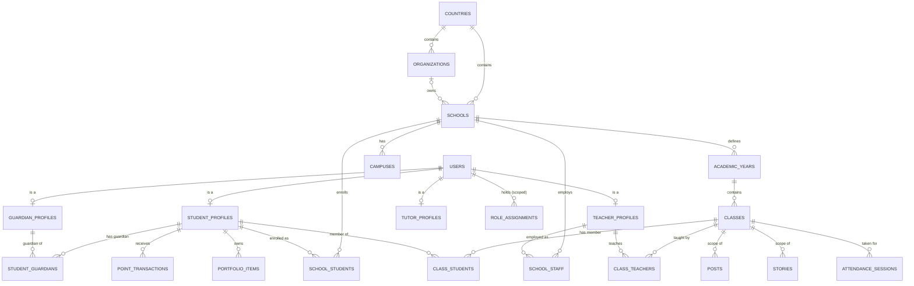
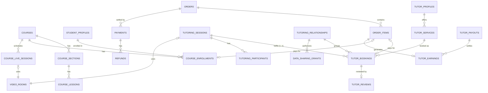

# Database Design

*Version 1, 24 November 2026. Source: `Education_Platform.md` (20 Nov 2026), with the resolutions recorded in [Spec_Review.md](Spec_Review.md). Finding ids (R-xx) refer to that review.*

Target: **PostgreSQL 18**, one shared database, used by a Spring Boot modular monolith (`com.nemaz.school.<module>`). Flyway owns the schema. Every table is tagged with the phase that first needs it (**P1–P6**, using the phase re-sequencing in R-08).

---

## 1. Conventions

| Topic | Rule |
|---|---|
| Primary keys | `id uuid primary key default uuidv7()`. UUIDv7 is time-ordered, so it's index-friendly and safe to expose in URLs. Exceptions: reference tables keyed by ISO or standard codes (`countries.code`, `languages.code`, …) and append-only logs (`bigint generated always as identity`). |
| Profile keys | Role profiles use a **shared primary key**: `student_profiles.user_id = users.id`. Columns called `student_id`, `guardian_id`, `teacher_id` or `tutor_id` hold that user id and reference the matching profile table (R-03). Plain actor columns (`created_by`, `author_id`, `awarded_by`) reference `users(id)`. |
| Standard columns | `-- + std` means: `created_at timestamptz not null default now()`, `updated_at timestamptz not null default now()`, `version int not null default 0` (JPA `@Version`, used for optimistic locking and offline sync conflicts). Append-only tables have only `created_at`. |
| Soft delete | `deleted_at timestamptz` only where the spec needs history or restore (posts, messages, portfolio items, users). Other rows end through status and dates (`left_at`, `revoked_at`). |
| Enumerations | Stored as `text` and checked with a `CHECK` constraint. Mapped with JPA `EnumType.STRING`. Comments list the allowed values: `-- ACTIVE\|FORMER`. Anything an admin can extend (languages, roles, permissions, point categories, notification types, grading schemes) is a **table**, not an enum (§70). |
| Time | All instants are `timestamptz` stored in UTC. Calendar-only values are `date`. Wall-clock recurring values are `time` plus an IANA `timezone`. Ethiopian dates are only for display, never stored (§64). |
| Money | `amount_minor bigint` plus `currency_code char(3)`. No floats. Rates are in basis points (`*_bps int`). |
| Localized labels | Small configuration labels (category names, grade names, curriculum text) use `name_i18n jsonb`, e.g. `{"en":"Kindness","am":"ደግነት"}`. User content is stored once in its original language, and translations go in `content_translations` (§71, R-24). |
| Tenant column | Every school-owned row carries `school_id`, even if it can be derived from its parent row (§98). A **composite FK** makes it consistent with the parent, e.g. `foreign key (class_id, school_id) references classes(id, school_id)`, so a row can't point at another tenant's class. Parents expose `unique (id, school_id)` for this. Optional Postgres row-level security can be added later on `school_id`. |
| Scope | Content with a scope uses `scope_type` plus **typed nullable FKs** (`school_id`, `class_id`, `course_id`, …) and a CHECK that exactly the right FK is set. It does not use an untyped `scope_id`, so referential integrity is kept. |
| Extensions | `citext` (emails and usernames), `btree_gist` (exclusion constraints), `pg_trgm` (name and tutor search). |
| Naming | snake_case, plural table names, `*_id` FKs, `*_at` instants, `*_on` dates, `is_*` / `can_*` booleans. |

The code blocks below are design DDL. They're complete enough to turn straight into Flyway migrations. Indexes are listed only where they aren't obvious; every FK also gets an index.

---

## 2. Domain map & phase index

| # | Domain (module) | Tables | Phase |
|---|---|---|---|
| 1 | Reference & localization | currencies, languages, calendar_systems, countries, country_languages, country_calendars, administrative_areas, addresses, holidays, system_settings | P1 |
| 2 | Tenancy & configuration | organizations, schools, school_languages, campuses, setting_definitions, settings, feature_definitions, feature_overrides | P1 |
| 3 | Identity & access | users, password_credentials, federated_identities, otp_challenges, student_login_codes, auth_sessions, roles, permissions, role_permissions, role_assignments | P1 |
| 4 | People & relationships | student_profiles, guardian_profiles, teacher_profiles, tutor_profiles, school_staff, school_students, student_guardians, invitations | P1 (tutor_profiles P4) |
| 5 | Academic structure | academic_years, academic_periods, grade_levels, subjects, classes, class_subjects, class_teachers, class_students, student_groups, student_group_members | P1 |
| 6 | Attendance & offline sync | attendance_sessions, attendance_records, absence_reports, sync_operations, idempotency_keys | P1 |
| 7 | Engagement | point_categories, point_transactions, point_balances, badges, student_badges | P1 |
| 8 | Teacher toolkit | classroom_activity_templates | P1 |
| 9 | Media | media, media_variants | P1 |
| 10 | Social (feed & stories) | posts, post_media, post_student_tags, post_comments, post_reactions, post_views, stories, story_views, content_translations | P1 |
| 11 | Messaging | conversations, conversation_members, messages, message_attachments, message_reads, message_reactions, user_blocks | P1 |
| 12 | School communications | announcements, announcement_audiences, announcement_recipients, announcement_acknowledgements, announcement_revisions | P1 |
| 13 | Notifications | notification_types, notifications, notification_deliveries, notification_preferences, user_notification_settings, push_devices | P1 |
| 14 | Calendar | events, event_participants | P1 |
| 15 | SIS integration | import_mapping_profiles, import_jobs, import_job_rows, external_systems, external_entity_mappings, sync_runs | P1 (sync_runs later) |
| 16 | Portfolios | portfolios, portfolio_collections, portfolio_items, portfolio_attachments, portfolio_comments, portfolio_feedback, portfolio_approvals | P1 basic, P2 full |
| 17 | Moderation & safeguarding | content_reports, moderation_cases, moderation_actions, safeguarding_incidents, safeguarding_incident_notes | P1 |
| 18 | Consent & data governance | policy_documents, policy_versions, consent_records, data_sharing_grants, retention_policies, legal_holds, data_subject_requests | P1 (grants P4, retention P2) |
| 19 | Audit & platform infrastructure | audit_logs, event_publication (outbox), shedlock, report_jobs | P0–P1 |
| 20 | Subscriptions | subscription_plans, plan_prices, plan_entitlements, subscriptions | P1 (manual), P5 billing |
| 21 | Curriculum | education_systems, curriculum_versions, academic_levels, curriculum_subjects, curriculum_topics, learning_objectives, school_curriculum_adoptions, curriculum_mappings, learning_evidence, mastery_records | P2 |
| 22 | Assignments, assessment, grading | grading_schemes, grading_scheme_bands, assessment_rubrics, rubric_criteria, rubric_levels, assignments, assignment_attachments, assignment_targets, assignment_submissions, submission_attachments, assessments, assessment_results, assessment_result_rubric_scores, period_grades, quizzes, quiz_questions, quiz_attempts, quiz_attempt_answers | P2 |
| 23 | Digital library | resource_categories, library_resources, resource_access_rules, resource_collections, resource_collection_items | P2 |
| 24 | Courses | courses, course_instructors, course_audience_rules, course_sections, course_lessons, course_materials, course_enrollments, lesson_progress, course_live_sessions, course_live_participants | P3 |
| 25 | Video | video_rooms, video_recordings, session_transcripts | P3 |
| 26 | Payments core | payment_providers, country_payment_providers, orders, order_items, payments, payment_transactions, payment_webhook_events | P3 |
| 27 | Tutor marketplace | tutor_subjects, tutor_languages, tutor_qualifications, verification_requirements, tutor_verification_requests, tutor_verification_documents, cancellation_policies, tutor_services, tutor_availability, tutor_availability_exceptions, tutoring_relationships, booking_series, tutoring_sessions, tutor_bookings, booking_status_history, tutoring_participants, tutoring_session_notes, trial_assessments, tutor_reviews, tutor_match_requests, tutor_match_results | P4 |
| 28 | Marketplace finance & school fees | refunds, platform_commissions, tutor_earnings, tutor_payout_accounts, tutor_payouts, fee_items, invoices, invoice_lines | P5 |
| 29 | AI (copilot & student tutor) | ai_prompt_templates, ai_model_configs, ai_feature_enablements, ai_benchmark_items, ai_evaluation_runs, ai_generations, ai_usage_events, ai_usage_quotas, ai_tutor_sessions, ai_tutor_messages, ai_practice_attempts | P6 |

That is 213 tables in total. Roughly 110 of them (domains 1–20, minus the rows tagged later) are needed for P1.

---

## 3. Core relationship diagrams

### 3.1 Access model (school world, P1)



### 3.2 Learning & marketplace (P3–P5)



---

## 4. Tables

### 4.1 Reference & localization (P1)

```sql
create table currencies (
  code            char(3) primary key,           -- ISO 4217: ETB, KES, USD
  name            text not null,
  symbol          text,
  minor_units     smallint not null default 2
);

create table languages (
  code            text primary key,              -- BCP 47: am, en, om, ti, so, sw
  name            text not null,                 -- English name
  native_name     text not null,                 -- አማርኛ, Afaan Oromoo
  script          text,                          -- Ethi, Latn
  direction       text not null default 'LTR',   -- LTR|RTL
  is_enabled      boolean not null default true
);

create table calendar_systems (
  code            text primary key,              -- GREGORIAN|ETHIOPIAN (extensible)
  name            text not null
);

create table countries (
  code                    char(2) primary key,   -- ISO 3166-1: ET, KE
  name_i18n               jsonb not null,
  default_currency_code   char(3) not null references currencies,
  default_language_code   text not null references languages,
  default_timezone        text not null,         -- Africa/Addis_Ababa
  default_calendar_code   text not null references calendar_systems,
  phone_country_code      text not null,         -- +251
  address_format          jsonb not null,        -- labels per admin level per language, required levels, postal rules
  name_format             jsonb,                 -- labels for given/middle/family name (R-37)
  status                  text not null default 'DRAFT', -- DRAFT|ENABLED|DISABLED
  launched_at             timestamptz
  -- + std
);

create table country_languages (
  country_code    char(2) references countries,
  language_code   text references languages,
  is_default      boolean not null default false,
  is_official     boolean not null default false,
  sort_order      smallint not null default 0,
  primary key (country_code, language_code)
);

create table country_calendars (
  country_code    char(2) references countries,
  calendar_code   text references calendar_systems,
  is_default      boolean not null default false,
  primary key (country_code, calendar_code)
);

-- Region > Zone > Woreda (ET), County > Sub-county (KE): generic levels (§68)
create table administrative_areas (
  id              uuid primary key default uuidv7(),
  country_code    char(2) not null references countries,
  parent_id       uuid references administrative_areas,
  level           smallint not null check (level between 1 and 5),
  code            text,
  name_i18n       jsonb not null,
  unique (country_code, level, code)
);

create table addresses (
  id                      uuid primary key default uuidv7(),
  country_code            char(2) not null references countries,
  admin_area_1_id         uuid references administrative_areas,  -- structured (preferred)
  admin_area_2_id         uuid references administrative_areas,
  admin_area_3_id         uuid references administrative_areas,
  administrative_level_1  text,                  -- free text fallback (§68)
  administrative_level_2  text,
  administrative_level_3  text,
  locality                text,
  postal_code             text,
  address_line_1          text,
  address_line_2          text,
  latitude                numeric(9,6),
  longitude               numeric(9,6)
  -- + std
);

-- Concrete dated occurrences (movable feasts are entered per year)
create table holidays (
  id                  uuid primary key default uuidv7(),
  country_code        char(2) references countries,
  admin_area_1_id     uuid references administrative_areas, -- regional holiday
  school_id           uuid references schools,               -- school break
  name_i18n           jsonb not null,
  holiday_type        text not null,             -- NATIONAL|RELIGIOUS|REGIONAL|SCHOOL_BREAK
  starts_on           date not null,
  ends_on             date not null,
  check (country_code is not null or school_id is not null),
  check (ends_on >= starts_on)
  -- + std
);

create table system_settings (
  key             text primary key,
  value           jsonb not null,
  description     text,
  updated_by      uuid references users,
  updated_at      timestamptz not null default now()
);
```

### 4.2 Tenancy & configuration (P1)

```sql
create table organizations (
  id              uuid primary key default uuidv7(),
  country_code    char(2) not null references countries,
  name            text not null,
  legal_name      text,
  slug            citext not null unique,
  address_id      uuid references addresses,
  logo_media_id   uuid references media,
  status          text not null default 'ACTIVE', -- ACTIVE|SUSPENDED|ARCHIVED
  -- + std
);

create table schools (
  id                      uuid primary key default uuidv7(),
  country_code            char(2) not null references countries,
  organization_id         uuid references organizations,       -- null = independent school (§5)
  name                    text not null,
  short_name              text,
  slug                    citext not null unique,
  school_type             text,                  -- PRE_PRIMARY|PRIMARY|SECONDARY|K12|OTHER
  ownership_type          text,                  -- PUBLIC|PRIVATE|FAITH|NGO|INTERNATIONAL
  education_system_id     uuid references education_systems,   -- P2 column
  default_language_code   text not null references languages,
  timezone                text not null,
  default_calendar_code   text not null references calendar_systems,
  currency_code           char(3) not null references currencies,
  address_id              uuid references addresses,
  phone_e164              text,
  email                   citext,
  website                 text,
  logo_media_id           uuid references media,
  cover_media_id          uuid references media,
  brand_color             text,
  status                  text not null default 'ONBOARDING', -- ONBOARDING|ACTIVE|SUSPENDED|ARCHIVED
  unique (id, country_code)
  -- + std
);

create table school_languages (           -- §110 school-level localization
  school_id       uuid references schools,
  language_code   text references languages,
  is_default      boolean not null default false,
  primary key (school_id, language_code)
);

create table campuses (
  id              uuid primary key default uuidv7(),
  school_id       uuid not null references schools,
  name            text not null,
  code            text,
  address_id      uuid references addresses,
  timezone        text,                          -- null = school timezone
  status          text not null default 'ACTIVE', -- ACTIVE|ARCHIVED (values added in M1a; the design left them open)
  unique (id, school_id),
  unique (school_id, code)
  -- + std
);

-- Behavior settings: typed definition + scoped values (R-33)
create table setting_definitions (
  key             text primary key,              -- e.g. feed.parent_contributions.enabled
  module          text not null,
  value_schema    jsonb not null,                -- JSON Schema for validation
  default_value   jsonb not null,
  allowed_scopes  text[] not null,               -- {PLATFORM,COUNTRY,ORGANIZATION,SCHOOL}
  description     text
);

create table settings (
  id              uuid primary key default uuidv7(),
  key             text not null references setting_definitions,
  scope_type      text not null,                 -- PLATFORM|COUNTRY|ORGANIZATION|SCHOOL
  country_code    char(2) references countries,
  organization_id uuid references organizations,
  school_id       uuid references schools,
  value           jsonb not null,
  updated_by      uuid references users,
  updated_at      timestamptz not null default now(),
  check ( (scope_type='PLATFORM'     and num_nonnulls(country_code,organization_id,school_id)=0)
       or (scope_type='COUNTRY'      and country_code is not null and num_nonnulls(organization_id,school_id)=0)
       or (scope_type='ORGANIZATION' and organization_id is not null and num_nonnulls(country_code,school_id)=0)
       or (scope_type='SCHOOL'       and school_id is not null and num_nonnulls(country_code,organization_id)=0) )
);
create unique index ux_settings_scope on settings
  (key, scope_type, coalesce(country_code,''), coalesce(organization_id, '00000000-0000-0000-0000-000000000000'), coalesce(school_id, '00000000-0000-0000-0000-000000000000'));

create table feature_definitions (
  key             text primary key,              -- attendance, points, feed, messaging, library, courses, marketplace, tutoring, payments, ai_copilot, ai_student_tutor; plus the capacity keys max_students and storage_bytes, which exist only so plan_entitlements.limit_value has a key to attach to (M1a)
  description     text,
  default_enabled boolean not null default false
);

create table feature_overrides (              -- §80; same scope pattern as settings
  id              uuid primary key default uuidv7(),
  feature_key     text not null references feature_definitions,
  scope_type      text not null,                 -- PLATFORM|COUNTRY|ORGANIZATION|SCHOOL
  country_code    char(2) references countries,
  organization_id uuid references organizations,
  school_id       uuid references schools,
  enabled         boolean not null,
  config          jsonb,
  updated_by      uuid references users,
  updated_at      timestamptz not null default now()
  -- same scope CHECK + unique index as settings
);
```
Resolution order: **school → organization → country → platform → definition default**. A feature is on only if it is enabled **and** the school's plan entitles it (§4.20).

### 4.3 Identity & access (P1)

```sql
create table users (
  id                      uuid primary key default uuidv7(),
  account_type            text not null default 'STANDARD', -- STANDARD|MANAGED (school-managed child, R-31)
  email                   citext unique,
  email_verified_at       timestamptz,
  phone_e164              text unique,
  phone_verified_at       timestamptz,
  username                citext unique,         -- optional, for managed/older students
  given_name              text not null,
  middle_name             text,                  -- e.g. father's name (R-37)
  family_name             text,                  -- e.g. grandfather's name / surname
  display_name            text not null,
  date_of_birth           date,                  -- drives age-aware rules (§131)
  gender                  text,                  -- optional, school-collected
  avatar_media_id         uuid references media,
  home_country_code       char(2) references countries,
  preferred_language_code text references languages,       -- §111
  locale                  text,                  -- am-ET, en-ET
  timezone                text,
  calendar_preference     text references calendar_systems,
  status                  text not null default 'ACTIVE',   -- PENDING|ACTIVE|LOCKED|SUSPENDED|DEACTIVATED
  last_login_at           timestamptz,
  deleted_at              timestamptz,
  check (account_type = 'MANAGED' or email is not null or phone_e164 is not null)
  -- + std
);
create index ix_users_name_trgm on users using gin (display_name gin_trgm_ops);

create table password_credentials (
  user_id         uuid primary key references users,
  password_hash   text not null,                 -- argon2id
  must_change     boolean not null default false,
  changed_at      timestamptz not null default now(),
  failed_attempts smallint not null default 0,
  locked_until    timestamptz
);

create table federated_identities (
  id              uuid primary key default uuidv7(),
  user_id         uuid not null references users,
  provider        text not null,                 -- GOOGLE|APPLE|MICROSOFT
  provider_subject text not null,
  email           citext,
  created_at      timestamptz not null default now(),
  unique (provider, provider_subject)
);

create table otp_challenges (                    -- phone-first sign-in (Ethiopia), email verify, reset
  id              uuid primary key default uuidv7(),
  user_id         uuid references users,
  channel         text not null,                 -- SMS|EMAIL|VOICE
  destination     text not null,
  purpose         text not null,                 -- LOGIN|VERIFY_PHONE|VERIFY_EMAIL|RESET_PASSWORD|ACCEPT_INVITE
  code_hash       text not null,
  attempts        smallint not null default 0,
  expires_at      timestamptz not null,
  consumed_at     timestamptz,
  request_ip      inet,
  created_at      timestamptz not null default now()
);

create table student_login_codes (               -- ClassDojo-style QR / text code (R-31)
  id              uuid primary key default uuidv7(),
  student_id      uuid not null references student_profiles,
  school_id       uuid not null references schools,
  class_id        uuid references classes,       -- class sheet the code was printed for
  code_type       text not null,                 -- QR|TEXT
  code_hash       text not null unique,
  issued_by       uuid not null references users,
  expires_at      timestamptz,
  revoked_at      timestamptz,
  last_used_at    timestamptz,
  created_at      timestamptz not null default now()
);

create table auth_sessions (                     -- renamed from "sessions" (R-19)
  id                  uuid primary key default uuidv7(),
  user_id             uuid not null references users,
  refresh_token_hash  text not null unique,      -- rotated on each refresh
  token_family_id     uuid not null,             -- reuse detection
  auth_method         text not null,             -- PASSWORD|OTP|FEDERATED|LOGIN_CODE
  user_agent          text,
  ip                  inet,
  created_at          timestamptz not null default now(),
  last_seen_at        timestamptz,
  expires_at          timestamptz not null,
  revoked_at          timestamptz,
  revoked_reason      text
);

create table roles (
  code            text primary key,
  -- PLATFORM_ADMIN, COUNTRY_ADMIN, ORGANIZATION_ADMIN, SCHOOL_ADMIN, CAMPUS_ADMIN,
  -- SCHOOL_STAFF, PLATFORM_MODERATOR, SUPPORT_AGENT, SAFEGUARDING_LEAD (R-34)
  name_i18n       jsonb not null,
  scope_level     text not null,                 -- PLATFORM|COUNTRY|ORGANIZATION|SCHOOL|CAMPUS
  is_system       boolean not null default true,
  description     text
);

create table permissions (
  code            text primary key,              -- school.manage, class.manage, import.run, moderation.decide, audit.read ...
  module          text not null,
  description     text
);

create table role_permissions (
  role_code       text references roles,
  permission_code text references permissions,
  primary key (role_code, permission_code)
);

-- Administrative/operational roles only. Teacher, student, guardian and tutor capabilities come
-- from profiles + memberships + relationships, not from this table (R-02).
create table role_assignments (
  id              uuid primary key default uuidv7(),
  user_id         uuid not null references users,
  role_code       text not null references roles,
  scope_type      text not null,                 -- PLATFORM|COUNTRY|ORGANIZATION|SCHOOL|CAMPUS
  country_code    char(2) references countries,
  organization_id uuid references organizations,
  school_id       uuid references schools,
  campus_id       uuid,
  status          text not null default 'ACTIVE',-- ACTIVE|REVOKED
  granted_by      uuid references users,
  granted_at      timestamptz not null default now(),
  revoked_at      timestamptz,
  foreign key (campus_id, school_id) references campuses (id, school_id)
  -- CHECK: FKs set exactly as required by scope_type (same pattern as settings)
);
create unique index ux_role_assignment_active on role_assignments
  (user_id, role_code, scope_type, coalesce(country_code,''), coalesce(organization_id,'00000000-0000-0000-0000-000000000000'),
   coalesce(school_id,'00000000-0000-0000-0000-000000000000'), coalesce(campus_id,'00000000-0000-0000-0000-000000000000'))
  where status = 'ACTIVE';
```

*As built (M1b, `V1_05`/`V1_06`):* `student_login_codes` is created with students and classes in M3, `users.avatar_media_id` with media in M2. Added CHECKs for the commented enumerations, `auth_sessions.revoked_reason` (ROTATED, LOGOUT, LOGOUT_ALL, REUSE_DETECTED, EXPIRED, USER_INACTIVE, PASSWORD_CHANGED; set together with `revoked_at`), `role_assignments` (`status = 'REVOKED'` exactly when `revoked_at` is set; a CAMPUS assignment stores `campus_id` and its `school_id`). Emails are stored lower-cased, phones in E.164. Seeded permissions include `school.read` besides those listed (see `R__40_roles_permissions.sql`).

### 4.4 People & relationships (P1; tutor_profiles P4)

```sql
create table student_profiles (
  user_id                 uuid primary key references users,
  avatar_config           jsonb,                 -- ClassDojo-style monster/avatar builder
  learning_language_code  text references languages,
  created_at              timestamptz not null default now()
);

create table guardian_profiles (
  user_id                 uuid primary key references users,
  preferred_contact_channel text,                -- PUSH|SMS|EMAIL|VOICE
  created_at              timestamptz not null default now()
);

create table teacher_profiles (                  -- school-world identity; separate from tutor (§40)
  user_id                 uuid primary key references users,
  bio                     text,
  years_experience        smallint,
  created_at              timestamptz not null default now()
);

create table tutor_profiles (                    -- marketplace identity (P4)
  user_id                 uuid primary key references users,
  country_code            char(2) not null references countries,
  headline                text,
  bio                     text,
  years_experience        smallint,
  offers_online           boolean not null default true,
  offers_in_person        boolean not null default false,
  address_id              uuid references addresses,     -- approximate area only is shown publicly
  service_radius_km       smallint,
  age_groups              text[],                -- EARLY_YEARS|PRIMARY|LOWER_SECONDARY|UPPER_SECONDARY|ADULT
  intro_video_media_id    uuid references media,
  verification_status     text not null default 'UNVERIFIED', -- UNVERIFIED|PENDING_REVIEW|VERIFIED|SUSPENDED|REJECTED (§88)
  verified_at             timestamptz,
  listing_status          text not null default 'DRAFT',      -- DRAFT|LISTED|HIDDEN
  rating_avg              numeric(3,2),          -- denormalized from tutor_reviews
  rating_count            int not null default 0,
  price_from_minor        bigint,                -- denormalized for search
  currency_code           char(3) references currencies
  -- + std
);

-- Employment / staff membership in a school (R-02)
create table school_staff (
  id              uuid primary key default uuidv7(),
  school_id       uuid not null references schools,
  user_id         uuid not null references users,
  campus_id       uuid,
  staff_type      text not null,                 -- TEACHER|ADMINISTRATOR|SUPPORT_STAFF
  job_title       text,
  employee_number text,
  external_ref    text,                          -- SIS id (§125)
  status          text not null default 'ACTIVE',-- INVITED|ACTIVE|SUSPENDED|FORMER
  started_on      date,
  ended_on        date,
  foreign key (campus_id, school_id) references campuses (id, school_id),
  unique (id, school_id)
  -- + std
);
create unique index ux_school_staff_active on school_staff (school_id, user_id) where status in ('INVITED','ACTIVE');
-- staff_type = TEACHER requires a teacher_profiles row (enforced in service layer)

-- Student enrollment in a school (R-01)
create table school_students (
  id              uuid primary key default uuidv7(),
  school_id       uuid not null references schools,
  student_id      uuid not null references student_profiles,
  campus_id       uuid,
  student_number  text,
  external_ref    text,
  admission_on    date,
  status          text not null default 'ACTIVE',-- PENDING|ACTIVE|TRANSFERRED|GRADUATED|WITHDRAWN
  left_on         date,
  left_reason     text,
  foreign key (campus_id, school_id) references campuses (id, school_id)
  -- + std
);
create unique index ux_school_student_active on school_students (school_id, student_id) where status in ('PENDING','ACTIVE');
create unique index ux_school_student_number on school_students (school_id, student_number) where student_number is not null;

-- Guardian relationship: global, verified by a school (R-29)
create table student_guardians (
  id                      uuid primary key default uuidv7(),
  student_id              uuid not null references student_profiles,
  guardian_id             uuid not null references guardian_profiles,
  relationship_type       text not null,         -- MOTHER|FATHER|GRANDPARENT|SIBLING|AUNT_UNCLE|LEGAL_GUARDIAN|OTHER
  is_primary              boolean not null default false,
  status                  text not null default 'PENDING', -- PENDING|ACTIVE|REJECTED|REVOKED
  verification_method     text,                  -- SCHOOL_INVITE|SCHOOL_VERIFIED|DOCUMENT|PLATFORM_ADMIN
  verified_by_school_id   uuid references schools,
  verified_by             uuid references users,
  verified_at             timestamptz,
  can_view_academics      boolean not null default true,
  can_message_staff       boolean not null default true,
  can_receive_notifications boolean not null default true,
  can_award_points        boolean not null default true,
  can_give_consent        boolean not null default true,
  can_book_and_pay        boolean not null default true,
  custody_restricted      boolean not null default false, -- court order etc.; overrides flags above
  restriction_note        text,                  -- visible to school admins only
  revoked_at              timestamptz,
  revoked_by              uuid references users
  -- + std
);
create unique index ux_student_guardian_live on student_guardians (student_id, guardian_id) where status in ('PENDING','ACTIVE');

-- Invitations: guardian link, staff, class join, course invite (§125, §41)
create table invitations (
  id                  uuid primary key default uuidv7(),
  invitation_type     text not null,             -- GUARDIAN_LINK|STAFF|STUDENT_ACCOUNT|CLASS_JOIN|COURSE
  school_id           uuid references schools,
  class_id            uuid references classes,
  course_id           uuid references courses,  -- P3 column
  student_id          uuid references student_profiles,  -- for GUARDIAN_LINK
  relationship_type   text,
  payload             jsonb,                     -- e.g. staff_type, role
  channel             text not null,             -- SMS|EMAIL|LINK|PRINTED_CODE
  destination         text,                      -- phone/email (unverified; never proves guardianship)
  token_hash          text unique,
  short_code          text,                      -- human-typed class/parent code
  status              text not null default 'PENDING', -- PENDING|SENT|ACCEPTED|EXPIRED|REVOKED
  invited_by          uuid not null references users,
  import_job_id       uuid references import_jobs,
  accepted_by         uuid references users,
  accepted_at         timestamptz,
  expires_at          timestamptz not null,
  created_at          timestamptz not null default now()
);
```
Accepting a GUARDIAN_LINK invitation creates `student_guardians` with status PENDING. It becomes ACTIVE only after school verification, unless the school's setting `guardians.auto_verify_invite` allows the invite itself to count as verification.

*As built (M5a, `V5_01`):* `guardian_profiles`, `student_guardians` and `invitations` exist now. `invitations` omits `course_id` (P3) and `import_job_id` (added by the M4 import module), replaces `destination`/`short_code` with `destination_e164`, `destination_email`, `code_hash` (HMAC with the `parent-code:` namespace) and adds `guardian_name`, `max_uses`, `use_count`, `revoked_at`, `revoked_by`; EXPIRED is derived from `expires_at`. `student_guardians` adds `requested_via` (INVITE_LINK|PARENT_CODE|ADMIN), `invitation_id`, `decided_by`/`decided_at`/`decision_note`, the std columns and one live primary guardian per student (partial unique index).

*As built (M3a, `V3_02`, `V3_03`):* `guardian_profiles`, `student_guardians` and `invitations` are not created yet (M5); `tutor_profiles` waits for P4. `school_students` also has `unique (id, school_id)`. Enumerations carry CHECK constraints. Staff are provisioned directly (no `INVITED` rows yet). Managed students (`users.account_type = MANAGED`) have a `student_profiles` row (`avatar_config` is a jsonb object) and a `school_students` row per enrollment; API paths use the student's user id, and the latest live enrollment of the school is "the" enrollment.

### 4.5 Academic structure (P1)

```sql
create table academic_years (
  id              uuid primary key default uuidv7(),
  school_id       uuid not null references schools,
  name            text not null,                 -- "2018 E.C. / 2025-26"
  starts_on       date not null,
  ends_on         date not null,
  status          text not null default 'PLANNED', -- PLANNED|ACTIVE|CLOSED
  is_current      boolean not null default false,
  unique (id, school_id)
  -- + std
);
create unique index ux_academic_year_current on academic_years (school_id) where is_current;

create table academic_periods (
  id              uuid primary key default uuidv7(),
  academic_year_id uuid not null,
  school_id       uuid not null,
  name            text not null,                 -- Term 1, Semester 2
  period_type     text not null,                 -- TERM|SEMESTER|QUARTER|CUSTOM
  sequence        smallint not null,
  starts_on       date not null,
  ends_on         date not null,
  foreign key (academic_year_id, school_id) references academic_years (id, school_id),
  unique (academic_year_id, sequence)
  -- + std
);

create table grade_levels (
  id              uuid primary key default uuidv7(),
  school_id       uuid not null references schools,
  name            text not null,                 -- "Grade 8", "KG 2"
  code            text,
  sequence        smallint not null,
  academic_level_id uuid references academic_levels, -- curriculum mapping (P2 column)
  is_active       boolean not null default true,
  unique (id, school_id),
  unique (school_id, sequence)
  -- + std
);

create table subjects (
  id              uuid primary key default uuidv7(),
  school_id       uuid not null references schools,
  name            text not null,
  code            text,
  color           text,
  curriculum_subject_id uuid references curriculum_subjects, -- P2 column
  is_active       boolean not null default true,
  unique (id, school_id)
  -- + std
);

create table classes (
  id              uuid primary key default uuidv7(),
  school_id       uuid not null references schools,
  campus_id       uuid,
  academic_year_id uuid not null,
  grade_level_id  uuid,                          -- null for mixed-grade clubs
  name            text not null,                 -- "8A"
  class_type      text not null default 'HOMEROOM', -- HOMEROOM|SUBJECT|CLUB|OTHER
  icon            text,
  color           text,
  status          text not null default 'ACTIVE',-- ACTIVE|ARCHIVED
  archived_at     timestamptz,
  external_ref    text,
  created_by      uuid references users,
  foreign key (campus_id, school_id) references campuses (id, school_id),
  foreign key (academic_year_id, school_id) references academic_years (id, school_id),
  foreign key (grade_level_id, school_id) references grade_levels (id, school_id),
  unique (id, school_id)
  -- + std
);

create table class_subjects (
  class_id        uuid not null,
  subject_id      uuid not null,
  school_id       uuid not null,
  primary key (class_id, subject_id),
  foreign key (class_id, school_id) references classes (id, school_id),
  foreign key (subject_id, school_id) references subjects (id, school_id)
);

create table class_teachers (                    -- §10 + R-07
  id              uuid primary key default uuidv7(),
  class_id        uuid not null,
  school_id       uuid not null,
  teacher_id      uuid not null references teacher_profiles,
  role            text not null,                 -- LEAD|CO_TEACHER|SUBJECT_TEACHER|ASSISTANT
  subject_id      uuid,                          -- required when role = SUBJECT_TEACHER
  status          text not null default 'ACTIVE',-- PENDING|ACTIVE|FORMER|REMOVED (R-11)
  joined_at       timestamptz not null default now(),
  left_at         timestamptz,
  added_by        uuid references users,
  foreign key (class_id, school_id) references classes (id, school_id),
  foreign key (subject_id, school_id) references subjects (id, school_id),
  check (role <> 'SUBJECT_TEACHER' or subject_id is not null)
  -- + std
);
create unique index ux_class_teacher_active on class_teachers
  (class_id, teacher_id, coalesce(subject_id,'00000000-0000-0000-0000-000000000000')) where status in ('PENDING','ACTIVE');

create table class_students (                    -- §10, §12
  id              uuid primary key default uuidv7(),
  class_id        uuid not null,
  school_id       uuid not null,
  student_id      uuid not null references student_profiles,
  status          text not null default 'ACTIVE',-- PENDING|ACTIVE|FORMER|REMOVED
  joined_at       timestamptz not null default now(),
  left_at         timestamptz,
  left_reason     text,                          -- TRANSFERRED_CLASS|LEFT_SCHOOL|PROMOTED|REMOVED
  added_by        uuid references users,
  foreign key (class_id, school_id) references classes (id, school_id)
  -- + std
);
create unique index ux_class_student_active on class_students (class_id, student_id) where status in ('PENDING','ACTIVE');
create index ix_class_students_student on class_students (student_id) where status = 'ACTIVE';

-- Saved groups from the group maker (§126)
create table student_groups (
  id              uuid primary key default uuidv7(),
  class_id        uuid not null,
  school_id       uuid not null,
  name            text not null,
  created_by      uuid not null references users,
  foreign key (class_id, school_id) references classes (id, school_id)
  -- + std
);
create table student_group_members (
  group_id        uuid references student_groups on delete cascade,
  student_id      uuid references student_profiles,
  primary key (group_id, student_id)
);
```

*As built (M3a, `V3_01`, `V3_03`):* `grade_levels.academic_level_id` and `subjects.curriculum_subject_id` are omitted until the curriculum tables exist (P2). CHECKs on all enumerations and hex colours; `academic_periods` has an exclusion constraint (`btree_gist`, same year, overlapping `daterange` of start and end, inclusive) next to `unique (academic_year_id, sequence)`; `subjects` has a unique lower-cased `code` per school; `class_students` and `class_teachers` require `left_at` exactly when the status is no longer PENDING/ACTIVE, and `class_students.left_reason` is checked against TRANSFERRED_CLASS, LEFT_SCHOOL, PROMOTED, REMOVED. REMOVED is used when a teacher removes a student by hand; FORMER for moves, promotion and withdrawal. All new tables carry the std columns except the append-only/link tables (`class_subjects`, `student_group_members`, `student_login_codes`), and every tenant row has its composite `(…, school_id)` FK. `student_login_codes.class_id` references `classes (id, school_id)`; the code itself is never stored (`code_hash` = HMAC-SHA256 with the OTP pepper).

### 4.6 Attendance & offline sync (P1)

```sql
create table attendance_sessions (               -- one roll call
  id              uuid primary key default uuidv7(),
  school_id       uuid not null,
  class_id        uuid not null,
  attendance_date date not null,
  slot            text not null default 'DAY',   -- DAY|AM|PM|P1..P8 (school-configured)
  subject_id      uuid,
  academic_period_id uuid references academic_periods,
  taken_by        uuid not null references users,
  taken_at        timestamptz not null,
  status          text not null default 'SUBMITTED', -- DRAFT|SUBMITTED|LOCKED
  client_op_id    uuid,                          -- offline creation id
  foreign key (class_id, school_id) references classes (id, school_id),
  unique (class_id, attendance_date, slot)
  -- + std
);

create table attendance_records (
  id                  uuid primary key default uuidv7(),
  attendance_session_id uuid not null references attendance_sessions on delete cascade,
  school_id           uuid not null,
  student_id          uuid not null references student_profiles,
  status              text not null,             -- PRESENT|ABSENT|LATE|EXCUSED|LEFT_EARLY
  minutes_late        smallint,
  note                text,
  absence_report_id   uuid references absence_reports,
  recorded_by         uuid not null references users,
  recorded_at         timestamptz not null,      -- device time of the mark
  source              text not null default 'ONLINE', -- ONLINE|OFFLINE_SYNC|IMPORT
  client_op_id        uuid,
  unique (attendance_session_id, student_id)
  -- + std   (version used for conflict detection)
);
create index ix_attendance_student_date on attendance_records (student_id, recorded_at);

create table absence_reports (                   -- guardian pre-reports an absence
  id              uuid primary key default uuidv7(),
  school_id       uuid not null references schools,
  student_id      uuid not null references student_profiles,
  reported_by     uuid not null references users,
  from_date       date not null,
  to_date         date not null,
  reason_code     text,                          -- ILLNESS|FAMILY|APPOINTMENT|OTHER
  note            text,
  status          text not null default 'SUBMITTED', -- SUBMITTED|ACKNOWLEDGED|DECLINED
  acknowledged_by uuid references users,
  acknowledged_at timestamptz
  -- + std
);

-- Offline sync ledger (§72, §104, R-27)
create table sync_operations (
  id                  uuid primary key default uuidv7(),
  user_id             uuid not null references users,
  device_id           uuid not null references push_devices,
  client_operation_id uuid not null,
  operation_type      text not null,             -- ATTENDANCE_MARK|POINT_AWARD|SUBMISSION_CREATE|...
  entity_type         text not null,
  entity_id           uuid,
  base_version        int,                       -- version the client edited from
  payload             jsonb not null,
  status              text not null,             -- APPLIED|DUPLICATE|CONFLICT|REJECTED
  result              jsonb,                     -- server state / conflict details returned to client
  client_created_at   timestamptz not null,
  received_at         timestamptz not null default now(),
  unique (device_id, client_operation_id)
);

create table idempotency_keys (                  -- online POSTs (payments, bookings, message send)
  key             text not null,
  user_id         uuid not null references users,
  request_hash    text not null,
  response_status smallint,
  response_body   jsonb,
  created_at      timestamptz not null default now(),
  expires_at      timestamptz not null,
  primary key (user_id, key)
);
```
Conflict rule for attendance: the **latest `recorded_at` wins** per student per session. Conflicts are logged to `sync_operations.result` and are never discarded silently. *(Changed in M7a, see below: the first write stays, a later one needs the record's current version.)*

**As built (M7a, `V7_01__attendance`, `V7_02__sync`):** deviations from the DDL above.
- `attendance_sessions`: composite `(class_id, school_id)` and `(subject_id, school_id)` FKs; `unique (id, school_id, class_id, attendance_date)` so that records can copy class and date and still reference their session by a composite FK; `academic_period_id` is left out; std columns added; `slot` is checked (`DAY|AM|PM|P1..P8`, the school enables a subset with the setting `attendance.slots`); status `LOCKED` exists but the lock is **derived** (end of the date in the class campus's or school's time zone plus `attendance.lock_after_hours`), so rows stay `SUBMITTED`. `attendance_date` is a school-local calendar date.
- `attendance_records`: `school_id`, `class_id`, `attendance_date` copied from the session (immutable, composite FK) so that history and reports need no join to find a date; `unique (attendance_session_id, student_id)`; `minutes_late` only with `LATE` (1 to 600); `note` at most 200 characters; `device_id` (the sync device, null online); `version` starts at 0. A record is never deleted; an unmarked student simply has no record. **Conflict rule:** a write that differs from the stored record is applied only if the writer saw it (`expectedVersion` equals the stored `version`, or the roll's `baseVersion` equals the session's current version, or it is the same user's and device's own earlier edit); otherwise it is a CONFLICT and the stored record stays. `recorded_at` (device time, clamped to at most 5 minutes ahead of the server) is kept for audit and display, never to decide who wins. `source` is `ONLINE` or `OFFLINE_SYNC`.
- `absence_reports`: `reason_code` required and checked; `status` also `CANCELLED`; `decided_by`, `decided_at`, `decision_note` replace `acknowledged_by`/`acknowledged_at` (a decline is recorded too); `to_date - from_date <= 60`; `unique (id, school_id)`. `note` and `reason_code` are health data: readable only by the reporter, the student's LEAD, CO and SUBJECT teachers and attendance managers.
- `sync_operations`: `device_id` is a **client-generated installation id with no foreign key** (a device may sync without push; `push_devices` is untouched); uniqueness is per `(user_id, device_id, client_operation_id)`; added `school_id`, `problem_code`, `recorded_at` (effective time), `payload_purged_at`; `payload` is nullable once purged (children's data goes after `school.sync.payload-retention`, default 30 days, together with the result's `state`; rows after `school.sync.row-retention`, default 365 days); `status` is stored as `APPLIED`, `CONFLICT`, `REJECTED` or `DUPLICATE` (an operation already applied through the online endpoint with the same client operation id).
- Online POSTs stay in `idempotency_keys` (`Idempotency-Key` header); the sync endpoint does not use it (every operation has its own key).

**Device side (M7b, Expo app, local SQLite `school.db`, migrations in `apps/mobile/src/lib/db/migrations.ts`; not part of the server schema):**
- `outbox_operations` (migration 3): the phone's half of `sync_operations`. One row per queued operation: `op_id` (= `client_operation_id`), `owner_id`, `op_type`, `school_id`, `class_id`, `base_version`, `payload` (ids, marks, numbers: no names, tokens or notes), `status` (`PENDING`, `CONFLICT`, `REJECTED`, `EXPIRED`), the API's `problem_*` and the clashing marks (`conflict`) for the rows that wait for the teacher, `attempts`, `next_attempt_at`, `settled_at`. It replaces the M6c `points_award_queue` (rows are copied with their ids).
- `offline_cache` (migration 4): `(owner_id, kind, scope, entry_key) -> data, fetched_at` with kinds `classes`, `roster`, `roll`, `rollmeta`, `categories`, `totals`, `templates`; the scope is the class id. What each kind may hold, its maximum age and its wipe rules are in `apps/mobile/src/lib/offline/cache.ts`.

### 4.7 Engagement: points & badges (P1)

```sql
create table point_categories (                  -- §20; "skills" in ClassDojo
  id              uuid primary key default uuidv7(),
  school_id       uuid references schools,       -- null = platform template
  class_id        uuid references classes,       -- class-specific custom skill
  name_i18n       jsonb not null,
  icon            text,
  color           text,
  default_points  smallint not null default 1 check (default_points between 1 and 10),
  polarity        text not null default 'POSITIVE', -- POSITIVE|NEEDS_WORK (R-16)
  context         text not null default 'CLASS',    -- CLASS|HOME (HOME categories for parents)
  is_active       boolean not null default true,
  sort_order      smallint not null default 0,
  created_by      uuid references users
  -- + std
);

-- Append-only ledger (§21). Never updated; corrections are new rows.
create table point_transactions (
  id                  uuid primary key default uuidv7(),
  school_id           uuid not null references schools,
  student_id          uuid not null references student_profiles,
  context             text not null,             -- CLASS|SCHOOL|HOME
  class_id            uuid,                      -- required when context = CLASS
  academic_year_id    uuid references academic_years,
  category_id         uuid not null references point_categories,
  points              smallint not null check (points <> 0), -- sign from polarity; negative for reversals
  transaction_type    text not null default 'AWARD', -- AWARD|REVERSAL|CORRECTION
  reverses_transaction_id uuid references point_transactions,
  reason              text,
  awarded_by          uuid references users,     -- null = system award
  awarder_role        text not null,             -- TEACHER|GUARDIAN|SCHOOL_ADMIN|SYSTEM
  award_batch_id      uuid,                      -- whole-class / multi-select award
  client_op_id        uuid,
  created_at          timestamptz not null default now(),
  foreign key (class_id, school_id) references classes (id, school_id),
  check ((context = 'CLASS') = (class_id is not null)),
  check ((context = 'HOME') = (awarder_role = 'GUARDIAN')),     -- D2: guardian points are always HOME
  check ((transaction_type = 'AWARD') = (reverses_transaction_id is null))
);
create index ix_points_student on point_transactions (student_id, created_at desc);
create index ix_points_class on point_transactions (class_id, created_at desc);

-- Rebuildable projection for fast totals; never the source of truth
create table point_balances (
  student_id          uuid not null references student_profiles,
  school_id           uuid not null references schools,
  academic_year_id    uuid not null references academic_years,
  context             text not null,
  class_id            uuid not null default '00000000-0000-0000-0000-000000000000',
  positive_total      int not null default 0,
  needs_work_total    int not null default 0,
  last_transaction_at timestamptz,
  primary key (student_id, academic_year_id, context, class_id)
);

create table badges (                            -- definitions (R-19)
  id              uuid primary key default uuidv7(),
  school_id       uuid references schools,       -- null = platform template
  code            text not null,
  name_i18n       jsonb not null,
  description_i18n jsonb,
  icon_media_id   uuid references media,
  criteria_type   text not null,                 -- POINTS_TOTAL|CATEGORY_TOTAL|ATTENDANCE_STREAK|MANUAL
  criteria        jsonb,                         -- {"threshold":100,"category_id":...,"context":"CLASS"}
  is_active       boolean not null default true,
  unique nulls not distinct (school_id, code)
  -- + std
);

create table student_badges (                    -- awards ("achievements")
  id              uuid primary key default uuidv7(),
  badge_id        uuid not null references badges,
  student_id      uuid not null references student_profiles,
  school_id       uuid not null references schools,
  awarded_at      timestamptz not null default now(),
  awarded_by      uuid references users,         -- null = rule engine
  source          jsonb,                         -- triggering transaction ids, streak dates
  revoked_at      timestamptz,
  revoked_by      uuid references users
);
```
Badge, leaderboard and public-ranking toggles are `settings`: `engagement.badges.enabled`, `engagement.leaderboard.enabled`, `engagement.public_rankings.enabled`, and `engagement.needs_work.enabled` (default **true**, D2).

**Fixed rule (D2):** HOME-context transactions are excluded from every class or school aggregate: class and school totals, leaderboards, school badge criteria and reports. They appear only on the child's own profile and in the guardian's view. Badge criteria evaluate `context in ('CLASS','SCHOOL')` only. Parents can award only from HOME categories, so `context = 'HOME'` exactly when `awarder_role = 'GUARDIAN'` (enforced by CHECK).

*As built (M6a, `V6_01`, `R__70_engagement_templates`):*
- **`point_categories`:** adds `template_code` (the stable key of a platform template and of the school copy made from it; unique per scope), `(id, school_id)` unique (ledger rows reference their own school's category), CHECKs (HOME categories are school-level and POSITIVE only; a class category needs `school_id`). Platform templates (`school_id` null) are the default set; a school gets its own editable copy on first use (idempotent `insert … select … on conflict do nothing`), so later template changes reach new schools only.
- **`point_transactions`:** adds `polarity` (copied from the category; a reversal copies the original) so balances and reports need no join, and CHECKs tying the sign of `points` to it (AWARD: positive for POSITIVE, negative for NEEDS_WORK; REVERSAL the opposite), `abs(points) <= 10`, `awarded_by is null` exactly for SYSTEM awards, `academic_year_id` is `not null` (a class award uses the class's year, SCHOOL and HOME awards the school's current year) and class, category and year reference their parent through `(…, school_id)`. Two unique indexes make writes idempotent: one reversal per transaction (`ux_points_reversal_once`) and one row per (awarder, `client_op_id`, student, type) (`ux_points_client_op`, system awards counted as one awarder). A whole-class or multi-student award shares `award_batch_id`; its reversal rows keep it.
- **`point_balances`:** as designed, rewritten per (student, year, context, class) from the ledger by an idempotent listener and verified nightly. `needs_work_total` is negative; a student's total is `positive_total + needs_work_total`. The per-category split of totals is read from the ledger (no category column).
- **`badges`:** adds `icon` (a client icon key), `sort_order`, `created_by`, the std columns and `unique (id, school_id)`; criteria by type: `POINTS_TOTAL {threshold, context?}`, `CATEGORY_TOTAL {threshold, categoryId | templateCode}`, `ATTENDANCE_STREAK {days}` (granted by the attendance module, M7, through `PointsApi.grantBadge`), `MANUAL`. Platform templates are copied per school like categories. **`student_badges`:** `unique (badge_id, student_id)` (a grant is idempotent), composite `(badge_id, school_id)` FK.
- **Settings:** the four `engagement.*` toggles of this section exist since M1 (badges on, leaderboard off, public rankings off, needs-work on); M6a adds `engagement.points.undo_window_seconds` (default 120). `engagement.public_rankings.enabled` is reserved: no endpoint shows school-wide rankings yet.
- **Permissions:** `school.points.manage` (categories, badges, school-wide awards, reversing any point, school-wide activity templates) and `school.points.read` (school-wide reports and any student's points), both held by every administrator who may grant SCHOOL_ADMIN.

### 4.8 Teacher toolkit (P1)

```sql
-- Timer, stopwatch, random picker and group maker are client-side; saved groups are in 4.5.
create table classroom_activity_templates (      -- §126 routines, checklists, activity instructions
  id              uuid primary key default uuidv7(),
  school_id       uuid references schools,
  owner_id        uuid not null references users,
  template_type   text not null,                 -- ROUTINE|CHECKLIST|ACTIVITY|LESSON_PREP (P2)
  title           text not null,
  instructions    text,
  items           jsonb,                         -- checklist steps, timings
  visibility      text not null default 'PRIVATE', -- PRIVATE|SCHOOL
  subject_id      uuid references subjects,
  grade_level_id  uuid references grade_levels
  -- + std
);
```

*As built (M6a, `V6_01`):* `classroom_activity_templates` adds `class_id` and the visibility `CLASS` (PRIVATE: the owner; CLASS: the teachers of that class; SCHOOL: every teacher of the school), the std columns and composite `(…, school_id)` FKs for class, subject and grade level (`school_id` is always set by the API). `items` is a jsonb array of `{text, minutes?}`. Saved groups (`student_groups`) are unchanged; the API gained rename/replace-members and saving a whole set at once.

### 4.9 Media (P1)

```sql
create table media (
  id                  uuid primary key default uuidv7(),
  owner_id            uuid not null references users,
  school_id           uuid references schools,
  purpose             text not null,             -- AVATAR|POST|STORY|MESSAGE|PORTFOLIO|SUBMISSION|ASSIGNMENT|LIBRARY|COURSE|RECORDING|TRANSCRIPT|VERIFICATION_DOC|IMPORT_FILE|REPORT|BRANDING
  storage_provider    text not null default 'R2',
  bucket              text not null,
  object_key          text not null unique,      -- derived from purpose, e.g. schools/{schoolId}/posts/{mediaId}/original
  original_filename   text,
  mime_type           text not null,
  media_kind          text not null,             -- IMAGE|VIDEO|AUDIO|DOCUMENT|OTHER
  size_bytes          bigint,
  checksum_sha256     text,
  width               int,
  height              int,
  duration_ms         int,
  page_count          int,
  status              text not null default 'PENDING_UPLOAD', -- PENDING_UPLOAD|UPLOADED|PROCESSING|READY|FAILED|QUARANTINED|DELETED
  moderation_status   text not null default 'NOT_REQUIRED',   -- NOT_REQUIRED|PENDING|APPROVED|REJECTED
  retention_until     timestamptz,
  legal_hold          boolean not null default false,
  uploaded_at         timestamptz,
  deleted_at          timestamptz
  -- + std
);

create table media_variants (                    -- thumbnails, compressed, HLS renditions (low-data, §72)
  id              uuid primary key default uuidv7(),
  media_id        uuid not null references media on delete cascade,
  variant         text not null,                 -- THUMB|SMALL|MEDIUM|LARGE|HLS_MASTER|POSTER|PDF_PREVIEW
  object_key      text not null unique,
  mime_type       text not null,
  width           int,
  height          int,
  size_bytes      bigint,
  unique (media_id, variant)
);
```
There is no `media_access` ACL (R-30). Media is read only through its owning object. The API authorizes that object, then returns signed URLs that expire in minutes.

**As built (M2a):** deviations from the DDL above, in `V2_01__media`:
- `context_type` (`USER`, `SCHOOL`, `ORGANIZATION`; more arrive with classes and posts) and `context_id` name the owning object, which is what read authorization derives from; they are required. `school_id` is set only for school-owned media.
- `failure_reason text` explains `FAILED` and `QUARANTINED` rows.
- `storage_provider` defaults to `S3` (any S3-compatible store), `status` and `purpose` have CHECK constraints, `checksum_sha256` must be 64 lower-case hex characters.
- `media_variants.variant` has a CHECK on the listed values; only `THUMB`, `SMALL`, `MEDIUM` and `PDF_PREVIEW` are produced so far. Variant keys are `.../{mediaId}/{variant}` with the variant lower-cased and no extension.
- The deferred columns exist now: `users.avatar_media_id`, `schools.logo_media_id`, `schools.cover_media_id`, `organizations.logo_media_id` (FK to `media`, `ON DELETE SET NULL`, partial indexes). Media rows are soft-deleted (`status = DELETED`), so the FKs matter only for manual clean-up.

### 4.10 Social: feed & stories (P1)

```sql
create table posts (
  id                  uuid primary key default uuidv7(),
  scope_type          text not null,             -- CLASS|SCHOOL|COURSE (§81; GROUP deferred R-13)
  school_id           uuid references schools,   -- null only for COURSE scope on non-school courses (R-36)
  class_id            uuid,
  course_id           uuid references courses,   -- P3 column
  author_id           uuid not null references users,
  author_role         text not null,             -- TEACHER|SCHOOL_ADMIN|GUARDIAN|STUDENT|INSTRUCTOR
  post_type           text not null default 'POST', -- POST|ACTIVITY|ACHIEVEMENT
  body                text,
  body_language_code  text references languages,
  is_contribution     boolean not null default false, -- parent/student contribution (§18)
  status              text not null default 'PUBLISHED', -- DRAFT|PENDING_APPROVAL|SCHEDULED|PUBLISHED|REJECTED|HIDDEN
  scheduled_for       timestamptz,
  published_at        timestamptz,
  approved_by         uuid references users,
  approved_at         timestamptz,
  rejection_reason    text,
  comments_enabled    boolean not null default true,
  is_pinned           boolean not null default false,
  deleted_at          timestamptz,
  foreign key (class_id, school_id) references classes (id, school_id),
  check ( (scope_type='CLASS'  and class_id is not null and school_id is not null and course_id is null)
       or (scope_type='SCHOOL' and school_id is not null and class_id is null and course_id is null)
       or (scope_type='COURSE' and course_id is not null and class_id is null) )
  -- + std
);
create index ix_posts_class_feed  on posts (class_id, published_at desc) where status = 'PUBLISHED' and deleted_at is null;
create index ix_posts_school_feed on posts (school_id, published_at desc) where scope_type = 'SCHOOL' and status = 'PUBLISHED';

create table post_media (
  post_id         uuid references posts on delete cascade,
  media_id        uuid references media,
  sort_order      smallint not null default 0,
  caption         text,
  primary key (post_id, media_id)
);

-- Students appearing in / tagged on a post: drives portfolio linking, parent highlighting,
-- and the media-consent check before publishing (R-09)
create table post_student_tags (
  post_id         uuid references posts on delete cascade,
  student_id      uuid references student_profiles,
  primary key (post_id, student_id)
);

create table post_comments (
  id                  uuid primary key default uuidv7(),
  post_id             uuid not null references posts on delete cascade,
  school_id           uuid references schools,
  parent_comment_id   uuid references post_comments,
  author_id           uuid not null references users,
  body                text not null,
  body_language_code  text references languages,
  status              text not null default 'VISIBLE', -- VISIBLE|PENDING_APPROVAL|HIDDEN|DELETED
  edited_at           timestamptz,
  created_at          timestamptz not null default now()
);

create table post_reactions (
  post_id         uuid references posts on delete cascade,
  user_id         uuid references users,
  reaction        text not null default 'LIKE',  -- LIKE|HEART|CLAP|STAR
  created_at      timestamptz not null default now(),
  primary key (post_id, user_id)
);

create table post_views (                        -- "seen by N families"
  post_id         uuid references posts on delete cascade,
  user_id         uuid references users,
  viewed_at       timestamptz not null default now(),
  primary key (post_id, user_id)
);

create table stories (                           -- §17 + R-12
  id                  uuid primary key default uuidv7(),
  scope_type          text not null,             -- CLASS|SCHOOL
  school_id           uuid not null references schools,
  class_id            uuid,
  author_id           uuid not null references users,
  media_id            uuid not null references media,
  caption             text,
  caption_language_code text references languages,
  is_contribution     boolean not null default false,
  status              text not null default 'PUBLISHED', -- PENDING_APPROVAL|PUBLISHED|REJECTED|HIDDEN|EXPIRED
  approved_by         uuid references users,
  published_at        timestamptz,
  expires_at          timestamptz not null,      -- published_at + 24h by default
  foreign key (class_id, school_id) references classes (id, school_id),
  check ((scope_type='CLASS') = (class_id is not null)),
  created_at          timestamptz not null default now()
);

create table story_views (
  story_id        uuid references stories on delete cascade,
  user_id         uuid references users,
  viewed_at       timestamptz not null default now(),
  primary key (story_id, user_id)
);

-- Translations of user-generated content (§32, §71, §125; R-24). Originals are never overwritten.
create table content_translations (
  id                  uuid primary key default uuidv7(),
  source_type         text not null,             -- POST|POST_COMMENT|STORY|MESSAGE|ANNOUNCEMENT|PORTFOLIO_COMMENT
  source_id           uuid not null,
  source_field        text not null default 'body',
  source_hash         text not null,             -- invalidates on edit
  source_language_code text references languages,
  target_language_code text not null references languages,
  translated_text     text not null,
  is_machine          boolean not null default true,
  provider            text,
  created_at          timestamptz not null default now(),
  unique (source_type, source_id, source_field, target_language_code, source_hash)
);
```

**As built (M8a):** `V8_01__feed.sql`. Deviations from the DDL above:
- **Media (§4.9):** `media.context_type` gains `CLASS` (media of a class post or story belongs to the class; school-wide ones to the `SCHOOL`). The purposes are the existing `POST` and `STORY` (not a new `POST_MEDIA`), restricted to images (JPEG, PNG, WebP) in `SCHOOL` or `CLASS` contexts until video processing exists in Phase 3. `media.school_id` is set for class media through `MediaPurposePolicy.schoolOf`.
- **posts:** no `course_id` or `COURSE` scope yet (P3); `school_id` is `NOT NULL`; `status` gains `ARCHIVED` (taken down by its author, can be republished; `HIDDEN` is a moderator's hide) and the default is `DRAFT`. `approved_by`/`approved_at` became `decided_by`/`decided_at` (they record a rejection as well); `rejection_reason` also holds a moderator's hide reason. New columns: `pinned_at`, `edited_at` (the edit marker), `media_confirmed_by`/`media_confirmed_at` (the author's recorded confirmation that nobody without consent appears in untagged photos; dropped when the photos or tags change), `publish_error_code` (why a scheduled publish was blocked: the post returned to `DRAFT`), `deleted_by`. Checks: only `PUBLISHED` posts are pinned, only `SCHEDULED` posts must carry `scheduled_for`, contributions are class posts. `unique (id, school_id)`.
- **post_media:** `unique (media_id)`: a file belongs to at most one post (the service also keeps it out of stories). **post_student_tags:** unchanged (`ix_post_student_tags_student`).
- **post_comments:** `school_id` and `author_role` are `NOT NULL`; `status` is `VISIBLE|HIDDEN|DELETED` (no `PENDING_APPROVAL`); `moderated_by`; `parent_comment_id` exists but replies are not exposed yet; the body is 1 to 1000 characters.
- **post_views / story_views:** only the count is ever returned; names are never exposed (decision: conservative).
- **stories:** `media_id` is optional (a story may be a caption only; a story needs one of them while it is live), `author_role` (`TEACHER` or `SCHOOL_ADMIN`), `status` is `PUBLISHED|HIDDEN|EXPIRED|DELETED` (stories are written by staff, so there is no approval state), `media_confirmed_by`/`_at`, `deleted_at`, `unique (media_id)`. **`story_student_tags`** is new (the consent gate and the notification of guardians work as for posts). The expiry job marks stories `EXPIRED` after `expires_at` and, seven days later, deletes their photo and caption (`DELETED`); reads compare `expires_at` with the clock, never the status alone.
- **content_translations:** as designed, plus CHECK constraints; written only by `feed.application.TranslationService`.

### 4.11 Messaging (P1)

```sql
create table conversations (
  id                  uuid primary key default uuidv7(),
  conversation_type   text not null,             -- DIRECT|GROUP|CLASS|SCHOOL|COURSE|TUTORING (§28)
  school_id           uuid references schools,
  class_id            uuid,
  course_id           uuid references courses,          -- P3 column
  tutoring_relationship_id uuid references tutoring_relationships, -- P4 column
  context_student_id  uuid references student_profiles, -- parent↔teacher thread "about" a child (§29)
  title               text,
  avatar_media_id     uuid references media,
  posting_policy      text not null default 'ALL_MEMBERS', -- ALL_MEMBERS|MODERATORS_ONLY
  status              text not null default 'ACTIVE',     -- ACTIVE|ARCHIVED|LOCKED
  created_by          uuid references users,
  last_message_at     timestamptz,
  foreign key (class_id, school_id) references classes (id, school_id)
  -- + std
);

create table conversation_members (
  id                  uuid primary key default uuidv7(),
  conversation_id     uuid not null references conversations,
  user_id             uuid not null references users,
  member_role         text not null default 'MEMBER', -- OWNER|MODERATOR|MEMBER|OBSERVER (guardian/school visibility)
  acting_as           text,                      -- TEACHER|GUARDIAN|STUDENT|STAFF|TUTOR (label in UI)
  on_behalf_of_student_id uuid references student_profiles, -- "Abebe's parent"
  joined_at           timestamptz not null default now(),
  left_at             timestamptz,
  removed_by          uuid references users,
  muted_until         timestamptz,
  last_read_message_id uuid,
  last_read_at        timestamptz
);
create unique index ux_conversation_member on conversation_members (conversation_id, user_id) where left_at is null;
create index ix_member_user on conversation_members (user_id) where left_at is null;

create table messages (                          -- partition by range (created_at) monthly at scale
  id                  uuid primary key default uuidv7(),
  conversation_id     uuid not null references conversations,
  sender_id           uuid not null references users,
  message_type        text not null default 'TEXT', -- TEXT|MEDIA|VOICE|SYSTEM
  body                text,
  body_language_code  text references languages,
  reply_to_message_id uuid references messages,
  client_message_id   uuid not null,             -- idempotent send / offline outbox
  send_at             timestamptz,               -- scheduled message (respect quiet hours)
  status              text not null default 'SENT', -- SCHEDULED|SENT|EDITED|DELETED|HIDDEN
  edited_at           timestamptz,
  deleted_at          timestamptz,
  created_at          timestamptz not null default now(),
  unique (sender_id, client_message_id)
);
create index ix_messages_conv on messages (conversation_id, created_at desc);

create table message_attachments (               -- R-19 naming
  message_id      uuid references messages on delete cascade,
  media_id        uuid references media,
  sort_order      smallint not null default 0,
  primary key (message_id, media_id)
);

-- Per-message receipts only for DIRECT and small groups; larger conversations use the
-- conversation_members.last_read_message_id watermark.
create table message_reads (
  message_id      uuid references messages on delete cascade,
  user_id         uuid references users,
  read_at         timestamptz not null default now(),
  primary key (message_id, user_id)
);

create table message_reactions (
  message_id      uuid references messages on delete cascade,
  user_id         uuid references users,
  emoji           text not null,
  created_at      timestamptz not null default now(),
  primary key (message_id, user_id, emoji)
);

create table user_blocks (                       -- §131, R-28
  blocker_id      uuid references users,
  blocked_id      uuid references users,
  reason          text,
  created_at      timestamptz not null default now(),
  primary key (blocker_id, blocked_id)
);
```
Who may start a conversation with whom is decided in the service layer from relationships plus school-level `settings` (D3). It isn't stored per row.

| Setting key | Default | Meaning |
|---|---|---|
| `messaging.parent_teacher.enabled` | true | Guardians can message teachers of their child's classes (§29) |
| `messaging.parent_parent.enabled` | false | Guardians can message other guardians directly |
| `messaging.student.enabled` | true | Students can use messaging at all (class and group conversations) |
| `messaging.student.min_age` | null | Minimum age for student messaging. Null means no minimum |
| `messaging.student.teacher_direct.enabled` | false | Teacher↔student direct messages allowed |
| `messaging.student.teacher_direct.initiator` | TEACHER_ONLY | TEACHER_ONLY or EITHER |
| `messaging.student.student_direct.enabled` | false | Student↔student direct messages |
| `messaging.student.group_create` | TEACHER_ONLY | Who can create student groups: TEACHER_ONLY or STUDENTS_WITH_APPROVAL |
| `messaging.group_create.roles` | `[TEACHER, SCHOOL_ADMIN]` | Who can create groups (§31) |
| `messaging.teacher_hours` | null | Optional office hours. Messages outside them are delivered silently |
| `messaging.edit_window_minutes` | 15 | Minutes after sending in which the author may edit a message (0 switches editing off; earlier versions are kept). Added in M9a |
| `messaging.student.media_enabled` | false | Students may send images in conversations. Added in M9a |
| `messaging.translation.enabled` | false | Messages may be machine translated on request, never in direct conversations between an adult and a student. Added in M9a |

**Safeguarding floor (not configurable, §131):** any direct conversation between an adult and a student adds that student's ACTIVE guardians as `OBSERVER` members. If that isn't possible, the conversation is visible to school admins. Every such conversation is written to `audit_logs`.

**As built in M9a (migration `V10_01__messaging`; the rule book is `docs/Messaging_Rules.md`).** Deviations from the DDL above:

- `conversations`: `school_id` is `NOT NULL` (COURSE and TUTORING conversations and their columns arrive with P3/P4); `avatar_media_id` is not built. New columns: `direct_kind` (`GUARDIAN_TEACHER`, `GUARDIAN_GUARDIAN`, `TEACHER_STUDENT`, `STUDENT_STUDENT`), `direct_key` (the unique thread key: one thread per guardian, teacher and child; unique per school), `group_kind` (`CLASS_STUDENTS`, `CLASS_PARENTS`, `STAFF`, `STUDENT_GROUP`, `SCHOOL_STAFF`; one live `CLASS_*` conversation per class), `safeguarded` (the adult-student floor applies), `admin_visible` (no eligible observer; the review endpoint reads it; the effective value is computed live), `approved_by/approved_at` and `activity_at` (inbox order). `status` adds `PENDING_APPROVAL` and `REJECTED`. `conversation_type` stays `DIRECT|GROUP|CLASS|SCHOOL`.
- `conversation_members`: `school_id` (composite FK), `left_reason` (`REMOVED`, `LEFT`, `ROSTER`, `LINK_CHANGED`), `added_by`, `last_read_seq` (the watermark as a number). `acting_as` is `NOT NULL`. A membership row never grants access: every read and write re-checks the live eligibility (`messaging.infrastructure.Eligibility`).
- `messages`: `seq` (global increasing number given when the message is sent; ordering, keyset paging and the read watermark use it, because UUIDv7 ids are only ordered to the millisecond; a scheduled message gets it when released), `sent_at`, `sender_member_id` (the capacity it was sent in), `system_code`, `hidden_at/hidden_by/hide_reason`, `blocked_code`, `notified_at` (the delivery listener's claim). `status` adds `CANCELLED` and `BLOCKED`. The body of a deleted message is moved to `message_edits` and nulled.
- New tables: `message_edits` (earlier versions of an edit, the original of a deletion; readable only through the audited review endpoint) and `message_reports` (one row per reporter and message; ids and a reason code, plus the reporter's optional note, which is never copied anywhere else).
- `user_blocks`: a surrogate `id`, `school_id` (where it was made), `blocker_is_student` (students' blocks of adults are listed for reviewers), `via_conversation_id`. Blocks are created through a conversation member, never by user id.
- `media.context_type` gains `CONVERSATION`; purpose `MESSAGE` accepts images only (the media module re-encodes them and never signs an original).
- Notification types added: `NEW_MESSAGE_QUIET` (in-app only, for messages that reach a teacher outside office hours), `MESSAGE_OBSERVER_ADDED`, `MESSAGE_REPORTED`, `GROUP_APPROVAL_REQUESTED`, `MESSAGE_SCHEDULE_BLOCKED`; `NEW_MESSAGE` now defers in quiet hours and its text no longer carries a name.
- Permissions `school.messaging.moderate` and `school.messaging.review` (school, organization, country and platform administrators; `SAFEGUARDING_LEAD` holds `review`).

### 4.12 School communications (P1)

```sql
create table announcements (
  id                      uuid primary key default uuidv7(),
  school_id               uuid not null references schools,
  author_id               uuid not null references users,
  title                   text not null,
  body                    text not null,
  body_language_code      text references languages,
  category                text not null default 'GENERAL', -- GENERAL|EVENT_REMINDER|CLOSURE|MEETING_INVITE|SAFETY
  priority                text not null default 'NORMAL',  -- NORMAL|IMPORTANT|URGENT (urgent may bypass quiet hours)
  requires_acknowledgement boolean not null default false,
  channels                text[] not null default '{IN_APP,PUSH}', -- IN_APP|PUSH|EMAIL|SMS|VOICE
  event_id                uuid references events,
  status                  text not null default 'DRAFT',   -- DRAFT|SCHEDULED|PUBLISHED|WITHDRAWN
  scheduled_for           timestamptz,
  published_at            timestamptz,
  withdrawn_at            timestamptz,
  withdrawn_by            uuid references users,
  withdrawal_reason       text
  -- + std
);

create table announcement_audiences (            -- explicit scope (§125)
  id                  uuid primary key default uuidv7(),
  announcement_id     uuid not null references announcements on delete cascade,
  audience_type       text not null,             -- SCHOOL|CAMPUS|GRADE_LEVEL|CLASS|USER
  campus_id           uuid references campuses,
  grade_level_id      uuid references grade_levels,
  class_id            uuid references classes,
  user_id             uuid references users,
  recipient_roles     text[] not null default '{GUARDIAN}' -- GUARDIAN|STUDENT|STAFF
);

-- Snapshot taken at publish, so later roster changes don't rewrite history
create table announcement_recipients (
  id                  uuid primary key default uuidv7(),
  announcement_id     uuid not null references announcements,
  user_id             uuid not null references users,
  via_student_id      uuid references student_profiles,  -- guardian reached through this child
  resolved_at         timestamptz not null default now(),
  unique (announcement_id, user_id)
);

create table announcement_acknowledgements (     -- read ≠ delivered (§125)
  announcement_id     uuid references announcements,
  user_id             uuid references users,
  first_read_at       timestamptz,
  acknowledged_at     timestamptz,
  primary key (announcement_id, user_id)
);

create table announcement_revisions (            -- edit audit history
  id                  uuid primary key default uuidv7(),
  announcement_id     uuid not null references announcements,
  revision            int not null,
  title               text not null,
  body                text not null,
  edited_by           uuid not null references users,
  edited_at           timestamptz not null default now(),
  unique (announcement_id, revision)
);
```
Delivery status per channel is stored in `notification_deliveries`. Those rows link through `notifications.source_type='ANNOUNCEMENT'`.

**As built (M10a, `V9_01__communications`, seeds `R__20`, `R__40`, `R__50`):** deviations from the DDL above.
- `announcements`: `announcement_type` (NORMAL|IMPORTANT|URGENT|SAFETY) replaces `priority` and `category` (SAFETY was a category; one column answers "may it bypass quiet hours" and "needs `school.announcements.urgent`"); `channels` is IN_APP|PUSH|EMAIL|SMS (VOICE is not built; IN_APP is always present); `translations jsonb` (language -> `{title, body}`, written by people, D5); `body` is **plain text** (5000 characters, title 200: nothing is interpreted as markup anywhere); `requires_acknowledgement` only above NORMAL (CHECK); `revision` counts published versions; `schedule_error_code` says why a scheduled publish went back to DRAFT; `authored_as` (MANAGER|TEACHER) is the basis the author was authorized on when the draft was last validated; `recipient_count`; `delivery_completed_at` (all in-app notifications written); `deleted_at` (drafts only); `withdrawn_by/_at/withdrawal_reason` as designed (the reason is a public note shown to recipients). `event_id` is not there yet (events arrive with M11). CHECKs tie status to the timestamps.
- `announcement_audiences`: no `school_id` (the announcement carries it); one row per USER audience person; a CHECK makes exactly the id of the audience type present; `recipient_roles` is a non-empty subset of GUARDIAN|STUDENT|STAFF.
- `announcement_recipients`: composite FK `(announcement_id, school_id)`; `recipient_role`; `notified_at` and `notification_id` (the in-app notification: a chunk's progress marker and what the report joins to `notification_deliveries` for the push status); `channels_not_before` (email/SMS of non-urgent announcements wait for the end of quiet hours), `channels_claimed_at`, `email_status` (PENDING|SENDING|SENT|FAILED|SKIPPED) + `email_reason`, `sms_status` (same set) + `sms_reason`, `sms_at` (when reserved, for the per-day cap), `sms_adapter`, `sms_provider_ref`. **Read and acknowledgement are not here.**
- `announcement_acknowledgements`: adds `school_id` and `acknowledged_revision`; it holds rows for anybody who opened the announcement, also readers outside the snapshot (late joiners), which the report counts apart (`lateReaders`).
- `announcement_revisions`: row N is version N **as it was before** the edit that replaced it; `edited_by/edited_at` are who and when replaced it; adds `translations`, `material` (the editor's flag: only material edits notify) and `change_note`.
- New: `announcement_notices` (`UPDATED`, `REMINDER`, `WITHDRAWN`: one row per "tell the recipients again", the source id of those notifications, what makes chunked delivery of them resumable and reminders rate-limited), `communication_preferences` (per-user email and SMS opt-out) and `sms_opt_outs` (numbers that opted out with the SMS provider; the person cannot undo these).
- Recipient snapshot, reading and late joiners: see the M10a as-built note in the Implementation Plan.

### 4.13 Notifications (P1)

```sql
create table notification_types (                -- data, not enum (R-26)
  code                text primary key,          -- ATTENDANCE_MARKED, NEW_MESSAGE, POINT_AWARDED, NEW_POST, ANNOUNCEMENT_PUBLISHED, ACK_REQUESTED, PORTFOLIO_REVIEWED, IMPORT_COMPLETED, CONSENT_REQUESTED, GUARDIAN_LINK_APPROVED, BOOKING_*, PAYMENT_COMPLETED, ...
  category            text not null,             -- CLASSROOM|MESSAGING|SCHOOL|LEARNING|MARKETPLACE|ACCOUNT|SAFETY
  default_channels    text[] not null,
  can_be_urgent       boolean not null default false,
  user_can_disable    boolean not null default true,
  description         text
);

create table notifications (                     -- in-app inbox; partition monthly
  id                  uuid primary key default uuidv7(),
  user_id             uuid not null references users,
  type_code           text not null references notification_types,
  school_id           uuid references schools,
  title               text not null,
  body                text,
  data                jsonb,                     -- deep link + ids
  source_type         text,                      -- POST|MESSAGE|ANNOUNCEMENT|BOOKING|...
  source_id           uuid,
  priority            text not null default 'NORMAL', -- NORMAL|URGENT
  read_at             timestamptz,
  archived_at         timestamptz,
  created_at          timestamptz not null default now()
);
create index ix_notifications_inbox on notifications (user_id, created_at desc) where archived_at is null;

create table notification_deliveries (
  id                  uuid primary key default uuidv7(),
  notification_id     uuid not null references notifications,
  channel             text not null,             -- PUSH|EMAIL|SMS|VOICE
  push_device_id      uuid references push_devices,
  destination         text,
  provider            text,
  provider_message_id text,
  status              text not null default 'QUEUED', -- QUEUED|SENT|DELIVERED|FAILED|SUPPRESSED
  suppressed_reason   text,                      -- QUIET_HOURS|PREFERENCE|NO_DEVICE|BLOCKED
  attempt_count       smallint not null default 0,
  last_error          text,
  queued_at           timestamptz not null default now(),
  sent_at             timestamptz,
  delivered_at        timestamptz
);

create table notification_preferences (
  user_id             uuid references users,
  type_code           text references notification_types,
  channel             text,
  enabled             boolean not null,
  primary key (user_id, type_code, channel)
);

create table user_notification_settings (
  user_id             uuid primary key references users,
  quiet_hours_start   time,                      -- in the user's timezone
  quiet_hours_end     time,
  digest_mode         text not null default 'OFF', -- OFF|DAILY
  updated_at          timestamptz not null default now()
);

create table push_devices (                      -- also the device identity for offline sync
  id                  uuid primary key default uuidv7(),
  user_id             uuid not null references users,
  auth_session_id     uuid references auth_sessions,
  platform            text not null,             -- IOS|ANDROID|WEB
  provider            text not null,             -- FCM|APNS|EXPO|WEBPUSH
  push_token          text unique,
  app_version         text,
  device_model        text,
  locale              text,
  created_at          timestamptz not null default now(),
  last_seen_at        timestamptz,
  revoked_at          timestamptz
);
```

**As built (M2b, `V2_10__notifications`, seed `R__50_notification_types`):** deviations from the DDL above.
- `push_devices.session_family_id uuid` replaces `auth_session_id`. `auth_sessions` has one row per refresh token and a new row on every refresh, so its id changes constantly; the token family id (the access token's `sid` claim) is the stable identity of a sign-in. It has no foreign key (the family id is not unique in `auth_sessions`). Devices are revoked (`revoked_at`) when their family is revoked (`SessionsRevoked`); the row stays because `notification_deliveries` refers to it. `push_token` is `not null unique`: a token that appears again belongs to the new registrant (the phone changed hands) and becomes active again.
- `notification_deliveries.last_attempt_at` drives the retry back-off (1 minute after the first failure, 5 after the second, at most 3 attempts). Two partial unique indexes (`notification_id, push_device_id` where a device is set, `notification_id, channel` where not) make fan-out idempotent. `notification_id` cascades on delete. IN_APP needs no delivery row (the `notifications` row is the in-app record); EMAIL and SMS rows are not written yet. `SUPPRESSED` rows record `PREFERENCE` (type pushed by default, user opted out), `NO_DEVICE` (no row per device), `QUIET_HOURS` (per device) and `BLOCKED` (pending push of a device that moved to another user).
- `notifications` is a plain table for now. Monthly partitioning (and then `PRIMARY KEY (id, created_at)`) waits until volume needs it. Indexes: inbox `(user_id, created_at desc, id desc) where archived_at is null` (keyset order), unread `(user_id) where archived_at is null and read_at is null`, and `(user_id, type_code, source_type, source_id)` for idempotent listeners.
- `notification_preferences.channel` and `notification_types.category` carry CHECKs; `IN_APP` is a channel value but is always on (the API refuses to switch it off). `user_notification_settings` has a CHECK that quiet hours are both set or both null; `digest_mode` is `OFF` only for now.
- `notification_types` is code-owned (`R__50_notification_types.sql`, `ON CONFLICT DO UPDATE`); user-facing labels, titles and bodies are message keys `notification.<code in lower case>.label|title|body` in `messages*.properties`, rendered per recipient when the notification is written (the stored `title` and `body` are already in the recipient's language).

**As built (M10a, `V9_01__communications`):** two compatible extensions for the communications centre.
- `notification_types.defer_in_quiet_hours`: a push that falls in the recipient's quiet hours is not dropped (SUPPRESSED `QUIET_HOURS`) but QUEUED with `notification_deliveries.not_before` = the end of the window in the user's timezone; the retry job (every minute) sends it once `not_before` has passed (a held push is "fresh" for 24 hours from then). The in-app item is immediate. Set for ANNOUNCEMENT_PUBLISHED, ACK_REQUESTED, ANNOUNCEMENT_UPDATED, ANNOUNCEMENT_REMINDER; every other type keeps the old behaviour.
- `notification_types.urgent_overrides_preferences`: an URGENT notification of the type is pushed even when the user switched the type's PUSH off (the floor of urgent and safety announcements; IN_APP is always on and URGENT already ignored quiet hours). Same four types. A held-back push is cancelled (SUPPRESSED `BLOCKED`) when its source is withdrawn.
- New types: `ANNOUNCEMENT_UPDATED`, `ANNOUNCEMENT_REMINDER`, `ANNOUNCEMENT_WITHDRAWN` (in-app only) and `ANNOUNCEMENT_PUBLISH_BLOCKED` (locked); `ACK_REQUESTED` is used when an announcement asks for an acknowledgement. EMAIL and SMS deliveries of announcements are recorded on `announcement_recipients` (per recipient and channel), not in `notification_deliveries`.

### 4.14 Calendar (P1)

```sql
create table events (                            -- native events only (R-17)
  id                  uuid primary key default uuidv7(),
  scope_type          text not null,             -- SCHOOL|CAMPUS|GRADE_LEVEL|CLASS|COURSE|PERSONAL
  school_id           uuid references schools,
  campus_id           uuid references campuses,
  grade_level_id      uuid references grade_levels,
  class_id            uuid references classes,
  course_id           uuid references courses,   -- P3 column
  owner_id            uuid references users,     -- PERSONAL
  event_type          text not null,             -- SCHOOL_EVENT|CLASS_EVENT|EXAM|PARENT_MEETING|OTHER
  title               text not null,
  description         text,
  location            text,
  start_at            timestamptz not null,
  end_at              timestamptz not null,
  timezone            text not null,
  all_day             boolean not null default false,
  recurrence_rule     text,                      -- RFC 5545 RRULE
  rsvp_enabled        boolean not null default false,
  status              text not null default 'SCHEDULED', -- SCHEDULED|CANCELLED
  created_by          uuid not null references users,
  check (end_at >= start_at)
  -- + std; CHECK scope FK consistency
);

create table event_participants (                -- invitations / RSVPs, e.g. parent meetings
  event_id            uuid references events on delete cascade,
  user_id             uuid references users,
  role                text not null default 'ATTENDEE', -- ORGANIZER|ATTENDEE
  regarding_student_id uuid references student_profiles,
  rsvp_status         text,                      -- PENDING|YES|NO|MAYBE
  responded_at        timestamptz,
  primary key (event_id, user_id)
);
```
The calendar API combines `events` with `assignments.due_at`, `course_live_sessions`, `tutoring_sessions`, `holidays` and `academic_periods` boundaries. Each source is filtered by the user's access.

*As built (M11a, `V11_01__calendar.sql`; deviations from the sketch above):*
- `events.scope_type` adds **INVITEES** (visible only to the people invited; every PARENT_MEETING has it and only it: a CHECK ties the two). COURSE stays allowed by the CHECK but unsupported by the API; `course_id` has no FK until the courses table exists (P3). PERSONAL events carry `owner_id` and no `school_id` (they belong to a user; CHECKs tie `scope_type = 'PERSONAL'` to both). SCHOOL, CAMPUS, GRADE_LEVEL and CLASS rows are checked to carry exactly the ids of their scope; `campus_id`, `grade_level_id` and `class_id` are composite FKs `(x, school_id)`.
- **All-day** events are calendar dates in the event's zone: `start_date`/`end_date` (inclusive) are set exactly when `all_day`, and `start_at`/`end_at` hold the instants of the start of the first day and of the day after the last one (end exclusive), so window queries need no special case. Timed events: `end_at >= start_at`.
- `recurrence_rule` is an RFC 5545 RRULE **subset** (FREQ DAILY/WEEKLY/MONTHLY, INTERVAL, BYDAY for weekly, BYMONTHDAY for monthly, UNTIL or COUNT; no EXDATE inside the text). Cancelled occurrences and changed occurrences are rows of the new **`event_overrides`** (key: `event_id`, `occurrence_start`, the instant the occurrence has in the series; CANCELLED is the series' EXDATE, MODIFIED carries the fields that differ). `recurrence_ends_at` is the end of the last occurrence of a finite series (null: endless). Series are stored once; occurrences are expanded per request. A CHECK forbids RSVP on a repeating event.
- `event_participants` drops `regarding_student_id` (it is on the event: `events.regarding_student_id`, mandatory for PARENT_MEETING) and adds `invited_at`; `role` and `rsvp_status` are CHECKed. A parent meeting's participants are the organiser and the guardians resolved at creation (ACTIVE, not custody-restricted, `can_view_academics`); the guardians' links are re-checked against `student_guardians` at every read. Ordinary events create a row only when somebody answers.
- New **`event_reminders`** (`event_id`, `occurrence_start`, `user_id`): the memory of the reminder job (one reminder per person per occurrence).
- Also on `events`: `cancelled_at/by`, `cancellation_reason` (cancelling never deletes), `deleted_at` (soft delete, only of cancelled or personal events), `rsvp_enabled` (true for every parent meeting).
- Settings (`R__20`, module `calendar`): `calendar.teachers_can_create_class_events`, `calendar.notify.new_events`, `calendar.notify.changes`, `calendar.reminder.event_minutes`, `calendar.reminder.parent_meeting_minutes`, `calendar.reminder.audience`. Permission `school.calendar.manage`. Notification types `EVENT_INVITATION`, `EVENT_UPDATED`, `EVENT_CANCELLED` (UPCOMING_EVENT already existed).

### 4.15 SIS integration & roster import (P1)

```sql
create table import_mapping_profiles (           -- reusable column mappings
  id              uuid primary key default uuidv7(),
  school_id       uuid not null references schools,
  name            text not null,
  import_type     text not null,
  column_mapping  jsonb not null,
  created_by      uuid not null references users
  -- + std
);

create table import_jobs (
  id                  uuid primary key default uuidv7(),
  school_id           uuid not null references schools,
  import_type         text not null,             -- STUDENTS|STAFF|CLASSES|CLASS_ENROLLMENTS|GUARDIAN_CONTACTS|ACADEMIC_YEARS|SUBJECTS
  mode                text not null,             -- DRY_RUN|COMMIT
  dry_run_job_id      uuid references import_jobs, -- a COMMIT replays a validated dry run
  source_media_id     uuid not null references media,
  source_filename     text not null,
  mapping_profile_id  uuid references import_mapping_profiles,
  column_mapping      jsonb not null,
  external_system_id  uuid references external_systems,
  status              text not null default 'UPLOADED', -- UPLOADED|VALIDATING|VALIDATED|COMMITTING|COMPLETED|FAILED|CANCELLED
  total_rows          int,
  valid_rows          int,
  error_rows          int,
  duplicate_rows      int,
  created_count       int,
  updated_count       int,
  skipped_count       int,
  error_report_media_id uuid references media,
  initiated_by        uuid not null references users,
  started_at          timestamptz,
  completed_at        timestamptz
  -- + std
);

create table import_job_rows (
  id                  uuid primary key default uuidv7(),
  import_job_id       uuid not null references import_jobs on delete cascade,
  row_number          int not null,
  raw_data            jsonb not null,
  normalized_data     jsonb,
  status              text not null,             -- VALID|INVALID|DUPLICATE|APPLIED|SKIPPED
  planned_action      text,                      -- CREATE|UPDATE|NONE
  errors              jsonb,                     -- [{column, code, message}]
  entity_type         text,
  entity_id           uuid,
  unique (import_job_id, row_number)
);

create table external_systems (
  id              uuid primary key default uuidv7(),
  school_id       uuid not null references schools,
  system_type     text not null,                 -- CSV|<VENDOR_CODE> (future connectors)
  name            text not null,
  config          jsonb,                         -- non-secret; secrets in a vault
  status          text not null default 'ACTIVE'
  -- + std
);

create table external_entity_mappings (          -- stable external ids (§125)
  id                  uuid primary key default uuidv7(),
  school_id           uuid not null references schools,
  external_system_id  uuid not null references external_systems,
  entity_type         text not null,             -- STUDENT|STAFF|CLASS|SUBJECT|GUARDIAN_CONTACT|ACADEMIC_YEAR
  external_id         text not null,
  internal_id         uuid not null,
  last_synced_at      timestamptz,
  unique (external_system_id, entity_type, external_id)
);

create table sync_runs (                         -- future vendor connectors
  id                  uuid primary key default uuidv7(),
  external_system_id  uuid not null references external_systems,
  started_at          timestamptz not null default now(),
  finished_at         timestamptz,
  status              text not null,             -- RUNNING|SUCCEEDED|PARTIAL|FAILED
  stats               jsonb,
  error               text
);
```

*As built (M4a, `V4_01`):* `import_jobs` is one row that walks a state machine (`UPLOADED`, `PREVIEWED`, `VALIDATING`, `VALIDATED`, `COMMITTING`, `COMPLETED`, `FAILED`, `CANCELLED`), so `mode` and `dry_run_job_id` are dropped (`validated_hash` pins the file fingerprint, mapping and options a dry run saw); added `content_fingerprint`, `options`, `detected`, `headers`, `unchanged_count`, `progress_done/total`, lease columns, failure columns, `rows_purged_at`/`file_purged_at`; `error_report_media_id` is omitted (the report is rendered on demand). `import_type` is `STUDENTS|STAFF|CLASSES|SUBJECTS|GRADE_LEVELS|ENROLLMENTS` (guardian contacts are columns of the student file, academic years are not imported). `column_mapping` of a job is field to column index; of a profile field to header text. `import_job_rows` gains `school_id` (composite FK), `warnings`, `row_hash`, `duplicate_candidates`, `resolution`, `resolved_entity_id`, `apply_result`, `applied_at`; status is `VALID|INVALID|DUPLICATE|SKIPPED` (what the commit did is `apply_result`); raw and normalized payloads are nulled by the retention job. `sync_runs` is not created. New `guardian_contact_candidates` (staged by the student import, consumed by M5 invitations; never a guardian link) and `student_profiles.name_fold` (comparison key, GIN trigram index).

### 4.16 Portfolios (P1 basic; collections, objectives and feedback P2)

```sql
create table portfolios (                        -- one per student per school
  id              uuid primary key default uuidv7(),
  student_id      uuid not null references student_profiles,
  school_id       uuid not null references schools,
  default_visibility text not null default 'GUARDIANS', -- school policy may restrict
  unique (student_id, school_id),
  unique (id, school_id)
  -- + std
);

create table portfolio_collections (             -- P2
  id              uuid primary key default uuidv7(),
  portfolio_id    uuid not null references portfolios,
  title           text not null,
  description     text,
  collection_type text not null default 'CUSTOM',-- SUBJECT|PROJECT|LEARNING_GOAL|CUSTOM
  subject_id      uuid references subjects,
  sort_order      smallint not null default 0,
  created_by      uuid not null references users
  -- + std
);

create table portfolio_items (
  id                  uuid primary key default uuidv7(),
  portfolio_id        uuid not null,
  school_id           uuid not null,
  student_id          uuid not null references student_profiles,
  class_id            uuid,                      -- context; drives teacher review rights
  subject_id          uuid references subjects,
  collection_id       uuid references portfolio_collections,
  created_by          uuid not null references users, -- student, or teacher quick-capture (§126)
  item_type           text not null,             -- TEXT|PHOTO|DRAWING|SCAN|AUDIO|VIDEO|DOCUMENT|MIXED
  title               text,
  description         text,
  reflection          text,                      -- "what I learned"
  text_content        text,
  work_date           date,
  status              text not null default 'SUBMITTED', -- DRAFT|SUBMITTED|CHANGES_REQUESTED|APPROVED|REJECTED|ARCHIVED
  visibility          text not null default 'STUDENT_TEACHER', -- STUDENT_TEACHER|GUARDIANS|CLASS|SCHOOL (§124)
  is_featured         boolean not null default false,
  submitted_at        timestamptz,
  reviewed_by         uuid references users,
  reviewed_at         timestamptz,
  deleted_at          timestamptz,
  foreign key (portfolio_id, school_id) references portfolios (id, school_id),
  foreign key (class_id, school_id) references classes (id, school_id)
  -- + std
);

create table portfolio_attachments (
  item_id         uuid references portfolio_items on delete cascade,
  media_id        uuid references media,
  sort_order      smallint not null default 0,
  primary key (item_id, media_id)
);

create table portfolio_comments (                -- encouragement thread (teacher, guardian, student)
  id              uuid primary key default uuidv7(),
  item_id         uuid not null references portfolio_items on delete cascade,
  author_id       uuid not null references users,
  author_role     text not null,                 -- TEACHER|GUARDIAN|STUDENT
  body            text not null,
  status          text not null default 'VISIBLE',
  created_at      timestamptz not null default now()
);

create table portfolio_feedback (                -- teacher's formal feedback; guardians can't modify (§124)
  id              uuid primary key default uuidv7(),
  item_id         uuid not null references portfolio_items on delete cascade,
  teacher_id      uuid not null references teacher_profiles,
  feedback        text not null,
  rubric_id       uuid references assessment_rubrics, -- P2
  created_at      timestamptz not null default now()
);

create table portfolio_approvals (               -- status history (append-only)
  id              uuid primary key default uuidv7(),
  item_id         uuid not null references portfolio_items on delete cascade,
  action          text not null,                 -- SUBMITTED|APPROVED|CHANGES_REQUESTED|REJECTED|PUBLISHED|UNPUBLISHED|FEATURED
  from_status     text,
  to_status       text,
  actor_id        uuid not null references users,
  note            text,
  created_at      timestamptz not null default now()
);
```
*As built (M12a, `V12_01`; rule book `docs/Portfolio_Rules.md`):* `portfolio_collections`, `portfolio_feedback` and `collection_id` are **not created** (P2); items cannot be `MIXED`. `portfolios` is created lazily with the first item (`default_visibility` is CHECKed, GUARDIANS by default, used as the default of a new item). `portfolio_items`: `status` defaults to `DRAFT` (a student saves before submitting); `item_type` keeps `AUDIO` and `VIDEO` reserved in the CHECK while the service refuses them (media pipeline limits); `title` is required while the item lives and erased with the other text on delete (the row stays as a tombstone: `deleted_at`, `deleted_by`); `text_content` is only for TEXT items; new `shows_other_children` and `media_confirmed_by`/`media_confirmed_at` carry the consent gate (R-09: the creator's "no child without consent appears", dropped when files or tags change), `archived_by`/`archived_at`, CHECK `not is_featured or status = 'APPROVED'`. `portfolio_attachments`: a file belongs to one item (`unique (media_id)`), no caption. New `portfolio_item_tags(item_id, student_id)`: the other children who appear in the files, each needs media consent. `portfolio_comments`: `school_id`, `status` `VISIBLE|HIDDEN|DELETED`, `hide_reason`, `moderated_by`/`moderated_at`, `body` max 500 and erased on delete. `portfolio_approvals`: no `school_id` (the item carries it), `action` is `CAPTURED` (teacher quick capture), `SUBMITTED` (also a resubmission), `APPROVED`, `CHANGES_REQUESTED`, `REJECTED`, `ARCHIVED`, `UNARCHIVED`, `FEATURED`, `UNFEATURED`, `DELETED` (the design's `PUBLISHED`/`UNPUBLISHED` are not used); append-only: a trigger refuses UPDATE and DELETE. Files are `media` rows of purpose `PORTFOLIO` with context `SCHOOL` (images and PDFs only). Portfolios belong to the `portfolio` feature, entitled from `SCHOOL_BASIC` (plan matrix of M1).

Learning-objective tags for portfolio items use `curriculum_mappings` with target_type PORTFOLIO_ITEM (P2).

### 4.17 Moderation & safeguarding (P1)

```sql
create table content_reports (                   -- R-18 step 1
  id              uuid primary key default uuidv7(),
  reporter_id     uuid not null references users,
  school_id       uuid references schools,
  target_type     text not null,                 -- POST|POST_COMMENT|STORY|MESSAGE|USER|PORTFOLIO_ITEM|TUTOR_PROFILE|COURSE|TUTOR_REVIEW|LIBRARY_RESOURCE|MEDIA|AI_OUTPUT
  target_id       uuid not null,
  reason_code     text not null,                 -- SPAM|HARASSMENT|INAPPROPRIATE|SAFETY_CONCERN|COPYRIGHT|PRIVACY|INACCURATE|OTHER
  details         text,
  status          text not null default 'OPEN',  -- OPEN|LINKED|CLOSED
  moderation_case_id uuid references moderation_cases,
  created_at      timestamptz not null default now()
);

create table moderation_cases (                  -- R-18 step 2
  id              uuid primary key default uuidv7(),
  school_id       uuid references schools,       -- null = platform queue
  target_type     text not null,
  target_id       uuid not null,
  source          text not null,                 -- USER_REPORT|AUTOMATED|PRE_PUBLISH_REVIEW
  priority        text not null default 'NORMAL',-- LOW|NORMAL|HIGH|CRITICAL
  status          text not null default 'OPEN',  -- OPEN|ASSIGNED|RESOLVED|ESCALATED
  assigned_to     uuid references users,
  decision        text,                          -- NO_ACTION|HIDE|REMOVE|WARN_USER|SUSPEND_USER|ESCALATE
  decision_reason text,
  decided_by      uuid references users,
  decided_at      timestamptz,
  safeguarding_incident_id uuid references safeguarding_incidents
  -- + std
);
create unique index ux_open_case_per_target on moderation_cases (target_type, target_id) where status in ('OPEN','ASSIGNED');

create table moderation_actions (                -- append-only history
  id              uuid primary key default uuidv7(),
  case_id         uuid not null references moderation_cases,
  actor_id        uuid not null references users,
  action          text not null,
  notes           text,
  created_at      timestamptz not null default now()
);

create table safeguarding_incidents (            -- R-18 step 3; restricted to SAFEGUARDING_LEAD
  id              uuid primary key default uuidv7(),
  school_id       uuid references schools,
  reported_by     uuid not null references users,
  concerned_student_id uuid references student_profiles,
  involved_user_ids uuid[],
  category        text not null,                 -- CONDUCT|ONLINE_SAFETY|WELLBEING|TUTOR_CONDUCT|DATA_BREACH|OTHER
  severity        text not null,                 -- LOW|MEDIUM|HIGH|CRITICAL
  description     text not null,                 -- application-level encryption
  status          text not null default 'OPEN',  -- OPEN|INVESTIGATING|ACTION_TAKEN|REFERRED|CLOSED
  assigned_to     uuid references users,
  closed_at       timestamptz
  -- + std
);

create table safeguarding_incident_notes (
  id              uuid primary key default uuidv7(),
  incident_id     uuid not null references safeguarding_incidents,
  author_id       uuid not null references users,
  note            text not null,                 -- encrypted
  attachment_media_id uuid references media,
  created_at      timestamptz not null default now()
);
```

### 4.18 Consent & data governance (P1 core)

```sql
create table policy_documents (
  id              uuid primary key default uuidv7(),
  policy_type     text not null,                 -- TERMS|PRIVACY|ACCOUNT_PARTICIPATION|MEDIA_PUBLICATION|RECORDING|TRANSCRIPTION|AI_PROCESSING|RESEARCH_ANALYTICS
  country_code    char(2) references countries,
  school_id       uuid references schools,       -- school-specific wording
  title           text not null
  -- + std
);

create table policy_versions (
  id              uuid primary key default uuidv7(),
  policy_document_id uuid not null references policy_documents,
  version_label   text not null,
  language_code   text not null references languages,
  content         text not null,                 -- or content_media_id
  effective_from  timestamptz not null,
  requires_reconsent boolean not null default false,
  published_at    timestamptz,
  unique (policy_document_id, version_label, language_code)
);

create table consent_records (                   -- append-only; latest row per (subject, type, scope) wins
  id                  uuid primary key default uuidv7(),
  policy_version_id   uuid not null references policy_versions,
  consent_type        text not null,             -- same values as policy_type
  subject_user_id     uuid not null references users,    -- the child (or the adult themself)
  granted_by_user_id  uuid not null references users,    -- guardian or self
  school_id           uuid references schools,
  scope_ref_type      text,                      -- null = general; TUTORING_RELATIONSHIP|COURSE|VIDEO_ROOM
  scope_ref_id        uuid,
  decision            text not null,             -- GRANTED|DENIED|WITHDRAWN
  method              text not null,             -- IN_APP|PAPER_RECORDED_BY_SCHOOL|VERBAL_RECORDED_BY_SCHOOL
  evidence_media_id   uuid references media,
  recorded_by         uuid references users,     -- staff who entered a paper consent
  expires_at          timestamptz,
  ip                  inet,
  created_at          timestamptz not null default now()
);
create index ix_consent_lookup on consent_records (subject_user_id, consent_type, created_at desc);

create table data_sharing_grants (               -- R-21 (P4)
  id                  uuid primary key default uuidv7(),
  student_id          uuid not null references student_profiles,
  granted_by          uuid not null references users,    -- guardian
  grantee_user_id     uuid not null references users,    -- tutor
  tutoring_relationship_id uuid references tutoring_relationships,
  data_categories     text[] not null,           -- SCHOOL_GRADES|ATTENDANCE|PORTFOLIO|AI_TUTOR_PROGRESS|LEARNING_GOALS
  status              text not null default 'ACTIVE', -- ACTIVE|REVOKED|EXPIRED
  granted_at          timestamptz not null default now(),
  expires_at          timestamptz,
  revoked_at          timestamptz
);

create table retention_policies (                -- P2
  id              uuid primary key default uuidv7(),
  scope_type      text not null,                 -- PLATFORM|COUNTRY|SCHOOL
  country_code    char(2) references countries,
  school_id       uuid references schools,
  data_category   text not null,                 -- RECORDINGS|TRANSCRIPTS|AI_OUTPUTS|MESSAGES|STUDENT_RECORDS|SUPPORT_EVIDENCE|AUDIT_LOGS
  retention_days  int not null,
  action          text not null,                 -- DELETE|ANONYMIZE|ARCHIVE
  -- + std
);

create table legal_holds (
  id              uuid primary key default uuidv7(),
  target_type     text not null,                 -- USER|SCHOOL|MEDIA|CONVERSATION|INCIDENT
  target_id       uuid not null,
  reason          text not null,
  placed_by       uuid not null references users,
  placed_at       timestamptz not null default now(),
  released_by     uuid references users,
  released_at     timestamptz
);

create table data_subject_requests (             -- export / deletion (§131)
  id              uuid primary key default uuidv7(),
  subject_user_id uuid not null references users,
  requested_by    uuid not null references users,
  request_type    text not null,                 -- EXPORT|DELETE|RECTIFY
  status          text not null default 'RECEIVED', -- RECEIVED|VERIFYING|IN_PROGRESS|COMPLETED|REJECTED
  result_media_id uuid references media,
  completed_at    timestamptz,
  notes           text
  -- + std
);
```

*As built (M5a, `V5_02`, `R__60_policies`):* `policy_documents` has exactly one of `country_code`/`school_id` and one document per (type, country) and (type, school); `policy_versions` gains `created_at` and the named unique constraint `ux_policy_versions_label`, versions are immutable once published (code). `consent_records.granted_by_user_id` is nullable with `granted_by_name` for paper consent from a guardian without an account (one is required), `student_guardian_id` names the guardian link of a decision, the table is append-only (a trigger refuses UPDATE). Seeded ET texts are draft placeholders pending legal review.

### 4.19 Audit & platform infrastructure (P1)

```sql
create table audit_logs (                        -- append-only; partition by month; UPDATE/DELETE revoked
  id                  bigint generated always as identity,
  occurred_at         timestamptz not null default now(),
  actor_user_id       uuid,
  actor_roles         text[],
  impersonator_user_id uuid,
  school_id           uuid,
  action              text not null,             -- student.view, student.export, points.award, guardian.verify, consent.record, setting.change ...
  target_type         text,
  target_id           uuid,
  outcome             text not null,             -- SUCCESS|DENIED|FAILURE
  request_id          text,
  ip                  inet,
  user_agent          text,
  changes             jsonb,                     -- {before, after} for mutations
  metadata            jsonb,
  primary key (id, occurred_at)
) partition by range (occurred_at);

-- Transactional outbox (§91): Spring Modulith event publication registry (implemented in
-- Phase 0, migration V0_02). One row per (event, transactional listener), written in the
-- publishing transaction; completed when the listener succeeds, resubmitted otherwise.
-- Schema is owned by Spring Modulith (spring-modulith-events-jdbc v2 layout); re-check on upgrade.
create table event_publication (
  id                     uuid not null primary key,
  listener_id            text not null,
  event_type             text not null,
  serialized_event       text not null,             -- JSON
  publication_date       timestamptz not null,
  completion_date        timestamptz,
  status                 text,
  completion_attempts    int,
  last_resubmission_date timestamptz
);
create index event_publication_serialized_event_hash_idx on event_publication using hash (serialized_event);
create index event_publication_by_completion_date_idx on event_publication (completion_date);

create table shedlock (                          -- cluster-wide locks for @Scheduled jobs (V0_02)
  name       varchar(64) primary key,
  lock_until timestamptz not null,
  locked_at  timestamptz not null,
  locked_by  varchar(255) not null
);

create table report_jobs (                       -- async report generation (§91)
  id                  uuid primary key default uuidv7(),
  school_id           uuid references schools,
  requested_by        uuid not null references users,
  report_type         text not null,             -- ATTENDANCE_SUMMARY|POINTS_SUMMARY|REPORT_CARDS|ANNOUNCEMENT_REACH ...
  parameters          jsonb not null,
  status              text not null default 'QUEUED', -- QUEUED|RUNNING|SUCCEEDED|FAILED
  result_media_id     uuid references media,
  created_at          timestamptz not null default now(),
  completed_at        timestamptz
);
```

*As built (M1b, `V1_07`):* `audit_logs` has monthly partitions `audit_logs_yYYYYmMM` (current month and three ahead, kept by a daily ShedLock job) plus a default partition `audit_logs_default` so a row outside every month never fails a business transaction; it should stay empty. `outcome` has a CHECK. UPDATE/DELETE are not revoked yet (single database role); no code path updates or deletes rows.

### 4.20 Subscriptions (P1 manual, P5 billing)

```sql
create table subscription_plans (
  id              uuid primary key default uuidv7(),
  code            text not null unique,          -- SCHOOL_FREE|SCHOOL_BASIC|SCHOOL_STANDARD|SCHOOL_PREMIUM|ENTERPRISE|TUTOR_PRO
  audience        text not null,                 -- SCHOOL|ORGANIZATION|TUTOR
  name_i18n       jsonb not null,
  billing_period  text,                          -- MONTHLY|TERMLY|YEARLY
  is_active       boolean not null default true
);

create table plan_prices (
  plan_id         uuid references subscription_plans,
  country_code    char(2) references countries,
  currency_code   char(3) not null references currencies,
  amount_minor    bigint not null,
  primary key (plan_id, country_code)
);

create table plan_entitlements (                 -- §105 limits
  plan_id         uuid references subscription_plans,
  feature_key     text references feature_definitions,
  enabled         boolean not null default true,
  limit_value     bigint,                        -- e.g. max students, storage bytes, AI credits; null = unlimited
  primary key (plan_id, feature_key)
);

create table subscriptions (
  id                  uuid primary key default uuidv7(),
  plan_id             uuid not null references subscription_plans,
  subscriber_type     text not null,             -- SCHOOL|ORGANIZATION|TUTOR
  school_id           uuid references schools,
  organization_id     uuid references organizations,
  tutor_id            uuid references tutor_profiles,
  status              text not null,             -- TRIALING|ACTIVE|PAST_DUE|CANCELLED|EXPIRED
  current_period_start timestamptz,
  current_period_end  timestamptz,
  trial_ends_at       timestamptz,
  cancel_at           timestamptz,
  assigned_by         uuid references users,     -- manual assignment in P1
  external_ref        text
  -- + std
);
-- M1a additions: CHECK that exactly the subscriber's own FK is set (the TUTOR arm is completed when
-- tutor_id is added in P4), and partial unique indexes allowing one live (TRIALING|ACTIVE)
-- subscription per school and per organization. Assigning a plan cancels the previous one first.
-- A school with no live subscription gets the SCHOOL_FREE plan's entitlements.
```

### 4.21 Curriculum & learning standards (P2)

```sql
create table education_systems (
  id              uuid primary key default uuidv7(),
  country_code    char(2) references countries,  -- null = international (IGCSE, IB)
  code            text not null unique,          -- ET_NATIONAL, KE_CBC, IGCSE
  name            text not null,
  description     text,
  is_active       boolean not null default true
);

create table curriculum_versions (
  id                  uuid primary key default uuidv7(),
  education_system_id uuid not null references education_systems,
  name                text not null,
  version_label       text not null,
  effective_from      date not null,
  effective_to        date,
  status              text not null default 'DRAFT', -- DRAFT|ACTIVE|RETIRED
  source              text,
  owner               text,
  license             text,
  source_document_media_id uuid references media
  -- + std
);

create table academic_levels (                   -- national grade/level
  id                  uuid primary key default uuidv7(),
  curriculum_version_id uuid not null references curriculum_versions,
  code                text not null,
  name_i18n           jsonb not null,
  sequence            smallint not null,
  typical_age_min     smallint,
  typical_age_max     smallint,
  unique (curriculum_version_id, code)
);

create table curriculum_subjects (
  id                  uuid primary key default uuidv7(),
  curriculum_version_id uuid not null references curriculum_versions,
  code                text not null,
  name_i18n           jsonb not null,
  unique (curriculum_version_id, code)
);

create table curriculum_topics (                 -- unit > topic hierarchy
  id                  uuid primary key default uuidv7(),
  curriculum_subject_id uuid not null references curriculum_subjects,
  academic_level_id   uuid not null references academic_levels,
  parent_topic_id     uuid references curriculum_topics,
  code                text,
  title_i18n          jsonb not null,
  sequence            smallint not null
);

create table learning_objectives (
  id                  uuid primary key default uuidv7(),
  curriculum_topic_id uuid not null references curriculum_topics,
  code                text,
  description_i18n    jsonb not null,
  objective_type      text not null default 'OBJECTIVE', -- OBJECTIVE|COMPETENCY|STANDARD
  standard_reference  text,
  sequence            smallint not null
);

create table school_curriculum_adoptions (       -- which version a school follows, over time
  id                  uuid primary key default uuidv7(),
  school_id           uuid not null references schools,
  curriculum_version_id uuid not null references curriculum_versions,
  adopted_from        date not null,
  adopted_to          date
);

-- Tag any learning artifact with objectives (§127)
create table curriculum_mappings (
  id                  uuid primary key default uuidv7(),
  learning_objective_id uuid not null references learning_objectives,
  target_type         text not null,             -- ASSIGNMENT|ASSESSMENT|QUIZ_QUESTION|COURSE_LESSON|PORTFOLIO_ITEM|LIBRARY_RESOURCE|ACTIVITY_TEMPLATE
  target_id           uuid not null,
  tagged_by           uuid references users,
  created_at          timestamptz not null default now(),
  unique (learning_objective_id, target_type, target_id)
);
create index ix_curriculum_mappings_target on curriculum_mappings (target_type, target_id);

-- Evidence ≠ mastery (§127)
create table learning_evidence (
  id                  uuid primary key default uuidv7(),
  student_id          uuid not null references student_profiles,
  learning_objective_id uuid not null references learning_objectives,
  school_id           uuid references schools,   -- null for marketplace/AI evidence
  source_type         text not null,             -- ASSESSMENT_RESULT|QUIZ_ATTEMPT|PORTFOLIO_ITEM|AI_PRACTICE|TUTOR_NOTE
  source_id           uuid not null,
  score_normalized    numeric(5,4),              -- 0..1
  is_ai_generated     boolean not null default false,
  observed_at         timestamptz not null,
  recorded_by         uuid references users
);

create table mastery_records (                   -- human decision only
  id                  uuid primary key default uuidv7(),
  student_id          uuid not null references student_profiles,
  learning_objective_id uuid not null references learning_objectives,
  school_id           uuid references schools,
  level               text not null,             -- NOT_STARTED|EMERGING|DEVELOPING|PROFICIENT|MASTERED
  basis_note          text,
  decided_by          uuid not null references users,
  decided_at          timestamptz not null default now()
);
```

### 4.22 Assignments, assessment & grading (P2; course scope P3)

```sql
create table grading_schemes (                   -- §26
  id              uuid primary key default uuidv7(),
  school_id       uuid references schools,       -- null = country/platform template
  country_code    char(2) references countries,
  name            text not null,
  scheme_type     text not null,                 -- PERCENTAGE|NUMERIC|LETTER|GPA|PASS_FAIL|CUSTOM
  max_value       numeric(7,2),
  is_default      boolean not null default false
  -- + std
);

create table grading_scheme_bands (
  id              uuid primary key default uuidv7(),
  grading_scheme_id uuid not null references grading_schemes on delete cascade,
  label           text not null,                 -- A, B+, "Excellent"
  min_value       numeric(7,2) not null,
  max_value       numeric(7,2) not null,
  gpa_value       numeric(3,2),
  sort_order      smallint not null
);

create table assessment_rubrics (
  id              uuid primary key default uuidv7(),
  school_id       uuid references schools,
  owner_id        uuid not null references users,
  title           text not null,
  description     text,
  visibility      text not null default 'PRIVATE' -- PRIVATE|SCHOOL
  -- + std
);
create table rubric_criteria (
  id              uuid primary key default uuidv7(),
  rubric_id       uuid not null references assessment_rubrics on delete cascade,
  title           text not null,
  description     text,
  weight          numeric(5,2) not null default 1,
  sort_order      smallint not null
);
create table rubric_levels (
  id              uuid primary key default uuidv7(),
  criterion_id    uuid not null references rubric_criteria on delete cascade,
  label           text not null,
  points          numeric(6,2) not null,
  description     text,
  sort_order      smallint not null
);

-- Work students hand in (R-15). Scope: class or course.
create table assignments (
  id                  uuid primary key default uuidv7(),
  scope_type          text not null,             -- CLASS|COURSE
  school_id           uuid references schools,
  class_id            uuid,
  course_id           uuid references courses,   -- P3
  subject_id          uuid references subjects,
  academic_period_id  uuid references academic_periods,
  created_by          uuid not null references users,
  assignment_type     text not null,             -- HOMEWORK|CLASSWORK|PROJECT|REVISION|OTHER
  title               text not null,
  instructions        text,
  submission_types    text[] not null default '{TEXT,PHOTO,FILE}',
  publish_at          timestamptz,
  due_at              timestamptz,
  allow_late          boolean not null default true,
  late_until          timestamptz,
  max_attempts        smallint not null default 1,
  assigned_to_all     boolean not null default true,  -- false → assignment_targets
  status              text not null default 'DRAFT',  -- DRAFT|SCHEDULED|PUBLISHED|CLOSED|ARCHIVED
  foreign key (class_id, school_id) references classes (id, school_id),
  check ((scope_type='CLASS' and class_id is not null) or (scope_type='COURSE' and course_id is not null))
  -- + std
);

create table assignment_attachments (
  assignment_id   uuid references assignments on delete cascade,
  media_id        uuid references media,
  library_resource_id uuid references library_resources,
  sort_order      smallint not null default 0,
  check (num_nonnulls(media_id, library_resource_id) = 1)
);

create table assignment_targets (                -- subset assignment / differentiation
  assignment_id   uuid references assignments on delete cascade,
  student_id      uuid references student_profiles,
  primary key (assignment_id, student_id)
);

create table assignment_submissions (
  id                  uuid primary key default uuidv7(),
  assignment_id       uuid not null references assignments,
  student_id          uuid not null references student_profiles,
  school_id           uuid references schools,
  attempt_number      smallint not null default 1,
  status              text not null default 'DRAFT', -- DRAFT|SUBMITTED|RETURNED|RESUBMIT_REQUESTED|EXCUSED|MISSING
  is_late             boolean not null default false,
  text_content        text,
  submitted_by        uuid references users,     -- student, or guardian helping a young child
  submitted_at        timestamptz,
  returned_at         timestamptz,
  feedback            text,
  client_op_id        uuid,
  unique (assignment_id, student_id, attempt_number)
  -- + std
);

create table submission_attachments (
  submission_id   uuid references assignment_submissions on delete cascade,
  media_id        uuid references media,
  sort_order      smallint not null default 0,
  primary key (submission_id, media_id)
);

-- Gradable record (R-15)
create table assessments (
  id                  uuid primary key default uuidv7(),
  school_id           uuid not null references schools,
  class_id            uuid not null,
  subject_id          uuid references subjects,
  academic_period_id  uuid references academic_periods,
  assessment_type     text not null,             -- QUIZ|EXAM|ASSIGNMENT|PROJECT|PARTICIPATION|CUSTOM
  title               text not null,
  assignment_id       uuid references assignments, -- grades an assignment
  quiz_id             uuid references quizzes,     -- online quiz
  grading_scheme_id   uuid references grading_schemes,
  rubric_id           uuid references assessment_rubrics,
  max_score           numeric(7,2),
  weight              numeric(5,2),              -- contribution to period grade
  assessed_on         date,
  status              text not null default 'DRAFT', -- DRAFT|OPEN|GRADING|PUBLISHED
  results_published_at timestamptz,
  created_by          uuid not null references users,
  foreign key (class_id, school_id) references classes (id, school_id)
  -- + std
);

create table assessment_results (
  id                  uuid primary key default uuidv7(),
  assessment_id       uuid not null references assessments,
  student_id          uuid not null references student_profiles,
  school_id           uuid not null references schools,
  score               numeric(7,2),
  grade_band_id       uuid references grading_scheme_bands,
  grade_label         text,                      -- denormalized for display/history
  is_absent           boolean not null default false,
  is_excused          boolean not null default false,
  feedback            text,
  status              text not null default 'DRAFT', -- DRAFT|FINAL|PUBLISHED
  graded_by           uuid references users,
  graded_at           timestamptz,
  ai_generation_id    uuid references ai_generations, -- P6: AI-suggested, human-approved
  unique (assessment_id, student_id)
  -- + std
);

create table assessment_result_rubric_scores (
  result_id       uuid references assessment_results on delete cascade,
  criterion_id    uuid references rubric_criteria,
  level_id        uuid references rubric_levels,
  points          numeric(6,2),
  comment         text,
  primary key (result_id, criterion_id)
);

create table period_grades (                     -- report-card line (replaces vague "progress")
  id                  uuid primary key default uuidv7(),
  school_id           uuid not null references schools,
  student_id          uuid not null references student_profiles,
  class_id            uuid not null references classes,
  subject_id          uuid not null references subjects,
  academic_period_id  uuid not null references academic_periods,
  computed_score      numeric(7,2),
  final_score         numeric(7,2),              -- teacher override
  grade_label         text,
  teacher_comment     text,
  status              text not null default 'DRAFT', -- DRAFT|FINAL|PUBLISHED
  published_at        timestamptz,
  unique (student_id, subject_id, academic_period_id, class_id)
  -- + std
);

-- Shared quiz engine: school assessments, course lessons, AI practice (R-15)
create table quizzes (
  id              uuid primary key default uuidv7(),
  owner_type      text not null,                 -- SCHOOL|COURSE|PLATFORM
  school_id       uuid references schools,
  course_id       uuid references courses,
  created_by      uuid not null references users,
  title           text not null,
  settings        jsonb not null default '{}',   -- time_limit_s, shuffle, attempts_allowed, show_answers_after
  status          text not null default 'DRAFT'  -- DRAFT|PUBLISHED|ARCHIVED
  -- + std
);

create table quiz_questions (
  id              uuid primary key default uuidv7(),
  quiz_id         uuid not null references quizzes on delete cascade,
  question_type   text not null,                 -- SINGLE_CHOICE|MULTI_CHOICE|TRUE_FALSE|SHORT_TEXT|NUMERIC|ESSAY|MATCHING|ORDERING
  prompt          text not null,
  prompt_media_id uuid references media,
  options         jsonb,
  correct_answer  jsonb,                         -- never sent to student clients
  points          numeric(6,2) not null default 1,
  explanation     text,
  sort_order      smallint not null
);

create table quiz_attempts (
  id                  uuid primary key default uuidv7(),
  quiz_id             uuid not null references quizzes,
  student_id          uuid not null references student_profiles,
  context_type        text not null,             -- ASSESSMENT|COURSE_LESSON|PRACTICE
  assessment_id       uuid references assessments,
  course_enrollment_id uuid references course_enrollments,
  attempt_number      smallint not null default 1,
  status              text not null default 'IN_PROGRESS', -- IN_PROGRESS|SUBMITTED|GRADED
  started_at          timestamptz not null default now(),
  submitted_at        timestamptz,
  score               numeric(7,2),
  max_score           numeric(7,2),
  graded_by           uuid references users
);

create table quiz_attempt_answers (
  attempt_id      uuid references quiz_attempts on delete cascade,
  question_id     uuid references quiz_questions,
  answer          jsonb,
  is_correct      boolean,
  points_awarded  numeric(6,2),
  feedback        text,
  primary key (attempt_id, question_id)
);
```

### 4.23 Digital library (P2)

```sql
create table resource_categories (
  id              uuid primary key default uuidv7(),
  school_id       uuid references schools,
  parent_id       uuid references resource_categories,
  name_i18n       jsonb not null,
  sort_order      smallint not null default 0
);

create table library_resources (
  id                  uuid primary key default uuidv7(),
  owner_type          text not null,             -- SCHOOL|TEACHER|TUTOR|ORGANIZATION|PLATFORM|LICENSED_CONTENT|USER (§35)
  school_id           uuid references schools,
  organization_id     uuid references organizations,
  owner_user_id       uuid references users,
  title               text not null,
  description         text,
  resource_type       text not null,             -- BOOK|NOTES|PDF|DOCUMENT|PRESENTATION|AUDIO|VIDEO|REVISION|EXAM_PAPER|LINK
  media_id            uuid references media,
  external_url        text,
  language_code       text references languages,
  grade_level_id      uuid references grade_levels,
  subject_id          uuid references subjects,
  category_id         uuid references resource_categories,
  author_name         text,
  publisher           text,
  isbn                text,
  license_type        text not null default 'UNKNOWN', -- OWNED|CC_BY|CC_BY_SA|CC_BY_NC|PUBLIC_DOMAIN|LICENSED|UNKNOWN
  license_details     text,
  rights_confirmed_by uuid references users,     -- uploader attests rights (§35)
  rights_confirmed_at timestamptz,
  is_downloadable     boolean not null default false,
  status              text not null default 'DRAFT', -- DRAFT|PENDING_REVIEW|PUBLISHED|TAKEN_DOWN|ARCHIVED
  takedown_reason     text,
  published_at        timestamptz,
  created_by          uuid not null references users,
  check (num_nonnulls(media_id, external_url) >= 1)
  -- + std
);

-- Any matching rule grants access; no rules = owner/admins only ("PRIVATE") (R-06)
create table resource_access_rules (
  id              uuid primary key default uuidv7(),
  resource_id     uuid not null references library_resources on delete cascade,
  rule_type       text not null,                 -- PUBLIC|SCHOOL|GRADE_LEVEL|CLASS|COURSE|USER
  school_id       uuid references schools,
  grade_level_id  uuid references grade_levels,
  class_id        uuid references classes,
  course_id       uuid references courses,       -- "ENROLLED_ONLY"
  user_id         uuid references users,
  audience_roles  text[] not null default '{STUDENT,TEACHER,GUARDIAN}'
);

create table resource_collections (
  id              uuid primary key default uuidv7(),
  school_id       uuid references schools,
  owner_id        uuid not null references users,
  title           text not null,
  description     text,
  visibility      text not null default 'PRIVATE' -- PRIVATE|SCHOOL
  -- + std
);
create table resource_collection_items (
  collection_id   uuid references resource_collections on delete cascade,
  resource_id     uuid references library_resources,
  sort_order      smallint not null default 0,
  primary key (collection_id, resource_id)
);
```

### 4.24 Courses (P3)

```sql
create table courses (
  id                  uuid primary key default uuidv7(),
  owner_type          text not null,             -- SCHOOL|TEACHER|TUTOR|ORGANIZATION|PLATFORM (§39)
  school_id           uuid references schools,
  organization_id     uuid references organizations,
  owner_user_id       uuid references users,     -- TEACHER / TUTOR owner
  country_code        char(2) not null references countries,
  title               text not null,
  slug                citext not null unique,
  subtitle            text,
  description         text,
  language_code       text not null references languages,
  delivery_mode       text not null,             -- PRE_RECORDED|LIVE|HYBRID (§38)
  audience            text not null,             -- PUBLIC|SCHOOL|CLASS|INVITE_ONLY (R-06)
  enrollment_policy   text not null,             -- OPEN|APPROVAL_REQUIRED|INVITE_ONLY
  pricing_model       text not null default 'FREE', -- FREE|ONE_TIME
  price_minor         bigint,
  currency_code       char(3) references currencies,
  capacity            int,
  curriculum_subject_id uuid references curriculum_subjects,
  academic_level_id   uuid references academic_levels,
  cover_media_id      uuid references media,
  starts_on           date,
  ends_on             date,
  status              text not null default 'DRAFT', -- DRAFT|IN_REVIEW|PUBLISHED|UNLISTED|ARCHIVED
  published_at        timestamptz,
  created_by          uuid not null references users,
  check (audience not in ('SCHOOL','CLASS') or (owner_type = 'SCHOOL' and school_id is not null)), -- R-20
  check (pricing_model = 'FREE' or (price_minor > 0 and currency_code is not null))
  -- + std
);

create table course_instructors (
  course_id       uuid references courses on delete cascade,
  user_id         uuid references users,
  role            text not null,                 -- OWNER|INSTRUCTOR|ASSISTANT
  primary key (course_id, user_id)
);

create table course_audience_rules (             -- for SCHOOL/CLASS audience
  id              uuid primary key default uuidv7(),
  course_id       uuid not null references courses on delete cascade,
  school_id       uuid not null references schools,
  grade_level_id  uuid references grade_levels,
  class_id        uuid references classes
);

create table course_sections (
  id              uuid primary key default uuidv7(),
  course_id       uuid not null references courses on delete cascade,
  title           text not null,
  sort_order      smallint not null
);

create table course_lessons (
  id                  uuid primary key default uuidv7(),
  course_id           uuid not null references courses,
  section_id          uuid not null references course_sections on delete cascade,
  title               text not null,
  lesson_type         text not null,             -- VIDEO|TEXT|PDF|AUDIO|LIVE_SESSION|QUIZ|ASSIGNMENT (§43)
  body                text,                      -- TEXT lessons
  media_id            uuid references media,
  quiz_id             uuid references quizzes,
  assignment_id       uuid references assignments,
  live_session_id     uuid references course_live_sessions,
  duration_seconds    int,
  is_preview          boolean not null default false, -- visible before enrollment
  is_final_assessment boolean not null default false,
  sort_order          smallint not null,
  status              text not null default 'DRAFT'   -- DRAFT|PUBLISHED
  -- + std
);

create table course_materials (
  id                  uuid primary key default uuidv7(),
  course_id           uuid not null references courses,
  lesson_id           uuid references course_lessons,
  title               text not null,
  media_id            uuid references media,
  library_resource_id uuid references library_resources,
  sort_order          smallint not null default 0
);

create table course_enrollments (                -- §41
  id                  uuid primary key default uuidv7(),
  course_id           uuid not null references courses,
  student_id          uuid not null references student_profiles,
  enrolled_by         uuid references users,     -- guardian for minors
  source              text not null,             -- SELF|GUARDIAN|INVITE|SCHOOL_ASSIGNED|PURCHASE
  status              text not null default 'PENDING', -- PENDING|ACTIVE|REJECTED|COMPLETED|CANCELLED|EXPIRED|SUSPENDED (R-11)
  requested_at        timestamptz not null default now(),
  approved_at         timestamptz,
  approved_by         uuid references users,
  enrolled_at         timestamptz,
  completed_at        timestamptz,
  expires_at          timestamptz,
  order_item_id       uuid references order_items,
  progress_percent    numeric(5,2) not null default 0
  -- + std
);
create unique index ux_course_enrollment_live on course_enrollments (course_id, student_id) where status in ('PENDING','ACTIVE');

create table lesson_progress (
  enrollment_id       uuid references course_enrollments on delete cascade,
  lesson_id           uuid references course_lessons,
  status              text not null default 'NOT_STARTED', -- NOT_STARTED|IN_PROGRESS|COMPLETED
  position_seconds    int,
  completed_at        timestamptz,
  last_accessed_at    timestamptz,
  primary key (enrollment_id, lesson_id)
);

create table course_live_sessions (              -- §44
  id                  uuid primary key default uuidv7(),
  course_id           uuid not null references courses,
  title               text not null,
  host_user_id        uuid not null references users,
  scheduled_start     timestamptz not null,
  scheduled_end       timestamptz not null,
  timezone            text not null,
  video_room_id       uuid references video_rooms,
  recording_media_id  uuid references media,
  status              text not null default 'SCHEDULED' -- SCHEDULED|LIVE|ENDED|CANCELLED
  -- + std
);

create table course_live_participants (
  live_session_id     uuid references course_live_sessions on delete cascade,
  user_id             uuid references users,
  role                text not null,             -- HOST|CO_HOST|STUDENT|OBSERVER
  attendance_status   text,                      -- ATTENDED|ABSENT|PARTIAL
  joined_at           timestamptz,
  left_at             timestamptz,
  primary key (live_session_id, user_id)
);
```
Course discussions (§114) use `posts` with scope COURSE and/or a `conversations` row of type COURSE.

### 4.25 Video (P3)

```sql
create table video_rooms (                       -- shared infra, separate domains (§57)
  id                  uuid primary key default uuidv7(),
  provider            text not null,             -- AGORA
  provider_room_ref   text not null,             -- channel name
  context_type        text not null,             -- COURSE_LIVE_SESSION|TUTORING_SESSION
  context_id          uuid not null,
  recording_enabled   boolean not null default false, -- only after consent verified (R-35)
  transcription_enabled boolean not null default false,
  consent_checked_at  timestamptz,
  status              text not null default 'CREATED', -- CREATED|OPEN|CLOSED
  opened_at           timestamptz,
  closed_at           timestamptz,
  created_at          timestamptz not null default now(),
  unique (context_type, context_id)
);

create table video_recordings (
  id                  uuid primary key default uuidv7(),
  video_room_id       uuid not null references video_rooms,
  provider_recording_ref text,
  media_id            uuid references media,
  started_by          uuid not null references users,
  consent_verified    boolean not null,
  started_at          timestamptz not null,
  stopped_at          timestamptz,
  status              text not null,             -- RECORDING|PROCESSING|READY|FAILED|DELETED
  retention_until     timestamptz
);

create table session_transcripts (               -- P6 copilot input; consent-gated
  id                  uuid primary key default uuidv7(),
  video_room_id       uuid not null references video_rooms,
  media_id            uuid references media,     -- transcript file
  language_code       text references languages,
  consent_verified    boolean not null,
  status              text not null,
  retention_until     timestamptz,
  created_at          timestamptz not null default now()
);
```
Join tokens are short-lived and never stored. Each issue is logged in `audit_logs` (`video.join_token.issue`).

### 4.26 Payments core (P3)

```sql
create table payment_providers (
  code            text primary key,              -- CHAPA|TELEBIRR|MPESA|STRIPE ...
  name            text not null,
  provider_type   text not null                  -- CARD|MOBILE_MONEY|BANK|WALLET|AGGREGATOR
);

create table country_payment_providers (         -- §61
  country_code    char(2) references countries,
  provider_code   text references payment_providers,
  is_enabled      boolean not null default true,
  config          jsonb,                         -- non-secret
  sort_order      smallint not null default 0,
  primary key (country_code, provider_code)
);

create table orders (
  id                  uuid primary key default uuidv7(),
  buyer_id            uuid not null references users,
  beneficiary_student_id uuid references student_profiles,
  country_code        char(2) not null references countries,
  currency_code       char(3) not null references currencies,
  subtotal_minor      bigint not null,
  discount_minor      bigint not null default 0,
  tax_minor           bigint not null default 0,
  total_minor         bigint not null,
  status              text not null default 'PENDING', -- PENDING|AWAITING_PAYMENT|PAID|PARTIALLY_REFUNDED|REFUNDED|CANCELLED|EXPIRED
  expires_at          timestamptz,
  paid_at             timestamptz
  -- + std
);

create table order_items (
  id                  uuid primary key default uuidv7(),
  order_id            uuid not null references orders,
  item_type           text not null,             -- COURSE_ENROLLMENT|TUTOR_BOOKING|SUBSCRIPTION
  course_id           uuid references courses,
  tutor_booking_id    uuid references tutor_bookings,
  subscription_id     uuid references subscriptions,
  description         text not null,
  quantity            int not null default 1,
  unit_price_minor    bigint not null,
  total_minor         bigint not null,
  seller_type         text not null,             -- PLATFORM|TUTOR|SCHOOL|ORGANIZATION
  seller_user_id      uuid references users,
  seller_school_id    uuid references schools,
  commission_rate_bps int not null default 0
);

create table payments (
  id                  uuid primary key default uuidv7(),
  order_id            uuid references orders,
  invoice_id          uuid references invoices,  -- P5 school fees
  payer_id            uuid not null references users,
  provider_code       text not null references payment_providers,
  amount_minor        bigint not null,
  currency_code       char(3) not null references currencies,
  status              text not null default 'INITIATED', -- INITIATED|PENDING|SUCCEEDED|FAILED|CANCELLED|REFUNDED|PARTIALLY_REFUNDED
  provider_reference  text,
  checkout_url        text,
  idempotency_key     text not null unique,
  failure_reason      text,
  initiated_at        timestamptz not null default now(),
  completed_at        timestamptz,
  check (num_nonnulls(order_id, invoice_id) = 1)
  -- + std
);

create table payment_transactions (              -- provider-level events
  id                  uuid primary key default uuidv7(),
  payment_id          uuid not null references payments,
  transaction_type    text not null,             -- AUTHORIZE|CAPTURE|CHARGE|REFUND|VERIFY|RECONCILE
  provider_transaction_ref text,
  amount_minor        bigint,
  status              text not null,
  raw_payload         jsonb,
  created_at          timestamptz not null default now()
);

create table payment_webhook_events (            -- idempotent webhook intake
  id                  uuid primary key default uuidv7(),
  provider_code       text not null references payment_providers,
  provider_event_id   text not null,
  payload             jsonb not null,
  signature_valid     boolean not null,
  status              text not null default 'RECEIVED', -- RECEIVED|PROCESSED|IGNORED|FAILED
  received_at         timestamptz not null default now(),
  processed_at        timestamptz,
  unique (provider_code, provider_event_id)
);
```

### 4.27 Tutor marketplace (P4)

```sql
create table tutor_subjects (
  id                  uuid primary key default uuidv7(),
  tutor_id            uuid not null references tutor_profiles,
  curriculum_subject_id uuid references curriculum_subjects,
  subject_name        text not null,             -- display / when not curriculum-mapped
  level_from_id       uuid references academic_levels,
  level_to_id         uuid references academic_levels
);

create table tutor_languages (
  tutor_id        uuid references tutor_profiles,
  language_code   text references languages,
  proficiency     text not null,                 -- NATIVE|FLUENT|CONVERSATIONAL
  primary key (tutor_id, language_code)
);

create table tutor_qualifications (
  id                  uuid primary key default uuidv7(),
  tutor_id            uuid not null references tutor_profiles,
  qualification_type  text not null,             -- DEGREE|DIPLOMA|CERTIFICATE|TEACHING_LICENSE|EXPERIENCE
  title               text not null,
  institution         text,
  year_awarded        smallint,
  document_media_id   uuid references media,
  verification_status text not null default 'PENDING', -- PENDING|VERIFIED|REJECTED
  verified_by         uuid references users,
  verified_at         timestamptz
);

create table verification_requirements (         -- per-country rules (§88)
  id              uuid primary key default uuidv7(),
  country_code    char(2) not null references countries,
  code            text not null,                 -- NATIONAL_ID|TEACHING_CERT|POLICE_CLEARANCE ...
  name_i18n       jsonb not null,
  is_mandatory    boolean not null default true,
  requires_document boolean not null default true,
  unique (country_code, code)
);

create table tutor_verification_requests (
  id              uuid primary key default uuidv7(),
  tutor_id        uuid not null references tutor_profiles,
  country_code    char(2) not null references countries,
  status          text not null default 'PENDING_REVIEW', -- PENDING_REVIEW|NEEDS_INFO|VERIFIED|REJECTED
  submitted_at    timestamptz not null default now(),
  reviewed_by     uuid references users,
  reviewed_at     timestamptz,
  reviewer_notes  text
);

create table tutor_verification_documents (
  request_id      uuid references tutor_verification_requests on delete cascade,
  requirement_id  uuid references verification_requirements,
  media_id        uuid not null references media,
  status          text not null default 'PENDING', -- PENDING|ACCEPTED|REJECTED
  primary key (request_id, requirement_id)
);

create table cancellation_policies (
  id                  uuid primary key default uuidv7(),
  tutor_id            uuid references tutor_profiles, -- null = platform template
  name                text not null,
  free_cancel_hours   smallint not null,
  late_cancel_refund_pct smallint not null,
  tutor_no_show_refund_pct smallint not null default 100,
  description         text
);

create table tutor_services (                    -- §50
  id                  uuid primary key default uuidv7(),
  tutor_id            uuid not null references tutor_profiles,
  title               text not null,
  description         text,
  curriculum_subject_id uuid references curriculum_subjects,
  subject_name        text not null,
  level_from_id       uuid references academic_levels,
  level_to_id         uuid references academic_levels,
  service_type        text not null,             -- ONE_TO_ONE|SMALL_GROUP (§52)
  delivery_mode       text not null,             -- ONLINE|IN_PERSON|BOTH
  duration_minutes    smallint not null,
  price_minor         bigint not null,
  currency_code       char(3) not null references currencies,
  max_students        smallint not null default 1,
  is_trial            boolean not null default false, -- introductory lesson (§128)
  min_notice_hours    smallint not null default 12,
  booking_window_days smallint not null default 30,
  requires_guardian_approval boolean not null default true,
  cancellation_policy_id uuid references cancellation_policies,
  status              text not null default 'DRAFT', -- DRAFT|ACTIVE|PAUSED|ARCHIVED
  check (service_type = 'SMALL_GROUP' or max_students = 1)
  -- + std
);

create table tutor_availability (                -- §53 weekly pattern
  id              uuid primary key default uuidv7(),
  tutor_id        uuid not null references tutor_profiles,
  day_of_week     smallint not null check (day_of_week between 1 and 7), -- ISO, 1 = Monday
  start_time      time not null,
  end_time        time not null,
  timezone        text not null,
  effective_from  date,
  effective_to    date,
  is_active       boolean not null default true,
  check (end_time > start_time)
);

create table tutor_availability_exceptions (     -- R-23
  id              uuid primary key default uuidv7(),
  tutor_id        uuid not null references tutor_profiles,
  exception_type  text not null,                 -- UNAVAILABLE|EXTRA_AVAILABILITY
  starts_at       timestamptz not null,
  ends_at         timestamptz not null,
  reason          text
);

create table tutoring_relationships (            -- R-21: tutor ↔ learner (↔ guardian)
  id              uuid primary key default uuidv7(),
  tutor_id        uuid not null references tutor_profiles,
  student_id      uuid not null references student_profiles,
  guardian_id     uuid references guardian_profiles, -- required if student is a minor
  status          text not null default 'TRIAL', -- TRIAL|ACTIVE|PAUSED|ENDED
  learning_goals  text,
  started_at      timestamptz not null default now(),
  ended_at        timestamptz,
  ended_by        uuid references users
);
create unique index ux_tutoring_rel_live on tutoring_relationships (tutor_id, student_id) where status <> 'ENDED';

create table booking_series (                    -- recurring weekly lessons (R-22)
  id              uuid primary key default uuidv7(),
  service_id      uuid not null references tutor_services,
  tutoring_relationship_id uuid not null references tutoring_relationships,
  recurrence_rule text not null,                 -- RRULE
  starts_on       date not null,
  ends_on         date,
  status          text not null default 'ACTIVE' -- ACTIVE|PAUSED|ENDED
);

create table tutoring_sessions (                 -- R-04: independent of bookings
  id                  uuid primary key default uuidv7(),
  tutor_id            uuid not null references tutor_profiles,
  service_id          uuid not null references tutor_services,
  session_type        text not null,             -- ONE_TO_ONE|SMALL_GROUP
  delivery_mode       text not null,             -- ONLINE|IN_PERSON
  scheduled_start     timestamptz not null,
  scheduled_end       timestamptz not null,
  capacity            smallint not null default 1,
  video_room_id       uuid references video_rooms,
  location_address_id uuid references addresses,
  started_at          timestamptz,
  ended_at            timestamptz,
  status              text not null default 'SCHEDULED', -- SCHEDULED|IN_PROGRESS|COMPLETED|CANCELLED|TUTOR_NO_SHOW
  exclude using gist (tutor_id with =, tstzrange(scheduled_start, scheduled_end) with &&)
    where (status in ('SCHEDULED','IN_PROGRESS'))       -- no double-booking (R-23)
  -- + std
);

create table tutor_bookings (                    -- §54 + R-05, R-22
  id                  uuid primary key default uuidv7(),
  service_id          uuid not null references tutor_services,
  tutor_id            uuid not null references tutor_profiles,
  student_id          uuid not null references student_profiles,
  booked_by           uuid not null references users,
  guardian_id         uuid references guardian_profiles,
  tutoring_relationship_id uuid not null references tutoring_relationships,
  tutoring_session_id uuid references tutoring_sessions,  -- set when confirmed
  booking_series_id   uuid references booking_series,
  is_trial            boolean not null default false,
  scheduled_start     timestamptz not null,
  scheduled_end       timestamptz not null,
  timezone            text not null,
  delivery_mode       text not null,
  learner_goal        text,
  status              text not null default 'REQUESTED',
     -- REQUESTED|PENDING_GUARDIAN_APPROVAL|PENDING_PAYMENT|CONFIRMED|DECLINED|CANCELLED|COMPLETED|NO_SHOW|REFUNDED
  price_minor         bigint not null,
  currency_code       char(3) not null references currencies,
  order_id            uuid references orders,
  guardian_approved_by uuid references users,
  guardian_approved_at timestamptz,
  cancelled_by        uuid references users,
  cancelled_at        timestamptz,
  cancellation_reason text,
  rescheduled_from_booking_id uuid references tutor_bookings
  -- + std
);

create table booking_status_history (
  id              uuid primary key default uuidv7(),
  booking_id      uuid not null references tutor_bookings,
  from_status     text,
  to_status       text not null,
  actor_id        uuid references users,
  reason          text,
  created_at      timestamptz not null default now()
);

create table tutoring_participants (
  session_id      uuid references tutoring_sessions on delete cascade,
  user_id         uuid references users,
  booking_id      uuid references tutor_bookings,
  role            text not null,                 -- TUTOR|STUDENT|GUARDIAN_OBSERVER
  attendance_status text,                        -- ATTENDED|ABSENT|LATE|LEFT_EARLY
  joined_at       timestamptz,
  left_at         timestamptz,
  primary key (session_id, user_id)
);

create table tutoring_session_notes (            -- §116 session notes; copilot drafts (§129)
  id                  uuid primary key default uuidv7(),
  session_id          uuid not null references tutoring_sessions,
  student_id          uuid not null references student_profiles,
  author_id           uuid not null references users,
  topics_covered      text,
  notes               text,
  homework            text,
  next_steps          text,
  visibility          text not null default 'TUTOR_ONLY', -- TUTOR_ONLY|GUARDIAN|GUARDIAN_AND_STUDENT
  ai_generation_id    uuid references ai_generations,
  status              text not null default 'DRAFT',      -- DRAFT|APPROVED|SHARED
  approved_at         timestamptz,
  shared_at           timestamptz
  -- + std
);

create table trial_assessments (                 -- §128 post-trial structured assessment
  id                  uuid primary key default uuidv7(),
  booking_id          uuid not null unique references tutor_bookings,
  tutor_id            uuid not null references tutor_profiles,
  student_id          uuid not null references student_profiles,
  goals               text,
  strengths           text,
  areas_to_practise   text,
  proposed_plan       text,
  ai_generation_id    uuid references ai_generations,
  status              text not null default 'DRAFT', -- DRAFT|SHARED
  shared_at           timestamptz
  -- + std
);

create table tutor_reviews (                     -- §58; tied to a real booking
  id                  uuid primary key default uuidv7(),
  tutor_id            uuid not null references tutor_profiles,
  booking_id          uuid not null unique references tutor_bookings,
  reviewer_id         uuid not null references users,
  rating              smallint not null check (rating between 1 and 5),
  comment             text,
  tutor_response      text,
  status              text not null default 'PUBLISHED', -- PENDING|PUBLISHED|HIDDEN|REMOVED
  created_at          timestamptz not null default now()
);

create table tutor_match_requests (              -- §128 transparent matching
  id                  uuid primary key default uuidv7(),
  requested_by        uuid not null references users,
  student_id          uuid references student_profiles,
  curriculum_subject_id uuid references curriculum_subjects,
  subject_name        text,
  academic_level_id   uuid references academic_levels,
  learning_goal       text,
  current_level       text,
  preferred_language_code text references languages,
  delivery_mode       text,
  budget_max_minor    bigint,
  currency_code       char(3) references currencies,
  schedule_preferences jsonb,
  location_address_id uuid references addresses,
  created_at          timestamptz not null default now()
);

create table tutor_match_results (
  request_id      uuid references tutor_match_requests on delete cascade,
  tutor_id        uuid references tutor_profiles,
  rank            smallint not null,
  score           numeric(6,4) not null,
  factors         jsonb not null,                -- per-factor scores + human-readable "why" (§128)
  primary key (request_id, tutor_id)
);
```

### 4.28 Marketplace finance & school fees (P5)

```sql
create table refunds (
  id                  uuid primary key default uuidv7(),
  payment_id          uuid not null references payments,
  order_item_id       uuid references order_items,
  amount_minor        bigint not null,
  reason              text not null,             -- CANCELLATION|TUTOR_NO_SHOW|DISPUTE|GOODWILL
  status              text not null default 'REQUESTED', -- REQUESTED|APPROVED|PROCESSING|SUCCEEDED|FAILED|REJECTED
  requested_by        uuid references users,
  approved_by         uuid references users,
  provider_reference  text,
  completed_at        timestamptz
  -- + std
);

create table platform_commissions (              -- platform revenue (§106)
  id                  uuid primary key default uuidv7(),
  order_item_id       uuid not null unique references order_items,
  rate_bps            int not null,
  amount_minor        bigint not null,
  currency_code       char(3) not null references currencies,
  reversed_minor      bigint not null default 0,
  created_at          timestamptz not null default now()
);

create table tutor_payout_accounts (
  id                  uuid primary key default uuidv7(),
  tutor_id            uuid not null references tutor_profiles,
  method              text not null,             -- BANK_TRANSFER|MOBILE_MONEY
  provider_code       text references payment_providers,
  account_token       text not null,             -- tokenized / vault reference, never raw numbers
  display_hint        text,                      -- "•••• 4821"
  is_default          boolean not null default false,
  verified_at         timestamptz
  -- + std
);

create table tutor_payouts (
  id                  uuid primary key default uuidv7(),
  tutor_id            uuid not null references tutor_profiles,
  payout_account_id   uuid not null references tutor_payout_accounts,
  amount_minor        bigint not null,
  currency_code       char(3) not null references currencies,
  period_start        date,
  period_end          date,
  status              text not null default 'PENDING', -- PENDING|PROCESSING|PAID|FAILED|CANCELLED
  provider_reference  text,
  paid_at             timestamptz
  -- + std
);

create table tutor_earnings (                    -- tutor money ≠ platform revenue (§106)
  id                  uuid primary key default uuidv7(),
  tutor_id            uuid not null references tutor_profiles,
  order_item_id       uuid not null unique references order_items,
  gross_minor         bigint not null,
  commission_minor    bigint not null,
  net_minor           bigint not null,
  currency_code       char(3) not null references currencies,
  status              text not null default 'PENDING', -- PENDING|AVAILABLE|ON_HOLD|PAID_OUT|REVERSED
  available_at        timestamptz,               -- after session completes + hold period
  payout_id           uuid references tutor_payouts
  -- + std
);

-- School fees: separate domain from marketplace (§60)
create table fee_items (
  id                  uuid primary key default uuidv7(),
  school_id           uuid not null references schools,
  name                text not null,
  category            text not null,             -- TUITION|TRANSPORT|MEALS|REGISTRATION|UNIFORM|OTHER
  amount_minor        bigint not null,
  currency_code       char(3) not null references currencies,
  academic_year_id    uuid references academic_years,
  academic_period_id  uuid references academic_periods,
  is_active           boolean not null default true
  -- + std
);

create table invoices (
  id                  uuid primary key default uuidv7(),
  school_id           uuid not null references schools,
  invoice_number      text not null,
  student_id          uuid not null references student_profiles,
  bill_to_guardian_id uuid references guardian_profiles,
  currency_code       char(3) not null references currencies,
  issue_date          date not null,
  due_date            date not null,
  subtotal_minor      bigint not null,
  discount_minor      bigint not null default 0,
  total_minor         bigint not null,
  amount_paid_minor   bigint not null default 0,
  status              text not null default 'DRAFT', -- DRAFT|ISSUED|PARTIALLY_PAID|PAID|OVERDUE|VOID
  unique (school_id, invoice_number)
  -- + std
);

create table invoice_lines (
  id                  uuid primary key default uuidv7(),
  invoice_id          uuid not null references invoices on delete cascade,
  fee_item_id         uuid references fee_items,
  description         text not null,
  quantity            int not null default 1,
  unit_amount_minor   bigint not null,
  total_minor         bigint not null
);
```

### 4.29 AI: Tutor Copilot & Student AI Tutor (P6)

```sql
create table ai_prompt_templates (
  id              uuid primary key default uuidv7(),
  task_type       text not null,                 -- LESSON_PLAN|QUESTION_GENERATION|IN_SESSION_PROMPT|SESSION_SUMMARY|PARENT_REPORT|HOMEWORK_SUGGESTION|TRIAL_ASSESSMENT|TRANSLATION|STUDENT_TUTOR
  version         int not null,
  template        text not null,
  status          text not null default 'DRAFT', -- DRAFT|APPROVED|RETIRED
  approved_by     uuid references users,
  approved_at     timestamptz,
  unique (task_type, version)
);

create table ai_model_configs (                  -- routing separate from billing (§129)
  id              uuid primary key default uuidv7(),
  task_type       text not null,
  provider        text not null,
  model_id        text not null,
  prompt_template_id uuid references ai_prompt_templates,
  parameters      jsonb,
  cost_per_1k_input_micros  bigint,
  cost_per_1k_output_micros bigint,
  is_active       boolean not null default false
);

create table ai_feature_enablements (            -- gate per subject × language (§130, §131)
  id                  uuid primary key default uuidv7(),
  feature             text not null,             -- TUTOR_COPILOT|STUDENT_TUTOR
  country_code        char(2) references countries,
  school_id           uuid references schools,
  curriculum_subject_id uuid references curriculum_subjects,
  language_code       text references languages,
  status              text not null default 'EVALUATING', -- EVALUATING|ENABLED|SUSPENDED
  evaluation_run_id   uuid references ai_evaluation_runs,
  suspended_reason    text,
  changed_by          uuid references users,
  changed_at          timestamptz not null default now()
);

create table ai_benchmark_items (                -- human-reviewed benchmark questions
  id                  uuid primary key default uuidv7(),
  curriculum_subject_id uuid references curriculum_subjects,
  learning_objective_id uuid references learning_objectives,
  language_code       text not null references languages,
  prompt              text not null,
  reference_answer    text not null,
  rubric              jsonb,
  reviewed_by         uuid not null references users,
  is_active           boolean not null default true
);

create table ai_evaluation_runs (
  id                  uuid primary key default uuidv7(),
  feature             text not null,
  model_config_id     uuid not null references ai_model_configs,
  curriculum_subject_id uuid references curriculum_subjects,
  language_code       text references languages,
  items_evaluated     int not null,
  score               numeric(5,4),
  passed              boolean,
  reviewed_by         uuid references users,
  report_media_id     uuid references media,
  run_at              timestamptz not null default now()
);

create table ai_generations (                    -- every important AI output (§129 controls)
  id                  uuid primary key default uuidv7(),
  task_type           text not null,
  requested_by        uuid not null references users,
  school_id           uuid references schools,
  about_student_id    uuid references student_profiles,
  context_type        text,                      -- TUTORING_SESSION|BOOKING|ASSIGNMENT|COURSE_LESSON|ANNOUNCEMENT ...
  context_id          uuid,
  model_config_id     uuid not null references ai_model_configs,
  provider            text not null,
  model_id            text not null,
  prompt_template_version int not null,
  source_refs         jsonb,                     -- references only, minimized personal data (§131)
  output              jsonb not null,
  input_tokens        int,
  output_tokens       int,
  cost_micros         bigint,
  status              text not null default 'GENERATED', -- GENERATED|EDITED|APPROVED|REJECTED|DISCARDED
  reviewed_by         uuid references users,
  reviewed_at         timestamptz,
  created_at          timestamptz not null default now()
);

create table ai_usage_events (                   -- metering; billing computed separately
  id                  uuid primary key default uuidv7(),
  user_id             uuid references users,
  school_id           uuid references schools,
  tutor_id            uuid references tutor_profiles,
  task_type           text not null,
  units               int not null,
  cost_micros         bigint,
  generation_id       uuid references ai_generations,
  created_at          timestamptz not null default now()
);

create table ai_usage_quotas (
  id                  uuid primary key default uuidv7(),
  scope_type          text not null,             -- SCHOOL|TUTOR|USER
  school_id           uuid references schools,
  tutor_id            uuid references tutor_profiles,
  user_id             uuid references users,
  task_type           text,                      -- null = all tasks
  period              text not null,             -- DAY|MONTH
  limit_units         int not null,
  used_units          int not null default 0,
  period_start        timestamptz not null
);

create table ai_tutor_sessions (                 -- Student AI Tutor (§130)
  id                  uuid primary key default uuidv7(),
  student_id          uuid not null references student_profiles,
  school_id           uuid references schools,
  curriculum_subject_id uuid references curriculum_subjects,
  learning_objective_id uuid references learning_objectives,
  language_code       text not null references languages,
  mode                text not null,             -- EXPLAIN|GUIDED_PRACTICE|QUIZ|REVISION|EXAM_PREP
  status              text not null default 'ACTIVE', -- ACTIVE|ENDED|ENDED_BY_LIMIT|ESCALATED
  started_at          timestamptz not null default now(),
  ended_at            timestamptz,
  message_count       int not null default 0,
  safety_flag_count   int not null default 0
);

create table ai_tutor_messages (
  id                  uuid primary key default uuidv7(),
  session_id          uuid not null references ai_tutor_sessions on delete cascade,
  role                text not null,             -- STUDENT|ASSISTANT|SYSTEM
  content             text not null,
  is_hint             boolean not null default false,
  source_refs         jsonb,                     -- curriculum/library citations vs "AI-generated" (§130)
  generation_id       uuid references ai_generations,
  flagged             boolean not null default false,
  created_at          timestamptz not null default now()
);

create table ai_practice_attempts (              -- feeds learning_evidence (source_type AI_PRACTICE)
  id                  uuid primary key default uuidv7(),
  session_id          uuid not null references ai_tutor_sessions,
  student_id          uuid not null references student_profiles,
  learning_objective_id uuid references learning_objectives,
  question            jsonb not null,
  student_answer      text,
  is_correct          boolean,
  hints_used          smallint not null default 0,
  difficulty          smallint,
  created_at          timestamptz not null default now()
);
```
Flags on AI output use `content_reports` with `target_type = 'AI_OUTPUT'`. Suspending a subject × language combination sets `ai_feature_enablements.status = 'SUSPENDED'`.

---

## 5. Authorization paths (server-side, §82, §99–§103)

All checks below run in the backend's `authorization` module, and list endpoints apply them as SQL predicates. No list endpoint returns unfiltered data that the client then trims (§100).

**Can user U see class C content** (posts, stories, assignments, attendance, points, class chat)?
```sql
exists (select 1 from class_students  cs where cs.class_id = :C and cs.student_id = :U and cs.status = 'ACTIVE')
or exists (select 1 from class_teachers ct where ct.class_id = :C and ct.teacher_id = :U and ct.status = 'ACTIVE')
or exists (select 1 from student_guardians sg
           join class_students cs on cs.student_id = sg.student_id and cs.status = 'ACTIVE'
           where sg.guardian_id = :U and sg.status = 'ACTIVE' and not sg.custody_restricted
             and cs.class_id = :C)
or exists (select 1 from role_assignments ra join classes c on c.id = :C
           where ra.user_id = :U and ra.status = 'ACTIVE'
             and ((ra.scope_type = 'SCHOOL' and ra.school_id = c.school_id)
               or (ra.scope_type = 'CAMPUS' and ra.campus_id = c.campus_id)))   -- admins, per permission
```

| Resource | Rule |
|---|---|
| Student S's attendance, points, grades | S themself; ACTIVE teachers of a class S is ACTIVE in (subject teachers limited to their subject for gradebook data); ACTIVE guardians with `can_view_academics` and not `custody_restricted`; school admins. **Not tutors**, unless a `data_sharing_grants` row covers the category (§85, §103). |
| Course content | `course_enrollments.status = 'ACTIVE'`, or the user is in `course_instructors`, or the lesson has `is_preview`. A course id on its own never grants access (§101). |
| Library resource | Owner or admins, or any matching `resource_access_rules` row evaluated against the user's active class, grade, school and course enrollments (§84). |
| Messaging start | Parent→teacher only if the teacher is ACTIVE in a class where the parent's child is ACTIVE (§29). Students follow R-28 settings. `user_blocks` is checked both ways. |
| Tutor → learner data | Only through an ACTIVE `tutoring_relationships` row, plus `data_sharing_grants` for any school-sourced category. |
| Guardian → marketplace history | A guardian sees bookings they made or approved. School staff never see marketplace data (§103). |
| Safeguarding incidents | SAFEGUARDING_LEAD at the matching scope only. Every read is audited. |

Historical access (§12): FORMER members keep read access to content from their membership period only if the school setting `classes.former_member_history_access` allows it. Queries then add `published_at between joined_at and left_at`.

---

## 6. Indexing, partitioning, retention & operations

- **Hot paths in P1:** class feed (`posts` partial indexes), inbox (`notifications`), conversation timeline (`messages (conversation_id, created_at desc)`), "my children" (`student_guardians (guardian_id) where status='ACTIVE'`), "my classes" (`class_students (student_id)` and `class_teachers (teacher_id)`, both partial on ACTIVE).
- **Partition by month** once volumes justify it: `audit_logs` (from day one), `messages`, `notifications`, `notification_deliveries`, `point_transactions`, `event_publication` (or purge completed rows, as EventPublicationMaintenance does). UUIDv7 keeps inserts append-friendly before that point.
- **Search:** `pg_trgm` GIN indexes on users, tutors, courses and library titles. A separate search engine is deferred (§119).
- **Retention jobs** read `retention_policies` and skip anything under `legal_holds` or `media.legal_hold`. Expired stories become `EXPIRED` at `expires_at`, and their media is deleted according to policy.
- **Encryption:** TLS in transit, managed storage encryption at rest, and application-level encryption for `safeguarding_incidents.description` and incident notes. Payout account details are stored as tokens only.
- **Migrations:** Flyway, one migration per module per phase (`V1_01__reference.sql`, `V1_02__tenancy.sql` …). Columns marked "P2/P3 column" are added in that phase's migration, so P1 never references tables that don't exist yet.
- **Seed data (P1):** currencies (ETB, KES, USD), languages (am, en, om, ti, so, sw), calendar systems, country ET (enabled) and KE (draft), Ethiopian admin levels 1–2, roles and permissions, notification types, setting and feature definitions, the default point-category template, the default badge set and subscription plans.

---

## 7. Confirmed decisions (24 November 2026)

| Decision | Where it shows up in the schema |
|---|---|
| D1 Java 25 | No schema impact |
| D2 needs-work allowed; home points never count | `engagement.needs_work.enabled` defaults to true. HOME rule in §4.7 and the `point_transactions` CHECK |
| D3 school-configurable messaging | `messaging.*` setting definitions (§4.11) and the safeguarding floor |
| D4 payments core and video in P3 | Phase tags on §4.25 and §4.26 |
| D5 translation storage now, provider when chosen | `content_translations` (P1). Provider configured later |
| D6 managed accounts plus QR/text login codes | `users.account_type`, `student_login_codes` |
| D7 school fees P5+ | §4.28 fee tables |
